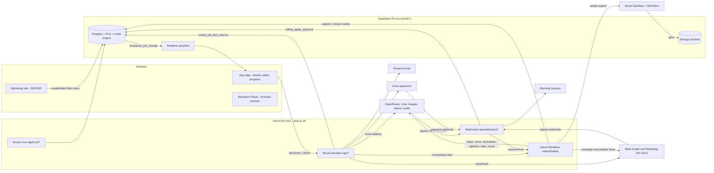

> **משתני תוכן — להחלפה גלובלית לפני ההדבקה לסוכן**
>
> כל ערך בצורה `{{…}}` הוא משתנה שהבעלים ממלא. הרשימה הקנונית נמצאת בחלק 06 §20.1 של הפרומפט המלא, וזהה לזו שבראש `PROMPT.md`.
>
> | משתנה | מה הוא | ברירת מחדל |
> |---|---|---|
> | `{{BRAND_NAME}}` | שם המותג בעברית: ממשק, אתר, מיילים, סרטונים | קדימון |
> | `{{BRAND_NAME_EN}}` | שם המותג באותיות לטיניות: כותרות OpenRouter, שם השולח, Product Hunt | Kdimon |
> | `{{DOMAIN}}` | הדומיין הראשי, בלי `https://` | `kdimon.co.il` |
> | `{{LEGAL_ENTITY_NAME}}` · `{{COMPANY_ID}}` · `{{LEGAL_ADDRESS}}` | הישות המשפטית; `{{COMPANY_ID}}` — ח״פ או מספר עוסק מורשה. עוסק פטור לא נתמך: האתר מבטיח חשבונית מס ומחירים כולל מע״מ; כתובת רשומה | אין, חובה לפני ההשקה |
> | `{{LEGAL_EFFECTIVE_DATE}}` · `{{JURISDICTION_CITY}}` | תחולת התנאים, עיר השיפוט | תאריך ההשקה · נקבע עם עורך הדין |
> | `{{DPO_NAME}}` | הממונה על הגנת הפרטיות | ריק (המשפט שמזכיר אותו לא מוצג) |
> | `{{A11Y_COORDINATOR_NAME}}` · `{{A11Y_COORDINATOR_TITLE}}` · `{{A11Y_COORDINATOR_PHONE}}` · `{{A11Y_COORDINATOR_EMAIL}}` | רכז או רכזת הנגישות: שם, תואר, טלפון, מייל | אדם אמיתי · "רכז הנגישות" או "רכזת הנגישות" · הערך של `{{SUPPORT_PHONE}}` · `accessibility@kdimon.co.il` |
> | `{{A11Y_STATEMENT_DATE}}` · `{{A11Y_AUDIT_DATE}}` · `{{A11Y_AUDITOR}}` | פרטי הצהרת הנגישות והבדיקה הידנית | נקבעים ב-M7 |
> | `{{WHATSAPP_NUMBER}}` | וואטסאפ עסקי, ספרות בלבד (`9725XXXXXXXX`) | אין |
> | `{{SUPPORT_PHONE}}` | טלפון תמיכה, משמש גם לביטול מנוי בטלפון | אין, חובה לפני ההשקה |
> | `{{VERCEL_TEAM_SLUG}}` | שם הצוות ב-Vercel, רק לכתובות ההפניה של Supabase Auth | `kdimon` |
>
> - בקוד הערכים נקראים רק מ-`lib/constants.ts` (`BRAND.nameHe`, `BRAND.nameEn`, `BRAND.domain`, `BRAND.legal.*`, `BRAND.a11y.*`, `BRAND.whatsapp`, `BRAND.phone`). אסור לכתוב שם מותג או פרט משפטי ישירות בקומפוננטה, במייל או בפרומפט.
> - אם לא הוחלפו: לשלושת משתני המותג משתמשים בברירות המחדל (קדימון · Kdimon · ‏kdimon.co.il) ורושמים ב-`DECISIONS.md`. כל השאר נשארים `{{…}}`, ו-`pnpm check-content --launch` חוסם פריסת פרודקשן עד שימולאו.
> - `{{1}}`, `{{2}}` בתבניות וואטסאפ הם משתני Meta; `{עיר}`, `{מחיר}` וחבריהם הם placeholders של הוקים ותסריטים; `{retryAfter}` וכדומה הם משתני ICU ב-`messages/he.json`. אף אחד מהם אינו משתנה בעלים.

# {{BRAND_NAME}} — הפרומפט המקוצר (Quickstart)

## 0. מה הקובץ הזה ואיך משתמשים בו

הקובץ הזה הוא גרסה מקוצרת ועצמאית של פרומפט הבנייה המלא של {{BRAND_NAME}} ({{BRAND_NAME_EN}}). הוא נועד לשני מצבים:

1. **בוני אפליקציות עם מגבלת קלט** (Lovable, ‏Bolt, ‏v0, ‏Replit Agent, צ׳אט של Cursor) שלא יכולים לקרוא כמה מגה-בייט של מפרט.
2. **מעבר ראשון** — שלד עובד שאפשר להראות, לפני שמתחילים את הבנייה המלאה לפי אבני הדרך.

**כלל העל:** הפרומפט המלא נמצא ב-`PROMPT.md` (חלק 00 ומפת המסמך) וב-`prompt/*.md`. **סוכן שיכול לקרוא את הריפו חייב לעבוד לפי הפרומפט המלא**, ולהשתמש בקובץ הזה רק כמפה. הקובץ הזה לא מוסיף דרישות ולא מבטל אף אחת. בכל סתירה גובר הפרומפט המלא, לפי סדר העדיפויות שלו: עקרונות חלק 00 ← החלק שהנושא בבעלותו (01–08) ← נספחים A–E ← נספח F. כל שם שמופיע כאן (טבלה, נתיב, רכיב, אירוע, קוד שגיאה, משתנה סביבה, מזהה פרומפט) הוא חוזה, ומשתמשים בו אות באות.

### 0.1 מה טוענים לסוכן בכל אבן דרך

| אבן דרך | מה בונים | קבצים שטוענים מהפרומפט המלא |
|---|---|---|
| M0 | יסודות, טוקנים, RTL, CI, ספייקים `[M0-verify]` (כולל 19–24 של Meta ושל ניתוח וידאו); הבעלים מתחילים את המסלול מול Meta | `PROMPT.md`, ‏`prompt/06` §19–§24, ‏`prompt/01` §4–§9, ‏`prompt/07` (רשימת הבעלים מול Meta) |
| M1 | מיגרציות `0001`–`0012`, ‏RLS, פונקציות, אחסון, Realtime, ‏seed | `prompt/04`, ‏`prompt/A-niches.md`, ‏`prompt/B-hook-taxonomy.md`, ‏`prompt/C-hooks.md`, ‏`seed/*.json` |
| M2 | אתר שיווקי וספריית הוקים | `prompt/02`, ‏`prompt/01`, נספח E ב-`prompt/D-E-samples-style.md` |
| M3 | התחברות, אונבורדינג, סביבות עבודה, ערכת מותג | `prompt/03` §2–§4, §11–§12, §16–§17; ‏`prompt/04` |
| M4 | האשף ושכבת הטקסט של ה-AI | `prompt/05`, ‏`prompt/03` §6, נספח D |
| M5 | צנרת היצירה והרינדור | `prompt/05`, ‏`prompt/03` §7–§9 |
| M6 | חיוב, סוכנות, אדמין | `prompt/06` §1–§10, ‏`prompt/03` §15, §18, §22 |
| M7 | הקשחה והשקה | `prompt/06` §15, §25; נספח E §13.4 |
| M8 | מנוע הטרנדים: Trend Studio, ניתוח סרטוני ייחוס, 12 תבניות, שכבות הטרנד ב-Remotion, צילום מודרך, "ציון הוק" | `prompt/08`, ‏`prompt/05` §20 והסעיף של "ציון הוק", ‏`prompt/03` (ממשק ציון ההוק), ‏`seed/trend_templates.json` |
| M9 | חיבור Meta ופרסום רגיל: `0013`, ‏`lib/meta`, חיבור ובדיקה מקדימה, רילס לאינסטגרם ולפייסבוק עכשיו או בתזמון, לוח תוכן, "תוכנית 30 יום" | `prompt/07` (ארכיטקטורה, חיבור וטוקנים, הרשאות, ‏`0013`, נתיבים, ‏webhooks, ‏crons ו-workflows, פרסום רגיל, תוכנית 30 יום), ‏`prompt/06` §24 |
| M10 | קמפיינים, דשבורד ולידים: בונה הקמפיינים, תצוגות מקדימות, סטטוסים, בדיקת 3 הוקים, כללים, דוחות, תיבת הלידים, "דף העסק", "בדיקת דופק" | `prompt/07` (בונה הקמפיינים, דשבורד ודוחות, לידים, דף העסק, בדיקת דופק), ‏`prompt/06` §2 |
| M11 | אישורי Meta והשקה ציבורית של יכולות Meta: App Review, ‏Tech Provider, ‏Full Access, בדיקת smoke שבועית, סקירות אבטחה ומשפט | `prompt/07` (רשימת הבעלים מול Meta), ‏`prompt/06` §22, §24–§25 |

M8–M11 באים אחרי M7, משוחררים מאחורי דגלים, וכל אחת נסגרת כמו M0–M7. המסלול של הבעלים מול Meta (Business Verification, אפליקציה, ‏App Review, ‏Tech Provider) מתחיל כבר ב-M0, כי האישורים לוקחים שבועות ולא תלויים בקוד.

`prompt/F-spec.md` (נספח F, המפרט הטכני באנגלית) הוא רקע ונימוקים בלבד, ולא מקור לשמות. `docs/research/*` — רק כשצריך לאמת עובדה; ה-"Verification addendum" בכל קובץ גובר על מה שלפניו. בקבצים 10–15 אין נספח כזה: כל טענה מתויגת במקום, ומה שמסומן שם (unverified) מופיע בחלקים 07–08 כ-`[M0-verify]`.

### 0.2 איך עובדים (מקוצר)

- **אל תשאל — תחליט ותתעד** ב-`DECISIONS.md` בפורמט: תאריך · נושא, ההחלטה, חלופות, סיבה, השפעה. אסור להחליט לשנות שם שמוגדר בפרומפט, ואסור להחליש עיקרון.
- **`[M0-verify]`** מסמן הנחה על ספק חיצוני שעוד לא נבדקה (חתימת webhook של OpenRouter, Vercel Workflows, ‏`@remotion/vercel`, ‏Grow, ‏Morning, ובחלקים 07–08 גם טוקן ה-BISU של Meta, מבנה ה-JSON של קמפיין לוואטסאפ, התקציב המינימלי בשקלים ו-`video_url` ב-OpenRouter). בודקים בספייק, רושמים תוצאה, ורק אז ממזגים קוד שתלוי בה.
- **בלי מפתחות אמיתיים — mocks מלאים** לכל ספק (OpenRouter, ‏Grow, ‏Morning, ‏Resend, ומ-M9 גם Meta עם `META_PROVIDER=mock`), כך שכל הזרימות עובדות מקצה לקצה.
- **קוד, מזהים, לוגים וקומיטים באנגלית; כל טקסט שמשתמש רואה בעברית סופית** ב-`messages/he.json`. בלי lorem ipsum, בלי "TBD".
- **Conventional Commits** (`feat(m0): …`), ענפים `m{n}/{topic}`, ‏squash merge, תגית `v0.{m}.0` לכל אבן דרך. אבן דרך נסגרת רק כש-`pnpm typecheck && pnpm lint && pnpm test` ירוקים וכל הקריטריונים מסומנים.

---

## 1. המוצר והמיצוב

**{{BRAND_NAME}}** היא פלטפורמת SaaS בעברית, מימין לשמאל, שמייצרת בעזרת AI **סרטוני תדמית וסרטונים קצרים לרשתות (Reels, ‏TikTok, ‏Shorts) לפי נישה עסקית**, ומחליפה את עורך הווידאו.

**הזרימה המרכזית:** בעל עסק בוחר נישה (מספרה, מרפאת שיניים, קבלן שיפוצים, מתווך נדל״ן…), מדביק קישור לאתר או לאינסטגרם או מתאר את העסק במילים, בוחר הוק (משפט פתיחה שעוצר גלילה) ומטרה, ומקבל תוך דקות סרטון מוכן: תסריט בעברית טבעית, ויז׳ואלים שנוצרו ב-AI, קריינות עברית, כתוביות RTL עם הדגשת מילים, מוזיקה, לוגו וכרטיס סיום עם הנעה לפעולה — ב-9:16, ‏1:1 ו-16:9, עם קובצי SRT ו-VTT.

**ספריית הוקים ציבורית בעברית** — לפי נישה, סוג הוק, פלטפורמה, מטרה ועונה, בדפים מאונדקסים. כל הוק אפשר להעתיק בחינם, להתאים לשם העסק ולעיר, או להפוך לסרטון. היא מנוע SEO, מגנט לידים וחלק מהמוצר.

**הרחבת ההיקף (M8–M11): מסרטון לקמפיין.** הקהל: עסקים קטנים בתחילת הדרך ועסקים בצמיחה, שרוצים לפרסם בפייסבוק ובאינסטגרם בלי לשבור את הבנק, בלי לשלם למשווק אלפי שקלים בחודש ובלי ללמוד את מנהל המודעות של מטא. הלולאה: לוחצים על כפתור ← מקבלים סרטון מוכן בעברית (הרבה פעמים מפורמט טרנדי) ← מעלים אותו כקמפיין בפייסבוק ובאינסטגרם, או כפוסט רגיל, מתוך הממשק שלנו ← רואים דשבורד פשוט בעברית: בוחרים תקציב, רואים מה קרה, ומשנים תקציב, משהים או מגבירים את ההוק המנצח מאותו מקום. המשפט הפנימי: **"סרטון טרנדי בעברית בדקות, קמפיין בפייסבוק ובאינסטגרם בלחיצה, ודוח שמבינים. בלי סוכנות ובלי מנהל המודעות של מטא."**

**חמשת עמודי המסר** (כיוון; הקופי הסופי בחלק 02, וכל טענה על קמפיינים, לידים, פרסום וטרנדים מוצגת רק כשהדגל שלה פעיל):

| # | עמוד המסר | ההוכחה במוצר |
|---|---|---|
| 1 | "לוחצים, ויש סרטון" | האשף, תבניות הטרנד, הצילום המודרך |
| 2 | "מעלים לקמפיין מכאן" | בונה קמפיין ב-4 צעדים, הכול נוצר מושהה, תצוגות מקדימות, כפתור "פרסום" אחד |
| 3 | "רואים מה עובד, בעברית" | 4 מדדים, השוואת הוקים, הסבר פשוט, סיכום שבועי |
| 4 | "טרנדים חדשים, מותאמים לעסק שלכם" | הפיד "טרנדים השבוע" ודפי "פירוק טרנד" ציבוריים |
| 5 | "בלי לשבור את הבנק" | מחיר קבוע כולל מע״מ, 0% מהתקציב, התקציב משולם ישירות למטא, תקרות הוצאה שמוצגות בכל מקום |

**הבידול:** קריאייטיב עברי מקורי עם שכבות RTL; תבניות טרנד שכל נישה יכולה להפיק; תוצאות בשפה של וואטסאפ ("פניות בוואטסאפ", "₪ לפנייה"); דוח של 4 מספרים ומשפט אחד; פרסום רגיל וממומן באותה לולאה; 0% מהתקציב, ואנחנו אף פעם לא מחזיקים כסף של פרסום; ומעקות בטיחות: הכול נוצר מושהה, אישור מפורש, תקרות קשיחות ויומן שינויים. **הסיכון:** המתחרה הגדול הוא מטא עצמה, וה-AI שלה משתפר כל הזמן. לכן החפיר הוא קריאייטיב בעברית, ידע נישתי, מהירות בטרנדים וממשק פשוט, ולא הצנרת מול ה-API; חלק 07 משתמש באוטומציה של מטא (Advantage+) במקום להילחם בה.

**המיצוב:** המתחרה הישראלי הקרוב הוא ארגז כלים של מנועי AI שמתמחר בדולרים ומשאיר למשתמש לבחור מנוע. אנחנו מוכרים **תוצאה מוגמרת** על שלושה עמודי תווך:

| עמוד תווך | מה זה אומר |
|---|---|
| **נישה** | מתחילים מ"מה העסק שלכם", לא מבחירת מנוע. הוקים, מבנה, מוזיקה והנעה לפעולה לפי הנישה |
| **עברית טבעית** | כל טקסט — בממשק ובסרטון — נראה ונשמע כאילו ישראלי כתב אותו; RTL נכון הוא סימן פרימיום |
| **תוצאה מוגמרת** | מחיר בשקלים כולל מע״מ, חשבונית מס, ביטול אונליין בכל רגע, החזר קרדיטים אוטומטי כשיצירה נכשלת, ועלות גלויה לפני כל לחיצה |

**אישיות:** במאי-מפיק ותיק שעובד בשבילכם — ישיר וחם, מדויק ושקוף, מקומי בלי קיטש, פרימיום בשקט, אחראי ("לא הצלחנו", "הקרדיטים חזרו אליכם"), אפוליטי ורגיש לימי זיכרון.

**שלושה-עשר העקרונות שאינם נתונים למשא ומתן** (חלק 00 §3, בקיצור):

1. עברית ו-RTL כשפת אם: `<html lang="he" dir="rtl">`, מאפיינים לוגיים בלבד, פנייה ברבים או ניטרלית, בלי לוכסנים מגדריים, ₪ לפני המספר.
2. עיצוב פרימיום בכיוון "בכורה": קולנועי, כהה כברירת מחדל, זהב של מקרן, וערכה בהירה מלאה.
3. כל ה-AI עובר דרך OpenRouter בלבד, מהשרת בלבד, עם מודלים מרישום במסד (`route(taskKey)`), אף פעם לא slug כמחרוזת בקוד.
4. Vercel ‏(`fra1`) + ‏Supabase (פרנקפורט); Vercel Workflows לתזמור, ‏Remotion על Vercel Sandbox לרינדור.
5. עברית לא נכנסת לפריימים שמודל AI מצייר — כל טקסט, כתוביות, לוגו ומחיר מוצגים בשכבת Remotion.
6. נגישות היא דרישה חוקית: ת״י 5568 כבסיס, בונים ובודקים ל-WCAG 2.2 AA, בלי תוסף נגישות צף.
7. הדין הישראלי ממומש בקוד: ביטול אונליין בכל רגע, החזר 14 יום, מע״מ 18% וחשבונית מס, תיקון 13, חוק הספאם, תיוג AI, מגבלות בחירות. מה שממתין לעורך דין או רו״ח מסומן ⚖️.
8. אבטחה ופרטיות כברירת מחדל: RLS על כל טבלה, Zod לכל קלט, חתימה ואידמפוטנטיות לכל webhook, מגבלות קצב, תקציב יומי ל-AI, MFA למנהלים.
9. בלי טקסט זמני — כל מחרוזת בעברית סופית.
10. אמת בפרסום: בלי מספרים, ביקורות, לקוחות או דחיפות מומצאים — לא בסרטוני הלקוחות ולא באתר שלנו.
11. עלות שקופה: כל כפתור יצירה מציג מחיר בקרדיטים, כישלון מחזיר קרדיטים אוטומטית.
12. כסף של פרסום: 0% מהתקציב, לא מחזיקים כסף של לקוחות, הכול נוצר מושהה ומתפרסם רק באישור מפורש.
13. טרנדים: מעתיקים פורמט, לא ביטוי; בלי סקרייפינג, בלי דמות או קול של יוצרים, בלי מוזיקה מוגנת.

---

## 2. הסטאק והארכיטקטורה

| שכבה | בחירה (נעולה) |
|---|---|
| Framework | Next.js 16 ‏(≥ 16.1, App Router, Turbopack), ‏React 19.2, ‏TypeScript strict, ‏Node 22, ‏pnpm |
| UI | Tailwind CSS v4.3+ (CSS-first, בלי `tailwind.config.js`), ‏shadcn/ui במצב RTL (סגנון `radix-nova`), ‏Radix, ‏lucide-react, ‏Motion, ‏GSAP (שיווק בלבד) |
| שפה | next-intl v4, לוקאל יחיד `he`, כל המחרוזות ב-`messages/he.json` |
| נתונים ו-Auth | Supabase Pro ‏(`eu-central-1`), מפתחות `sb_publishable_` / ‏`sb_secret_`: ‏Postgres + RLS, ‏Auth (קישור קסם, Google; טלפון ב-v2), ‏Storage, ‏Realtime Broadcast |
| AI טקסט | AI SDK v6 ‏(`ai@6`) + ‏`@openrouter/ai-sdk-provider@2`; סטרימינג לדפדפן ב-NDJSON |
| AI מדיה | לקוח `fetch` מוקלד ל-OpenRouter: ‏`/images`, ‏`/videos`, ‏`/audio/speech`, ‏`/audio/transcriptions` |
| תזמור | Vercel Workflows (‏`"use workflow"` / ‏`"use step"`) מאחורי `JobOrchestrator`; חלופה מתועדת: Trigger.dev v4 |
| הרכבת וידאו | Remotion 4 על Vercel Sandbox ‏(`@remotion/vercel`) מאחורי `RenderProvider`; חלופה: Remotion Lambda ב-`eu-central-1` |
| תשלומים | Grow מאחורי `PaymentProvider`; חשבוניות ב-Morning (חשבונית ירוקה) מאחורי `InvoiceProvider`; לשניהם מתאם `mock` |
| מייל | Resend + React Email (תבניות RTL) |
| פרסום ברשתות (M9–M11) | Meta Graph / Marketing API `v26.0` (`META_GRAPH_VERSION`), ‏Facebook Login for Business עם טוקן system user לעסק של הלקוח, ‏webhooks של Meta; כל קריאה דרך `metaFetch()` ב-`lib/meta/client.ts`, עם מתאם `mock` מלא (`META_PROVIDER`) |
| ניתוח וידאו (M8) | OpenRouter עם חלק `video_url` (קליפ קצר ב-base64), ‏ffmpeg בתוך צעד workflow (`ffmpeg-static`), ‏Scribe לתמלול |
| ניטור | Sentry (EU), ‏PostHog (EU, רק אחרי הסכמה), ‏Upstash Ratelimit/Redis (EU) |
| בדיקות | Vitest, ‏Playwright + axe, ‏MSW, ‏pgTAP |

**קבוצות נתיבים:** `app/(marketing)/` (אתר ציבורי), ‏`app/(auth)/login`, ‏`app/(product)/app/` (האפליקציה), ‏`app/(admin)/admin/` (פאנל ניהול), ‏`app/(dev)/dev` (רק מחוץ לפרודקשן). ‏`proxy.ts` (ה-middleware של Next 16) מטפל בסשן, ב-CSP עם nonce ובניסוי ה-hero.

**ארבעה לקוחות Supabase:** `lib/supabase/server.ts` (עוגיות, RLS), ‏`browser.ts` (Realtime, ‏TUS), ‏`admin.ts` (מפתח סודי, `server-only`, רק אחרי בדיקת הרשאה), ‏`static.ts` (`createStaticClient()` לדפי שיווק SSG/ISR, בלי `cookies()`).



**שלוש תחנות קבועות לכל קריאת AI:** `route(taskKey, ctx)` ‏(`lib/ai/registry.ts`, בוחר ראשי וגיבויים מ-`model_routes` ו-`model_registry`) ← לקוח (`lib/ai/aisdk.ts` לטקסט, ‏`lib/ai/openrouter/*.ts` למדיה) ← `record()` ‏(`lib/ai/cost.ts`, שורה ב-`ai_generations` עם העלות מ-`usage.cost`). שום קוד בדפדפן לא מדבר עם OpenRouter, ושום כתובת של OpenRouter לא מגיעה לדפדפן או ל-renderer.

**פקודות הבסיס:** `pnpm dev` (ספקי mock כשאין מפתחות) · `pnpm typecheck` · `pnpm lint` · `pnpm lint:rtl` · `pnpm lint:copy` · `pnpm test` · `pnpm test:e2e` · `pnpm test:a11y` · `pnpm db:reset` · `pnpm seed:sync` · `pnpm db:seed` · `pnpm db:types` · `pnpm models:sync` · `pnpm check-env` · `pnpm check-content` · `pnpm check-decisions` · `pnpm demo:render`; ומ-M8–M11 גם `pnpm meta:smoke` ו-`pnpm trends:demos`. `pnpm lint` כולל את `scripts/lint-meta.ts` ואת `scripts/lint-deps.ts`.

**משתני סביבה עיקריים** (הרשימה המלאה ב-`.env.example` ובחלק 06 §20; כולם נבדקים ב-`lib/env.ts`): `APP_ENV` (`local` · `test` · `preview` · `staging` · `production`), ‏`NEXT_PUBLIC_SITE_URL`, ‏`NEXT_PUBLIC_SUPABASE_URL`, ‏`NEXT_PUBLIC_SUPABASE_PUBLISHABLE_KEY`, ‏`SUPABASE_SECRET_KEY`, ‏`OPENROUTER_API_KEY`, ‏`OPENROUTER_BASE_URL`, ‏`OPENROUTER_APP_URL`, ‏`OPENROUTER_WEBHOOK_SECRET`, ‏`OPENROUTER_CALLBACK_TOKEN_SECRET`, ‏`OPENROUTER_DAILY_BUDGET_USD`, ‏`ORCHESTRATOR` (`vercel-workflow` · `inline` לבדיקות), ‏`RENDER_PROVIDER` (`vercel-sandbox` · `lambda` · `local`), ‏`REMOTION_LICENSE_KEY`, ‏`PAYMENT_PROVIDER` (`grow` · `mock`, ‏`mock` אסור בפרודקשן), ‏`GROW_PAGE_CODE_BIT`, ‏`INVOICE_PROVIDER` (`morning` · `mock`), ‏`EMAIL_PROVIDER` (`resend` · `smtp` · `log`), ‏`RESEND_API_KEY`, ‏`UPSTASH_REDIS_REST_URL`, ‏`CRON_SECRET`, ‏`APP_ENCRYPTION_KEY`, ‏`TRIAL_HASH_PEPPER`, ‏`ADMIN_EMAILS`, ‏`NEXT_PUBLIC_SENTRY_DSN`, ‏`NEXT_PUBLIC_POSTHOG_KEY`. מ-M8–M11: `META_PROVIDER` (`meta` · `mock`; `mock` אסור בפרודקשן כשהדגל `meta_connect` פעיל), ‏`META_APP_ID`, ‏`META_APP_SECRET` (רשימה מופרדת בפסיקים לרוטציה), ‏`META_LOGIN_CONFIG_ID`, ‏`META_GRAPH_VERSION` (`v26.0`), ‏`META_WEBHOOK_VERIFY_TOKEN`; ב-CI בלבד `META_GRAPH_VERSION_NEXT`, ‏`META_SANDBOX_AD_ACCOUNT_ID`, ‏`META_SANDBOX_SYSTEM_TOKEN`, ‏`META_SANDBOX_PAGE_ID`. אין `NEXT_PUBLIC_` עם סוד.

---

## 3. מערכת העיצוב — העיקר

### 3.1 כיוון חזותי

**"בכורה" (Premiere)** — ערב בכורה בקולנוע תל-אביבי: אולם שחור, אלומת זהב של מקרן, ורוד של שטיח אדום, הילה סגולה, גרעין פילם. **כהה כברירת מחדל**, לצדו ערכה בהירה מלאה "אור יום" (נייר חם ודיו, הזהב נשאר מילוי הכפתור הראשי). עיקרון התנועה: "המצלמה זזה, לא הרהיטים" — תנועה רק כשהיא מספרת משהו.

אפקטים חתימתיים, רק בערכה הכהה: אלומת מקרן (`bg-projector`), הילת after-glow, **מילה אחת בגרדיאנט זהב בכל דף** (`text-gold-gradient`, בדף הבית: "תדמית"; בבהירה הופכת לסימון מרקר לימון), זכוכית (`glass`) רק על UI צף, גרעין פילם במעטפת השיווקית בלבד. לכל היותר 3 אפקטים "כבדים" בדף.

### 3.2 טוקני צבע (`app/globals.css`, ‏`@theme`; הכהה היא ברירת המחדל, הבהירה תחת `:root[data-theme="light"]`)

| טוקן | כהה | בהירה | שימוש |
|---|---|---|---|
| `bg` | `#08080C` | `#FAF7F2` | רקע הדף |
| `surface-1` | `#121219` | `#FFFFFF` | כרטיסים |
| `surface-2` | `#1A1A24` | `#F1ECE4` | פופאובר, רקע משני |
| `surface-3` | `#23232F` | `#E9E2D7` | hover / נבחר |
| `border` | `#2A2A38` | `#E4DDD1` | קו דקורטיבי בלבד |
| `border-strong` | `#686884` | `#8C8577` | גבול שדות ומתגים (≥ 3:1) |
| `text` | `#F5F4F0` | `#16140F` | טקסט ראשי |
| `text-2` | `#A3A3B5` | `#5A554C` | טקסט משני |
| `muted` | `#8A8AA0` | `#6F6A60` | **צבע טקסט** למטא — אף פעם לא רקע (`bg-muted` חסום) |
| `primary` | `#FFB547` | `#FFB547` | זהב המקרן: מילוי CTA, תמיד עם דיו |
| `primary-hover` | `#FFC56B` | `#FFC56B` | |
| `on-primary` | `#0A0A0F` | `#0A0A0F` | דיו על זהב (11.24:1) |
| `primary-text` | `#FFB547` | `#9A5B00` | זהב כטקסט ואינדיקטור לא-טקסטואלי |
| `focus` | `#FFB547` | `#1F3DFF` | טבעת פוקוס (אולטרמרין בבהירה) |
| `rose` | `#FF4F7B` | `#C2185B` | |
| `violet` / `link` | `#8E7BFF` | `#5B47E0` | קישורים, AI |
| `success` | `#3DDC97` | `#0B7A53` | |
| `danger` / `on-danger` | `#FF6B6B` / `#0A0A0F` | `#C62F1D` / `#FFFFFF` | |
| `lemon` | `#FFE14D` | `#FFE14D` | תג "הוק", מרקר |
| `glass` | `rgb(18 18 25 / .6)` | `rgb(255 255 255 / .72)` | |
| `overlay` | `rgb(4 4 8 / .72)` | `rgb(22 20 15 / .42)` | |

הפלטה הדיפולטית של Tailwind מאופסת (`--color-*: initial`), כך ש-`bg-red-500` לא קיים. גשר ל-shadcn ב-`@theme inline` (‏`background` → `bg`, ‏`primary-foreground` → `on-primary`, ‏`input` → `border-strong`, ‏`ring` → `focus`…). בבהירה `muted` ו-`primary-text` לא יושבים על `surface-3`. `tests/unit/contrast.test.ts` מחשב מחדש כל זוג.

**סקאלה:** רדיוסים `xs 6px` (תגים) · `sm 10px` (שדות, צ׳יפים) · `md 14px` (כרטיסים, אריחי וידאו) · `lg 20px` (פאנלים, מודאלים) · `xl 28px` (כרטיס ה-hero); CTA וגלולות `rounded-full`. נקודות שבירה: `xs 390px` · `sm 640` · `md 768` · `lg 1024` · `xl 1280` · `2xl 1536`. הגבהה `elev-1/2/3`, ‏`glow-primary`, ‏`glow-ai`. שכבות Z: ‏sticky 40 · dropdown 50 · overlay 60 · modal 70 · toast 80. משכים: hover 120ms · press 200ms · panel 320ms · reveal 600ms · letterbox 900ms · reduced 150ms.

### 3.3 טיפוגרפיה

| גופן | תפקיד | הערות |
|---|---|---|
| **Heebo** (variable, 400–900) | ממשק וגוף | נטען ב-`next/font`, ‏preload (ה-H1 הוא ה-LCP) |
| **Karantina** 700 | תצוגה: 1–3 מילים ענקיות או מספר גדול | לעולם לא לפסקה, לכפתור או מתחת ל-40px |
| **JetBrains Mono** 400/600 | קודי זמן, מזהים | לטינית בלבד |
| Rubik 800, ‏Suez One 400, ‏Fredoka 600, ‏Assistant, ‏Secular One | גופני כתוביות וערכת מותג | נטענים רק במסכים עם תצוגת כתוביות, מאותו origin (CSP); `@remotion/google-fonts` רק בסביבת הרינדור |
| Amatic SC · Noto Color Emoji | כתב יד עברי על שלט (`SignOverlay` בלבד, בנגן וברינדור); אימוג׳י צבעוני ברינדור בלבד | שכבות הטרנד של M8 (חלק 08); איכות הגליפים העבריים ב-Amatic SC `[M0-verify]` |

סולם: `display` ‏clamp(52→120px)/0.98/700 · `h1` ‏clamp(36→68px)/1.08/800 · `h2` ‏clamp(28→48px)/1.15/700 · `h3` ‏clamp(20→26px)/1.25/700 · `body-lg` 19px · `body` 17px/1.7 · `small` 15px · `micro` 13px/600 · קריאה ארוכה (`.prose-he`) 18px/1.75, ‏68ch. באפליקציה כותרת מסך היא `text-h3`–`text-h2`. שדות קלט לעולם לא מתחת ל-16px.

**כללי סדר דפוס בעברית:** אין `letter-spacing`, אין `uppercase`, אין הטיה (`em` = מודגש 700), `text-wrap: balance` לכותרות ו-`pretty` לפסקאות, בלי מקפי שבירה, תחילית + מספר נשארים צמודים ("ב-2026"), ספרות טבלאיות למספרים, גרשיים ״ (U+05F4) בראשי תיבות (מע״מ, נדל״ן) וגרש ׳ (U+05F3) בקיצורים (שנ׳).

### 3.4 RTL ו-bidi — כללים מחייבים

1. `<html lang="he" dir="rtl">` פעם אחת, ב-root layout.
2. **רק מאפיינים לוגיים**: `ms/me/ps/pe`, ‏`inset-s-*/inset-e-*`, ‏`text-start/end`, ‏`border-s/e`, ‏`rounded-s/e`; ‏`gap-*` במקום `space-x-*`. ‏`pnpm lint:rtl` חוסם מחלקות פיזיות ו-`bg-muted`.
3. **מתהפכים** (דרך `DirIcon`): חיצי הקודם והבא, chevrons, פירורי לחם, undo/redo, שליחה, יציאה. ‏`WizardFooter`: "הקודם" מימין, "המשך" משמאל. Sidebar ותפריט מובייל בצד ימין.
4. **לעולם לא מתהפכים**: כפתורי מדיה (play/pause), נגן הווידאו וסרגל ההתקדמות שלו, ציר הזמן בעורך (`TimelineLite`, ‏`dir="ltr"`, זמן 0 משמאל), גלי קול, גרפים, קודי זמן, ‏₪ ומספרים, לוגואים, אייקוני חפצים, התקדמות מעגלית, ותוכן וידאו ותמונות. אזור LTR מכוון מסומן `{/* ltr-zone: reason */}`.
5. **טקסט מעורב תמיד מבודד**: מספרים ומחירים דרך `Num`/`Price` (עם `<bdi>`), שדות טלפון, מייל, URL, קופון וח״פ דרך `LtrInput` (`dir="ltr"`, מיושרים לקצה הטופס). תוכן משתמש לא ידוע — `dir="auto"`; תוכן עברי שאנחנו מייצרים (הוקים, תסריטים, כתוביות) — `dir="rtl"` מפורש, כדי ש-"POV: …" לא יתהפך.
6. **ערכות נושא**: `dark` (ברירת מחדל) · `light` · `system` בעוגייה `theme` וב-`profiles.theme`; ‏`ThemeScript` חוסם ב-`<head>` מונע הבהוב (CSP לפי hash). העדפת תנועה בעוגייה `motion` ← `data-motion="full|reduce"`.

### 3.5 רכיבים משותפים (חוזה, חלק 01 §10)

`Num` · `Price` (תמיד "כולל מע״מ" לצרכן) · `LtrInput` · `DirIcon` · `VideoTile` (מתנגן רק כשנראה, מושתק) · `PhoneFrame` · `VideoPlayer` (עם `<track srclang="he">`) · `CostBadge` (עלות בקרדיטים לפני כל יצירה: "צרו את הסרטון · 107 קרדיטים") · `CreditsMeter` · `StatusBadge` (אייקון + טקסט, אף פעם לא צבע בלבד) · `EmptyState` · `CaptionPreview` · `SkipLink`, ‏`MotionToggle`, ‏`ThemeToggle`, ‏`UtilityMenu`, ‏`LiveAnnouncer` · `NicheIcon`, ‏`NichePicker` · `HookCard`, ‏`HookFilters` · `SectionHeading`, ‏`GlowCard`, ‏`LegalPage`, ‏`Breadcrumbs`, ‏`JsonLd`. מצבי טעינה בצורת התוכן הסופי, מצבים ריקים מאוירים, ושגיאות שעונות על שלוש שאלות: מה קרה, מה קרה לקרדיטים, מה עושים עכשיו.

**רכיבים של M8–M11** (חלק 01 §10.17; המסכים בחלקים 07–08): `KpiTile` (חץ שינוי מול התקופה הקודמת) · `SpendCapMeter` (מצבי 80% ו-100%) · `HookComparisonTable` · `CampaignStatusTimeline` · `MetaConnectChecklist` · `MetaPreviewFrame` · `BudgetPresetPicker` · `AreaPicker` · `LeadCard` · `CalendarGrid` · `TrendCard` · `TrendLifecycleBadge` · `CameraGhostGuide` · `ClaimFootnote` · `HookScoreBadge`. `StatusBadge` מקבל את הסוגים `campaign`, ‏`ad`, ‏`social_post`, ‏`lead` ו-`trend`. גרפים (Recharts) נשארים `dir="ltr"`, ותמיד יש לצידם טבלה חלופית.

### 3.6 נגישות (WCAG 2.2 AA, הבסיס החוקי ת״י 5568)

מקלדת מלאה בכל הזרימות (כולל גרירת סצנות עם חלופה: "הזזה למעלה" · "הזזה למטה"), `SkipLink` "דילוג לתוכן הראשי" כרכיב הפוקוסבילי הראשון, פוקוס גלוי (`outline` 2px + offset 2px) שלא מוסתר מתחת לפסים דביקים (`scroll-padding`), יעדי מגע ≥ 32×32, ניגודיות לפי הטבלה, `<title>` עברי ייחודי לכל דף ולכל שלב באשף, וידאו אוטומטי תמיד `muted` עם כפתור עצירה, כתוביות עבריות לכל וידאו שיווקי, "עצירת אנימציות" ו-`prefers-reduced-motion` מכובדים בכל מקום, הודעות סטטוס דרך `LiveAnnouncer`, שגיאות מקושרות לשדות (`aria-describedby`) עם אייקון. **אין ווידג׳ט נגישות צף.** הצהרת נגישות ב-`/legal/accessibility`.

### 3.7 מראה הכתוביות בסרטון — 6 סגנונות (`remotion/captions/presets.ts`, מקור אמת אחד ל-Remotion ול-`CaptionPreview`)

| ID | שם | גופן | גודל 9:16 / 1:1 / 16:9 | מילה פעילה | מתאים ל- |
|---|---|---|---|---|---|
| `bold-pop` | פופ (ברירת מחדל) | Heebo 900 | 84 / 72 / 60 | קופסה בצבע ההדגשה (ברירת מחדל זהב `#FFB547`), טקסט דיו | רוב הנישות, רילס |
| `clean-box` | קופסה נקייה | Heebo 700 | 64 / 56 / 48 | פס סימון מתחת למילה | מרפאות, נדל״ן, B2B |
| `karaoke` | קריוקי | Rubik 800 | 72 / 64 / 52 | מילים שנאמרו מתמלאות בצבע `accent` (ברירת מחדל `#FF4F7B`) | אוכל, אירועים, כושר |
| `poster` | פוסטר | Karantina 700 | 132 / 112 / 88 | המילה הפעילה בצבע ההדגשה | הוקים, מבצעים |
| `news` | חדשות | Suez One 400 | 64 / 56 / 48 | המילה הפעילה בצבע `primary`, על פס תחתון כהה עם פס צבע בצד ימין | עו״ד, רו״ח, יועצים |
| `soft` | רך | Fredoka 600 | 68 / 60 / 50 | scale 1.06 ורקע פסטל עמוק יותר | משפחה, מאפיות, יופי |

כללים משותפים: `direction: rtl`, ‏`unicode-bidi: plaintext` לכל שורה, טוקנים לועזיים ומספריים בתוך `<bdi>`, ‏`letter-spacing: 0`, שבירה רק בין מילים, יישור למרכז, תנועה **לפי מילה בלבד** (לא לפי אות), "₪99" ו-"50%" לא נשברים (בטקסט שבסרטון מיקום ה-₪ נקבע לפי `brand_kits.shekel_format`, ברירת מחדל לפני המספר). ניגודיות מובטחת בקו מתאר, קופסה או פס — לא בצבע הווידאו. אזורים בטוחים ב-9:16: הוק ב-15%–55% מהגובה, כתוביות תחתונות ב-62%–78%, אסור ב-12% העליונים, ב-22% התחתונים ובעמודה הימנית (14% רוחב) של כפתורי הרשת. תווית "נוצר באמצעות AI" בפינה העליונה-ימנית; סימן המים של החינם "נוצר ב{{BRAND_NAME}}" (`BRAND.watermarkHe`) בעליונה-שמאלית.

---

## 4. מפת האתר

### 4.1 אתר ציבורי (`app/(marketing)/`; slugs באנגלית ב-kebab-case, כותרות ו-H1 בעברית)

| נתיב | מה יש בו | רינדור |
|---|---|---|
| `/` | דף הבית (§5 כאן) | Static + ISR 3600 |
| `/niches` | האב הנישות לפי קטגוריות, H1 "סרטוני תדמית ורילס לפי נישה" | SSG + ISR |
| `/niches/[niche]` | דף נישה: "סרטון תדמית ל{short_name_he}", סוגי סרטונים, 3 תסריטים לדוגמה, הוקים, עונות, כללי פרסום, עלות, שאלות | SSG + ISR |
| `/hooks` | האב הספרייה: חיפוש, פאסטים, הוק היום, עונות קרובות, לפי נישה ולפי סוג | SSR עם נתונים ממטמון |
| `/hooks/[niche]` · `/hooks/[niche]/[type]` | הוקים לנישה ולצירוף נישה × סוג | SSG + ISR |
| `/hooks/types` · `/hooks/types/[type]` | 27 סוגי ההוקים, עמוד הסבר לכל סוג (MDX) | SSG |
| `/hooks/season/[season]` · `/hooks/platform/[platform]` | הוקים לעונה ולפלטפורמה | ISR / SSG |
| `/hooks/h/[id]` | הוק בודד (noindex, canonical לאב) | ISR |
| `/examples` · `/templates` · `/templates/[slug]` | גלריית דוגמאות, תבניות ועמוד תבנית | ISR |
| `/pricing` | מנוי חודשי / חבילות קרדיטים, מחזור חיוב, מתג "לפני מע״מ", טבלת השוואה, "כמה עולה סרטון" | SSG + ISR |
| `/blog` · `/blog/[slug]` · `/blog/tag/[tag]` | בלוג MDX (שלושה מאמרי השקה) | SSG |
| `/about` · `/contact` · `/faq` | אודות, יצירת קשר (`?topic=`), שאלות נפוצות | SSG |
| `/legal/{terms,privacy,cancellation,accessibility,ai-policy,likeness-consent,cookies}` | שבעת הדפים המשפטיים (`?v=` לגרסה מהארכיון) | דינמי |
| `/accessibility` | הפניה 308 ל-`/legal/accessibility` | — |
| `/exp/hero/[variant]` | וריאנטים `b`, `c` של ניסוי ה-hero (noindex, יעד rewrite בלבד) | SSG |
| `/trends` · `/trends/[slug]` | האב הטרנדים (סינון לפי נישה ומחזור חיים) ועמוד "פירוק טרנד": סרטון הדגמה שלנו, "למה זה עובד", "איך עושים את זה", דוגמאות לנישות ושאלות; אף פעם לא סרטון הייחוס או שם היוצר. דגל `trends_public` (M8) | ISR (תג `trends`) |
| `/campaigns` | עמוד הפיצ׳ר "קמפיינים בפייסבוק ובאינסטגרם בלי סוכנות"; הקופי מוצג רק כשהדגל `meta_ads` פעיל (שער הטענות) | SSG + ISR |
| `/legal/dpa` | הסכם עיבוד נתונים: העסק הוא בעל השליטה בלידים שלו, ואנחנו המעבד ⚖️ (M10) | דינמי |
| `/sitemap.xml` · `/robots.txt` · תמונות OG | — | — |

### 4.2 נתיבים ציבוריים דינמיים ו-Auth (כולם `noindex`)

`/login` (`?next=&invite=&email=`) — מסך אחד להתחברות והרשמה (קישור קסם, Google) · `/auth/callback` · `/auth/confirm` · `/auth/error` · `/v/[token]` — עמוד שיתוף ציבורי · `/approve/[token]` — אישור לקוח · `/unsubscribe` (`?token=`) · `/meta/data-deletion?code=` — סטטוס בקשת מחיקת נתונים שהגיעה מ-Meta ("התקבלה" · "בטיפול" · "הושלמה") · `/b/[slug]` ו-`/b/[slug]/privacy` — "דף העסק" הציבורי של לקוח והודעת הפרטיות שנוצרת לו (ISR; מאונדקס רק אם העסק בחר `indexable`).

### 4.3 האפליקציה (`app/(product)/app/`)

| נתיב | מה יש בו |
|---|---|
| `/app` | הדף הראשי (בניווט: "ראשי"): ברכה והתחלה מהירה, תור היצירות, פרויקטים אחרונים, הוק השבוע לנישה, חגים קרובים, צעדים ראשונים |
| `/app/onboarding` | שלושה שלבים: העסק (חילוץ מותג מקישור) · נישה · איך מדברים; כשהדגל `meta_connect` פעיל נוסף שלב רביעי, "חיבור פייסבוק ואינסטגרם" (`?step=connect`), עם "דילוג, אחבר אחר כך" תמיד גלוי |
| `/app/create` | יוצר טיוטה (`POST /api/projects`) ומפנה לשלב הנכון באשף |
| `/app/projects/[projectId]/create/[step]` | אשף היצירה, 9 שלבים (§6) |
| `/app/projects` | רשימת פרויקטים |
| `/app/projects/[projectId]` | דף הפרויקט: נגן, גרסאות הוק, ייצוא, שיתוף, אישור לקוח; מ-M8–M10 גם "ציון הוק", "העלו לקמפיין" ו"פרסמו עכשיו" (בפרויקט מתבנית לפרסום רגיל בלבד, "העלו לקמפיין" כבוי ומציג את הסיבה) |
| `/app/projects/[projectId]/jobs/[jobId]` | מסך התקדמות היצירה |
| `/app/projects/[projectId]/editor` | עורך הסטוריבורד |
| `/app/projects/[projectId]/shoot` | ערכת הצילום המודרך: רשימת צילומים, מצלמה עם קווי מנחה, העלאה ועריכה אוטומטית (דגל `guided_filming`, חלק 08) |
| `/app/trends` · `/app/trends/[slug]` | "טרנדים השבוע": הדרופ של השבוע, ואחריו פורמטים ותבניות נצחיות שמתאימים לנישה; "צרו בקליק" או "צלמו בעצמכם" (חלק 08) |
| `/app/campaigns` · `/app/campaigns/new` · `/app/campaigns/[campaignId]` | דשבורד הקמפיינים (4 מדדים ומד תקרת ההוצאה), בונה הקמפיין ב-4 צעדים (`?project=&group=&post=&season=&duplicate=`) ועמוד קמפיין עם השוואת הוקים, "מה זה אומר?" ויומן שינויים (חלק 07) |
| `/app/campaigns/health` | "בדיקת דופק" לחשבון מודעות קיים: איפה הכסף נשרף, ועד 5 תיקונים עם פעולה בלחיצה (חלק 07) |
| `/app/leads` | תיבת הלידים: סטטוס, הערות, אחראי, "התקשרו" ו"וואטסאפ", ייצוא CSV (חלק 07) |
| `/app/publish` · `/app/publish/new?project=` | "פרסום ותזמון": לוח תוכן (פוסטים, קמפיינים, עונות וימי שקט) ודיאלוג הפרסום לאינסטגרם ולפייסבוק (חלק 07) |
| `/app/plan` | "התוכנית שלי": תוכנית 30 יום עם כ-12 פריטי תוכן ו-1–2 הצעות לקמפיין, ולכל פריט "צרו בקליק" (חלק 07) |
| `/app/landing-pages` · `/app/landing-pages/[id]` | "דף העסק": יצירה, עריכת טקסט, פרסום והסרה; בתוכניות בתשלום בלבד, ובחינם רק תצוגה מקדימה (חלק 07) |
| `/app/templates` · `/app/hooks` · `/app/library` | תבניות, ספריית ההוקים באפליקציה, ספריית המדיה |
| `/app/brand` · `/app/brand/[kitId]` | פרטי העסק וערכות מותג (`BrandKitEditor`) |
| `/app/team` | צוות, הזמנות, הרשאות |
| `/app/clients` | סביבות לקוח ו-White label (תוכנית סוכנות) |
| `/app/billing` · `/plans` · `/return` · `/cancel` | חיוב וקרדיטים, החלפת תוכנית, חזרה מהסליקה, ביטול מנוי (`CancelSubscriptionFlow`) |
| `/app/settings` · `/notifications` · `/accessibility` · `/privacy` · `/pronunciation` | פרופיל וסביבה, התראות, נגישות ותצוגה, פרטיות ונתונים, מילון הגייה |
| `/app/settings/integrations` · `/app/settings/integrations/meta` | כרטיס החיבור ל-Meta: סטטוס, שם העסק, הנכסים שנבחרו, בדיקה אחרונה, "החלפת נכסים", "בדיקה מחדש", "ניתוק" ו"מחיקת נתוני מטא"; אישור מספר הוואטסאפ וכתובת מדיניות הפרטיות לטופסי לידים |

מעטפת: `AppShell` עם `SidebarNav` בצד ימין (248px, או 72px מכווץ), ‏`TopBar` 56px עם `CreditsMeter` ו-`NotificationBell`, ‏`WorkspaceSwitcher`, ‏`CommandMenu` (⌘K / Ctrl+K), ובמובייל `MobileTabBar` 64px. פריטי הניווט לפי הסדר: ראשי · סרטון חדש (כפתור זהוב) · פרויקטים · טרנדים (`Flame`) · קמפיינים (`Megaphone`) · לידים (`Inbox`, עם מונה של לידים שלא נקראו) · פרסום ותזמון (`CalendarClock`) · תבניות · ספריית הוקים · ערכת מותג · ספריית מדיה · צוות · לקוחות (סוכנות בלבד) · חיוב וקרדיטים (בעלים ומנהלים) · הגדרות. פריט שהדגל שלו כבוי מוסתר. ב-`MobileTabBar`: ראשי · פרויקטים · ＋ · קמפיינים · חשבון (הוקים, טרנדים, לידים ופרסום עוברים לגיליון, ומונה הלידים יושב על "חשבון"). ב-`CommandMenu` נוספים "קמפיין חדש", "פרסום סרטון", "לידים חדשים" ו"טרנדים השבוע". המקום של "התוכנית שלי" ושל "דף העסק" בניווט — לפי חלק 03 §2.

**תפקידים** (`member_role`): `owner` בעלים · `admin` מנהל · `editor` עורך · `viewer` צופה. צופה רק צופה ומוריד; עורך יוצר ומוציא קרדיטים; חיוב, רכישה וצוות — בעלים ומנהלים; שינוי תוכנית וביטול — בעלים בלבד. השרת תמיד אוכף (RLS + בדיקת תפקיד); הסתרה בממשק היא נוחות. **ב-Meta:** חיבור, ניתוק, בחירת נכסים, פרסום קמפיין, חידוש, שינוי תקציב, הגברת המנצח, כללים וייצוא לידים — בעלים ומנהלים; טיוטות, השהיה, פרסום רגיל ותזמון ועדכון לידים — עורך ומעלה; צפייה — כל חבר בסביבה, כולל צופה (הלידים הם הנתונים של העסק).

### 4.4 פאנל הניהול (`app/(admin)/admin/`, רק מנהלי פלטפורמה עם MFA — `/admin/mfa`)

`/admin` לוח בקרה · `/admin/users` · `/admin/workspaces/[id]` · `/admin/jobs` ו-`/admin/jobs/[id]` (ניסיון חוזר, החזר) · `/admin/costs` עלויות מול הכנסות · `/admin/models` רישום מודלים ונתיבים (כולל "בדיקה" וסנכרון) · `/admin/prompts` · `/admin/niches` (כולל "נבדק" ל-SEO) · `/admin/seasons` · `/admin/hooks` · `/admin/templates` · `/admin/examples` · `/admin/voices` · `/admin/music` · `/admin/billing` (תשלומים, החזרים, חשבוניות, chargeback, מנויים) · `/admin/credits` (התאמות, הסרת יתרה מדלי, עלויות פעולה) · `/admin/settings` (הגדרות ודגלים) · `/admin/audit` יומן ביקורת · `/admin/abuse` דיווחים · `/admin/design` גלריית רכיבים בכל מצב ובשתי הערכות · ומ-M8–M11: `/admin/trends` (Trend Studio: סרטוני ייחוס עם בסיס זכויות ותאריך מחיקה, מציג ניתוחים, עורך תבניות לפי נישה, רינדורי הדגמה, תזמון פרסום ולוח מחזור חיים) · `/admin/trends/references/new` · `/admin/trends/references/[id]` · `/admin/trends/templates/[id]` · `/admin/meta` (בריאות החיבורים ושגיאות אחרונות, אף פעם לא טוקנים) · `/admin/meta/campaigns` (קמפיינים בבדיקה יותר מ-24 שעות, סיבות דחייה, שגיאות, המוציאים הגדולים). בפיתוח בלבד: `/dev/mock-meta-login` (404 בפרודקשן). כל פעולת אדמין עוברת דרך `/api/admin/*` עם `requirePlatformAdmin()` ונרשמת ב-`audit_logs`.

---

## 5. דף הבית — סקשנים, כותרות והנעה לפעולה (קופי סופי, להעתקה מדויקת)

**סדר קבוע:** `AnnouncementBar` → `MarketingHeader` → Hero → `EnginesStrip` → `NicheShowcase` → `HowItWorks` → `EditorMath` → `FeatureBento` → `HooksTeaser` → `ShowcaseGallery` → `Testimonials` → `PricingCards` + `CreditCostTable` → `FaqAccordion` → `FinalCtaBand` → `MarketingFooter` → `MobileStickyCta`. כל סקשן `<section aria-labelledby>` עם `id` קבוע: `hero`, `engines`, `niches`, `how-it-works`, `editor-math`, `features`, `hooks`, `examples`, `testimonials`, `pricing`, `faq`, `start`. ה-LCP הוא טקסט ה-H1. כל CTA שולח `cta_clicked {location}`.

**כשהדגלים של M8–M11 פעילים** (שער הטענות; הקופי הסופי בחלק 02): אחרי `HowItWorks` נכנס `CampaignFlow` (`#campaigns`: סרטון ← קמפיין ← דוח, עם דשבורד לדוגמה שמסומן "דוגמה להמחשה"), אחרי `HooksTeaser` נכנס `TrendsTeaser` (`#trends`), ולפני `PricingCards` נכנס `ComparisonBlock` (`#compare`: טענות מ-`content/claims/comparisons.json` עם הערת שוליים, מקור ותאריך גישה). `FeatureBento` מקבל אריחים של קמפיינים, לידים, תזמון, טרנדים וצילום מודרך. כשהדגל `meta_ads` פעיל, מנגנון ה-A/B הקיים מקבל וריאנט בקרה חדש ל-hero, עם H1 בכיוון "מסרטון לקמפיין בפייסבוק ובאינסטגרם, בלי סוכנות." הכפתור "בדיקת דופק חינם לחשבון המודעות שלכם" (בדף הבית ובעמוד המחירים) מוביל להרשמה ← חיבור ← דוח. `cta_clicked.location` מקבל את `campaigns_page`, ‏`trends_hub`, ‏`trend_page` ו-`compare`. טענה על "זול יותר מסוכנות" מוצגת רק עם מקור ותאריך, ומשווה מחיר ניהול חודשי למחיר התוכנית, בשני הצדדים בלי תקציב הפרסום.

**`AnnouncementBar`** (ברירת מחדל): **"חדש: ספריית הוקים בעברית לפי נישה. מעתיקים בחינם ←"** → `/hooks`. ביום שקט (יום הזיכרון, יום השואה) מוחלף ב-`QuietDayBanner` מאופק בלי זהב ובלי קישור, וקיר הווידאו מציג פוסטרים בלבד.

**`MarketingHeader`** (sticky, ‏64px, זכוכית אחרי גלילה): לוגו מימין · איך זה עובד · נישות · ספריית הוקים · דוגמאות · מחירים · בלוג · כפתור "הגדרות תצוגה" · **"התחברות"** · **"צרו סרטון בחינם"** (גלולה זהובה → `/login?next=/app/create`).

**Hero (`#hero`)**
- Eyebrow: **"AI · עברית מלאה · מותאם לנישה שלכם"**
- וריאנטים לניסוי A/B (PostHog flag `hero_copy_v1`; בלי הסכמה תמיד A):

| וריאנט | H1 | תת-כותרת |
|---|---|---|
| **A** | סרטון **תדמית** מקצועי לעסק שלכם, בלי עורך וידאו. | בוחרים נישה, מדביקים קישור לאתר או לאינסטגרם, ומקבלים סרטון תדמית ורילס עם הוק שעוצר גלילה, קריינות וכתוביות בעברית. תוך דקות, לא שבועות. |
| **B** | רילס וסרטון **תדמית** בעברית, שנכתבו בשביל הנישה שלכם. | מספרה, מרפאת שיניים, משרד תיווך או מסעדה: אנחנו יודעים מה עוצר גלילה אצל הלקוחות שלכם, וכותבים, מקריינים ומוסיפים כתוביות, בעברית טבעית. אתם רק בוחרים ומאשרים. |
| **C** | סרטון **תדמית** ורילס לעסק, בעברית טבעית ובשקלים. | בלי לבחור מנועים, בלי דולרים ובלי עורך: הוק לנישה שלכם, קריינות וכתוביות בעברית, ותוצאה מוכנה לפרסום בשלושה פורמטים. מתחילים בחינם. |

- **`HeroPromptCard`** (כרטיס זכוכית, רדיוס 28px): תווית **"מה העסק שלכם?"** + 8 צ׳יפים (מתווכי נדל״ן · מספרות וברברשופים · רופאי שיניים · מסעדות ובתי קפה · מכוני יופי וציפורניים · קבלני שיפוצים · מאמני כושר · קליניקות אסתטיקה) + **"עוד נישות…"**; שדה **"קישור לאתר או לאינסטגרם (לא חובה)"** (placeholder `yourbusiness.co.il או @yourbusiness` בשדה `dir="ltr"`, בלי סימני כיווניות; ‏`@handle` הופך לכתובת אינסטגרם) או **"אין לי אתר — אתאר במילים"** → **"ספרו בכמה מילים מה העסק עושה"** (עד 500 תווים); כפתור זהוב 56px **"צרו את הסרטון הראשון שלי"** ומתחתיו **"חינם · ללא כרטיס אשראי"**. בלחיצה: טיוטה ב-`localStorage` (`hero_draft_v1`) → מחובר: `/app/create?niche={slug}&src=hero`; אורח: `/login?next=` עם היעד מקודד.
- **`TrustRow`**: **"{trialCredits} קרדיטים לניסיון, בלי כרטיס אשראי"** (הערת השוליים שלו: בערך שני סרטונים קצרים באיכות טיוטה, עם סימן מים) · **"מחירים בשקלים, כולל מע״מ"** · **"חשבונית מס על כל תשלום"** · **"החזר קרדיטים אוטומטי על יצירה שנכשלה"**.
- **`VideoWall`**: 3 עמודות של אריחי 9:16 בתנועה אנכית (מובייל: מרקיז RTL אופקי), מושתקים, עם כתוביות צרובות ו-VTT, תג **"הדגמה"** על אנימטיקים, כפתור **"עצירת הווידאו"** / **"הפעלת הווידאו"**. תוכנית האריחים ב-`content/demo-wall.json` (18 אריחים, הוק ופריסט כתוביות לכל אחד).

**`EnginesStrip`**: **"מאחורי הקלעים עובדים מנועי AI כמו Veo, Kling ו-Claude, ואנחנו מתאימים מנוע לכל סצנה."** (שלושת השמות מוזרקים מ-`getEngineWordmarks()`, לפי נתיבי המודלים הפעילים) + שמות טקסט בלבד, נגזרים מנתיבי המודלים הפעילים (Google Veo, ‏Kling, ‏Seedance, ‏Wan, ‏Nano Banana, ‏ElevenLabs, ‏Claude, ‏Gemini, ‏Lyria…) + הסתייגות סימנים מסחריים. בלי שורת לוגואים של לקוחות בהשקה.

**`NicheShowcase` (`#niches`)**: H2 **"כל נישה מקבלת סרטון שנבנה בשבילה"** · תת-כותרת **"בחרו סוג עסק ותראו אילו הוקים, איזה תסריט ואיזה סרטון מקבלים. אותו סרטון, בשלושה פורמטים."** · פס צ׳יפים של 14 נישות העדיפות הראשונה (ברירת מחדל `real-estate`), 3 `HookCard` לכל נישה וסרטון.

**`HowItWorks` (`#how-it-works`)**: H2 **"מעסק לסרטון ב-3 צעדים"** — (1) **"ספרו לנו על העסק"** (2) **"בחרו הוק וסגנון"** (3) **"קבלו סרטון מוכן"**; טלפון מוצמד (GSAP pin) בדסקטופ. כפתור משני **"נסו את זה עם העסק שלכם"**.

**`EditorMath` (`#editor-math`)**: H2 **"החשבון של עורך הווידאו"** · תת-כותרת **"עורך וידאו גובה מאות שקלים על כל רילס, ועוד מחכים לגרסה הראשונה. כאן הגרסה הראשונה מוכנה תוך דקות, ומשלמים בקרדיטים."** · `BeforeAfterSlider` ("לפני: חומרים מהטלפון" / "אחרי: רילס עם הוק, קריינות וכתוביות") · `SavingsCalculator` (ברירות מחדל: 8 סרטונים, ₪550 לסרטון, טיוטה; פלט **"חיסכון משוער: ₪{saving} בחודש"**; כשהחיסכון ≤ 0 — **"במקרה הזה עורך הווידאו שלכם זול יותר מאיתנו…"**) עם חמש הערות שוליים מגובות מקור; כפתור **"התחילו עם {trialCredits} קרדיטים לניסיון"**.

**`FeatureBento` (`#features`)**: H2 **"מה שעורך הווידאו עשה, עכשיו בכמה לחיצות"** — 8 אריחים: **כתוביות בעברית שנראות נכון** (2×2) · **קריינות בעברית** · **ערכת מותג** · **הוקים לפי נישה** · **3 פורמטים בלחיצה** · **עריכה בסצנות** · **קרדיטים שקופים** · **תווית AI ועמידה בכללים**.

**`HooksTeaser` (`#hooks`)**: H2 **"ספריית ההוקים בעברית, לפי נישה"** · תת-כותרת **"{count} משפטי פתיחה שנכתבו בעברית לעסקים ישראליים, לפי נישה, סוג הוק ועונה. מעתיקים בחינם, ואם רוצים — הופכים לסרטון."** · שתי שורות מרקיז של הוקים · חיפוש **"חפשו הוק לפי נישה או נושא"** · כפתור **"לספרייה המלאה (חינם) ←"**.

**`ShowcaseGallery` (`#examples`)**: H2 **"סרטונים שנוצרו ב{{BRAND_NAME}}"**; קודם דוגמאות אמיתיות, משלימים לשש מחמשת סרטוני נספח D עם התג **"הדגמה"** והתת-כותרת החלופית. כפתור **"לכל הדוגמאות ←"**.

**`Testimonials` (`#testimonials`)**: H2 **"בעלי עסקים מספרים"** — מוצג **רק עם 3 המלצות מאושרות לפחות** (`content/testimonials.he.json`, כל רשומה עם `consentRef`). `CountersRow` רק עם מונים אמיתיים מעל סף.

**`PricingCards` (`#pricing`)**: H2 **"מחירים פשוטים, בשקלים"** · תת-כותרת **"מתחילים בחינם, בלי כרטיס אשראי. כל המחירים כוללים מע״מ, ומבטלים אונליין בכל רגע."** · ארבעת הכרטיסים (§9), שורת ההבטחות, ארבע הדוגמאות המחושבות, **"לכל פרטי המחירים ←"**.

**`FaqAccordion` (`#faq`)**: H2 **"שאלות נפוצות"** — 12 השאלות לפי המזהים `what-you-get`, `no-editing`, `hebrew-voice`, `own-media`, `credits`, `failure`, `ownership`, `ai-label`, `invoice-vat`, `cancel`, `accessibility`, `agencies`.

**`FinalCtaBand` (`#start`)**: H2 בגופן Karantina **"הסרטון הבא של העסק שלכם מתחיל כאן."** · **"בוחרים נישה, מספרים על העסק, ומקבלים תסריט ותצוגה מקדימה תוך דקות. {trialCredits} קרדיטים לניסיון עלינו, בלי כרטיס אשראי."** · `NichePicker` מקוצר + **"צרו את הסרטון הראשון שלי"**.

**`MarketingFooter`**: ניוזלטר **"5 הוקים לשבוע, ישר למייל"** (תיבת הסכמה לא מסומנת) · חמש עמודות (המוצר · נישות · ספריית ההוקים · משאבים · משפטי ועזרה) · הקישור **"ביטול מנוי"** בכל עמוד, בולט כמו שאר הקישורים המשפטיים · "כל המחירים באתר בשקלים וכוללים מע״מ (אלא אם מסומן "לפני מע״מ")."

**`MobileStickyCta`** (מובייל בלבד, אחרי שה-hero יוצא מהמסך): **"צרו סרטון בחינם"** + כפתור וואטסאפ עגול.

**מטא של דף הבית:** title **"{{BRAND_NAME}} | סרטון תדמית ורילס לעסק, בעברית ובלי עורך"** · description **"סרטון תדמית ורילס לעסק שלכם תוך דקות: הוק לנישה, תסריט, קריינות וכתוביות בעברית ב-3 פורמטים. מחירים בשקלים כולל מע״מ. {trialCredits} קרדיטים לניסיון, בלי כרטיס אשראי."**

---

## 6. אשף היצירה, מסך ההתקדמות והעורך

### 6.1 תשעת השלבים (`/app/projects/[projectId]/create/[step]`, ‏enum `WizardStep`)

| # | `step` | תווית בסטפר | כותרת השלב | תקין כש… | עלות |
|---|---|---|---|---|---|
| 1 | `business` | העסק | "מה העסק שלכם?" | יש שם עסק | `brand.extract` חינם (עד 5 ביום) |
| 2 | `niche` | נישה | "באיזה תחום העסק שלכם?" | נבחרה נישה, או "עסק אחר" עם תיאור | — |
| 3 | `goal` | מטרה ופורמט | "מה הסרטון צריך להשיג?" | סוג, מטרה, אורך, פורמט ראשי והנעה לפעולה, כולם מותרים בתוכנית | — |
| 4 | `hook` | הוק | "איך הסרטון ייפתח?" | נבחר הוק, ושער העובדות פתור | "כתבו לי הוקים · קרדיט אחד" |
| 5 | `script` | תסריט | "התסריט" | אין placeholders פתוחים או עובדות חסרות | "המשך לתסריט · 2 קרדיטים" |
| 6 | `style` | סגנון | "איך הסרטון ייראה?" | סגנון, תמהיל ואיכות מותרים | — |
| 7 | `voice` | קריינות | "מי יקריין את הסרטון?" | נבחר קול, או "בלי קריינות" | השמעה חינם |
| 8 | `music` | מוזיקה | "איזו אווירה?" | ספרייה, מקורית או "בלי מוזיקה" | "המשך לתצוגה המקדימה · קרדיט אחד" (סטוריבורד) |
| 9 | `preview` | תצוגה מקדימה | "ככה הסרטון ייראה" | סטוריבורד עדכני ופורמט אחד לפחות | "צרו את הסרטון · {credits, plural, one {קרדיט אחד} two {שני קרדיטים} other {# קרדיטים}}" |

**ערכי הבחירה (enum-ים):**
- **סוג סרטון** (`video_type`): `reel_hook` רילס עם הוק · `brand_promo` סרטון תדמית · `offer` מבצע או חג · `testimonial` המלצה (ציטוט מילה במילה + אישור בכתב, אחרת `422 MISSING_FACTS`) · `launch` השקה · `recruiting` גיוס עובדים · `explainer` הסבר שירות.
- **מטרה** (`hook_goal`): חשיפה · לידים · מכירות · אמון · מעורבות (`awareness`, ‏`leads`, ‏`sales`, ‏`trust`, ‏`engagement`).
- **אורך:** 15 · 30 · 45 · 60 שניות. **פורמט ראשי:** "אנכי 9:16" · "ריבוע 1:1" · "רוחבי 16:9", ופורמטים נוספים ב-`render.extra_format`. **פלטפורמות:** רילס · טיקטוק · יוטיוב שורטס · פייסבוק · יוטיוב · סטטוס וואטסאפ (`linkedin` שמור).
- **הנעה לפעולה** (`cta.type`): `whatsapp` · `call` · `booking` · `link_in_bio` · `navigate` · `lead_form` · `comment_keyword` · `save_share` · `visit_site`.
- **טון ופנייה:** `audience_gender` (לכולם ברבים · לנשים · לגברים), ‏`register` (רשמי · חם · קליל · סלנג), קריינית או קריין.
- **סגנון ויזואלי:** `cinematic` קולנועי · `ugc` צילום טלפון · `day_in_business` יום בעסק · `before_after` לפני ואחרי · `product` מוצר בפוקוס · `text_motion` טקסט בתנועה.
- **כמה וידאו** (`visual_mix`): תמונות בתנועה (`images`) · משולב, מומלץ (`smart`) · וידאו מלא (`full`). **איכות:** טיוטה · סטנדרט · פרימיום, עם הפרש העלות ליד כל אפשרות.
- **מוזיקה:** מצבי רוח אנרגטי · חם · יוקרתי · קליל ומצחיק · רגוע · מעורר השראה · אורבני; "מוזיקה מקורית לסרטון · 5 קרדיטים" (עסק וסוכנות); "בלי מוזיקה"; הנמכה אוטומטית בזמן הקריינות.

**כללים לרוחב האשף:**
- **`/app/create`** קורא `POST /api/projects` עם פרמטרי ה-query (`template`, ‏`hook`, ‏`workspaceHook`, ‏`niche`, ‏`type`, ‏`season`, ‏`fast=1`, ‏`src`, ומ-M8 גם `trend`) ומפנה לשלב שחזר (`lib/wizard/progress.ts`). אי אפשר לדלג קדימה מעבר לשלב הראשון שאינו תקין.
- **שמירה אוטומטית** בכל שינוי: `PATCH /api/projects/[id]` עם `ifUnmodifiedSince` (debounce 800ms לטקסט), חיווי "שומרים…" / "נשמר". "שמירה ויציאה" חוזר לדף הראשי.
- **`LivePreviewPhone`** לאורך כל האשף: אנימטיק (`@remotion/player`, קומפוזיציית `Animatic`) בלי עלות רינדור, עם `CostBadge variant="chip"` "≈ {n, plural, one {קרדיט אחד} two {שני קרדיטים} other {# קרדיטים}}" מ-`POST /api/projects/[id]/estimate`.
- **הוק:** שלוש לשוניות — "הוקים בשבילכם" (6 מהספרייה + "כתבו לי הוקים · קרדיט אחד", זרם NDJSON) · "מהספרייה" · "כתבו בעצמכם" (עד 12 מילים מומלץ, 20 מקסימום). מצב "בדיקת A/B" מאפשר עד `limits.hook_variants_max` הוקים, וכל אחד הופך לפרויקט אח עם נכסים משותפים. placeholders מסוג פרופיל (`{עיר}`, ‏`{שירות}`, ‏`{שם_העסק}`…) מתמלאים אוטומטית; השאר מוצגים כ-`PlaceholderChip`.
- **תסריט:** נכתב בזרם (`POST …/script`, ‏`ScriptV1` ב-NDJSON). כל beat עם תפקיד (הוק · בעיה · החרפה · פתרון · הוכחה · הצעה · הנעה לפעולה · מותג · סיפור), "קריינות", "טקסט על המסך" (עד 8 מילים), "מה רואים", ותפריט "שכתוב" (קצר יותר · אנרגטי יותר · רשמי יותר · הוראה משלכם…). עריכה ידנית חינם. `ComplianceChecklist` "לפני שמפרסמים" לנישות מפוקחות; טקסט לפוסט והאשטגים.
- **שער העובדות (`MissingFactsPanel`):** "המספרים כאן הם דוגמה" — כל מספר, מחיר, דירוג, כמות או דחיפות שלא אושרו נעצרים עד "זה נכון אצלנו" / החלפה / הסרה. השרת אוכף (`422 MISSING_FACTS`).
- **אישורי ציות:** בדיקת אישורי הציות (`brief.attestations`) נאכפת גם בשרת (`422 MISSING_FACTS`), על הגרסה שנוצרת וגם ביצירה מחדש של סצנה; המלצה (`testimonial`) דורשת גם `brief.testimonial.consent_attested`.
- **העלאות** (`MediaDropzone`): עד 20 קבצים לפרויקט, JPG/PNG/WEBP/HEIC/MP4/MOV, תמונות עד 25MB, סרטונים עד 500MB; מעל 6MB ב-TUS; תיבת הסכמה למי שמופיע בצילומים (וקטינים — הסכמת הורים) חובה; בדיקת תוכן `moderation.upload.v1`.
- **הנתיב המהיר "סרטון ב-3 לחיצות":** מתוך `business` תקין — "צרו לי הכול אוטומטית · 3 קרדיטים" (תסריט + סטוריבורד) ← תצוגה מקדימה (3 קרדיטים: תסריט + סצנות; הצפייה עצמה לא עולה קרדיטים נוספים) ← אישור.
- **מטרנד (M8, חלק 08):** `/app/create?trend={slug}&src=trend` שולח `POST /api/projects { trendSlug, productionMode: "ai" | "guided", nicheSlug?, src: "trend" }`. הפרויקט נוצר עם `trend_template_id`, ‏`production_mode`, ברירות המחדל של התבנית ו-3 גרסאות הוק מסומנות (עד `limits.hook_variants_max`), ותשעת השלבים הקיימים נפתחים בשלב הראשון שלא הושלם, בלי שלב חדש. בתבנית מודרכת או משולבת, השלב `style` מציע "הצילומים שלכם לפי רשימת צילומים", שפותח את ערכת הצילום וחוזר ל-`preview`.
- **"ציון הוק" (M8):** כל גרסה שהורכבה, וכל הדגמה של תבנית טרנד, מקבלת ציון 0–100 לפני פרסום או השקה (`POST /api/projects/[id]/hook-score`, נשמר ב-`project_versions.hook_score`): בדיקות דטרמיניסטיות ב-`lib/hooks/score.ts` ועוד `hooks.score.v1` על טקסט הסטוריבורד, ועד 3 הצעות עם "תקנו בקליק". `HookScoreBadge` מוצג בדף הפרויקט, בשלב הסקירה של בונה הקמפיין ובכרטיסי הטרנד, תמיד עם הכיתוב "הערכה לפי כללי הוקים — לא הבטחה לתוצאות."

### 6.2 `ConfirmGenerateDialog`

כותרת **"ליצור את הסרטון?"**; סיכום (סרטון, פורמטים, איכות, ויז׳ואל, קריינות, מוזיקה, גרסאות); `CostBadge` גדול עם פירוט ו-`common.credits.afterGeneration` ("{balance, plural, =0 {אחרי היצירה לא יישארו קרדיטים} one {אחרי היצירה יישאר קרדיט אחד} two {אחרי היצירה יישארו שני קרדיטים} other {אחרי היצירה יישארו # קרדיטים}}"); הבטחת החזר; זמן משוער (טיוטה 3–5 דק׳, סטנדרט 4–6, פרימיום 6–10 לסרטון של 30 שנ׳); "ביצירה אתם מאשרים את מדיניות השימוש ההוגן ב-AI"; כפתורים **"חזרה לעריכה"** (פוקוס ראשוני) · **"צרו את הסרטון · {credits, plural, one {קרדיט אחד} two {שני קרדיטים} other {# קרדיטים}}"**. ‏`Idempotency-Key` חדש לכל פתיחה ← `POST /api/projects/[id]/generate {versionId, formats}` ← `202 { jobId, variantProjectIds }` ← מסך ההתקדמות. יתרה חסרה: "{missing, plural, one {חסר קרדיט אחד.} two {חסרים שני קרדיטים.} other {חסרים # קרדיטים.}}" עם קיצורים (טיוטה, הסרת פורמט, קיצור ל-15 שנ׳) ו-`TopUpDialog`. כל קוד שגיאה (`402`, ‏`403 PLAN_LIMIT`, ‏`409 CONCURRENCY_LIMIT`, ‏`422`, ‏`451 ELECTION_POLICY_BLOCKED`, ‏`503 BUDGET_GUARD`) ממופה לקופי עברי. כל ספירה בקופי (קרדיטים, דקות, סצנות, ימים) כתובה ב-ICU plural עם `one`, `two` ו-`other`.

### 6.3 מסך ההתקדמות (`/app/projects/[projectId]/jobs/[jobId]`)

כותרת **"הסרטון בדרך"** + `Progress variant="ai"` עם אחוז וזמן משוער ("{minutes, plural, one {נשארה בערך דקה} two {נשארו בערך שתי דקות} other {נשארו בערך # דקות}}"). `StageList`: תסריט ✓ · קריינות · כתוביות · סצנות ({done}/{total}) · מוזיקה · הרכבה ({done}/{formats}) · מוכן. `PhoneFrame` מציג את התוצר המתקדם ביותר; `SceneStrip` עם מצב לכל סצנה (`pending` → `generating` → `ready` / `degraded` "תמונה בתנועה" / `failed`). שורת קבע: **"אפשר לסגור את הדף. נשלח לכם מייל כשהסרטון מוכן."** עדכונים דרך `useJobChannel(jobId)` (Realtime ‏`job:{jobId}`: ‏`job.updated`, ‏`step.updated`, ‏`scene.updated`). "עצירת היצירה" (`CancelJobDialog`, חיוב רק על מה שהסתיים). כישלון: `JobFailureCard` עם "{credits, plural, one {הקרדיט חזר ליתרה.} two {שני הקרדיטים חזרו ליתרה.} other {כל # הקרדיטים חזרו ליתרה.}}" ו"נסו שוב" שלא יוצר שוב סצנות מוכנות. הצלחה: **"הסרטון מוכן"**, ‏`VideoPlayer`, "הורדה" · "שיתוף" · "לדף הפרויקט" · "עריכה".

### 6.4 עורך הסטוריבורד (`/app/projects/[projectId]/editor`)

- **פריסה (≥ 1280px):** `SceneList` מימין (360px, גרירה עם dnd-kit + חלופת מקלדת) · נגן במרכז (`PromoComposition` ב-`@remotion/player` עם המדיה האמיתית; כל שינוי נראה מיד ובחינם) · `ScenePropertiesPanel` משמאל (320px; לשוניות סצנה · טקסט וכתוביות · מותג · קול · מוזיקה) · `TimelineLite` בתחתית (`dir="ltr"`).
- **גרסאות:** העורך עובד תמיד על גרסת טיוטה; שינוי בגרסה שכבר הורכבה מפצל אותה (`POST /api/projects/[id]/versions`). ביטול וחזרה עד 50 פעולות. התנגשות: `409 EDIT_CONFLICT`.
- **סצנת ההוק** תמיד ראשונה ולא נמחקת ("ההוק תמיד פותח את הסרטון.").
- **מה עולה בהרכבה:** טקסט על המסך, סדר, משך, מעברים, כתוביות, לוגו, כרטיס סיום, מוזיקה מהספרייה — הרכבה בלבד; טקסט קריינות, קול או מהירות — + הקלטה מחדש; מוזיקה מקורית — + 5. "יצירה מחדש · {n, plural, one {קרדיט אחד} two {שני קרדיטים} other {# קרדיטים}}" לסצנה בודדת (`RegenerateSceneDialog`). הכפתור הראשי: **"הרכבה מחדש · {n, plural, one {קרדיט אחד} two {שני קרדיטים} other {# קרדיטים}}"** או **"ייצוא"**.
- **שכבות טרנד (M8):** טקסט על השלט או בהודעה ("טקסט על השלט", "טקסט בהודעה") נערך כאן ועובר מודרציה כמו כל טקסט סצנה; בסצנה מצילום של הלקוח אפשר לקצץ התחלה וסוף (`user_media_in_ms`, ‏`user_media_out_ms`).
- **ייצוא ושיתוף:** MP4 לכל פורמט, SRT, ‏VTT ופוסטר; `ShareDialog` לקישור ציבורי (`/v/[token]`) ולקישור אישור לקוח (`/approve/[token]`, עסק וסוכנות). קישור אישור לקוח: 14/30/90 יום, תמיד עם תוקף (ברירת מחדל 14).

---

## 7. מודל הנתונים (Supabase)

### 7.1 מיגרציות

`supabase/migrations/`: `0001_extensions_enums.sql` (‏pgcrypto, ‏citext, ‏pg_trgm, ‏pg_cron, ‏supabase_vault; 36 enum-ים) · `0002_tenancy.sql` · `0003_catalog.sql` · `0004_projects_jobs.sql` · `0005_credits_billing.sql` · `0006_sharing_ops.sql` · `0007_functions.sql` · `0008_rls.sql` · `0009_storage.sql` · `0010_realtime.sql` · `0011_cron.sql` · `0012_ops_roles.sql`. snake_case, טבלאות ברבים, `created_at`/`updated_at` עם טריגר `set_updated_at`. אסור לערוך מיגרציה שכבר רצה ב-staging או בפרודקשן. **אחרי ההשקה** נוספות שתי מיגרציות חדשות, שלא נוגעות ב-`0001`–`0012`: `0013_meta_integration.sql` (חלק 07: חיבור Meta, קמפיינים, לידים, פרסום רגיל, תקרות הוצאה, "דף העסק", "בדיקת דופק" ו"תוכנית 30 יום") ו-`0014_trends.sql` (חלק 08: סרטוני ייחוס, ניתוחים, תבניות טרנד, צילום מודרך, העמודות החדשות ב-`projects`, ‏`scenes` ו-`workspaces`, והבאקט `trend-refs`). ערכים חדשים ל-enum-ים קיימים נוספים בראש הקובץ ב-`alter type … add value if not exists`, ולא משמשים באותו קובץ (חלק 04 §3). שתי המיגרציות מוסיפות 20 enum-ים, ועוד 2 של התוספות שאושרו (`landing_page_status`, ‏`lead_source`): 58 בסך הכול.

**enum-ים מרכזיים:** `workspace_type` (`personal`, ‏`business`, ‏`agency`, ‏`client`) · `member_role` · `compliance_flag` (`none`, ‏`medical`, ‏`legal`, ‏`financial`, ‏`real_estate`, ‏`alcohol`, ‏`political`, ‏`other`) · `platform` · `hook_goal` · `hook_gender` · `audience_gender` · `register` · `video_type` · `aspect_ratio` · `quality_tier` · `visual_mix` · `visual_source` (`ai_clip`, ‏`ai_image_kenburns`, ‏`user_media`, ‏`user_photo_animated`, ‏`brand_card`, ‏`stock_broll`) · `project_stage` · `job_kind` (`full_generate`, ‏`regenerate_scene`, ‏`rerender`) · `job_status` (`queued`, ‏`running`, ‏`waiting_external`, ‏`succeeded`, ‏`failed`, ‏`canceled`) · `job_stage` · `step_status` · `asset_kind` · `ledger_kind` · `grant_source` · `consent_kind`.

### 7.2 הטבלאות המרכזיות (עמודות מפתח)

| קבוצה | טבלה | עמודות מפתח |
|---|---|---|
| זהות | `profiles` | `id` (= `auth.users`), `ui_gender_form`, `theme`, `is_platform_admin`, `last_workspace_id`, `onboarding_completed_at`, `trial_status`, `notification_prefs` |
| | `workspaces` | `type`, `parent_workspace_id` (רק `client`), `owner_id`, `plan_id`, `has_paid`, `white_label`, `default_brand_kit_id`, `niche_slug` |
| | `workspace_members` · `workspace_invites` | `(workspace_id, user_id, role)`; הזמנה עם `token_hash` ותוקף 7 ימים |
| | `business_profiles` | `business_name`, `niche_slug`, `city`, `website_url`, `phone`, `whatsapp`, `services` (jsonb), `usp_he`, `audience_gender`, `register`, `facts` (רק עובדות שאושרו) |
| | `brand_kits` | `colors` (`primary` ‏`#FFB547`, ‏`secondary` ‏`#08080C`, ‏`accent` ‏`#FF4F7B`, ‏`text`), `caption_preset` (6 ה-ID-ים), `intro_style`, `end_card`, `default_voice_id`, `default_music_mood` |
| | `pronunciation_entries` | `term`, `say_as` |
| קטלוג | `niche_categories` · `niches` | `slug`, `name_he`, `short_name_he`, `category_slug`, `compliance_flag`, `compliance_note_he`, `priority`, `is_active`, `landing_intro_he`, `seo_intro_he`, `faq`, `sample_scripts`, `seo_reviewed_at` |
| | `hook_families` · `hook_types` · `seasons` · `hooks` | הוק: `id` (`real-estate-01`), `niche_slug`, `hook_type_slug`, `text_he`, `platforms`, `goal`, `gender`, `visual_direction_he`, `placeholders`, `season_slug`, `is_featured`; עונה: `is_quiet_day`, `starts_on`, `ends_on`, `niche_slugs` |
| | `hook_favorites` · `workspace_hooks` · `templates` · `examples` · `music_tracks` · `voices` | |
| פרויקטים | `projects` | `workspace_id`, `niche_slug`, `video_type`, `goal`, `platforms`, `primary_aspect`, `extra_aspects`, `duration_target_sec`, `quality_tier`, `visual_mix`, `visual_style`, `voice_id`, `music_mode`, `caption_preset`, `ai_label`, `render_options`, `hook_id`, `hook_text_he`, `brief` (jsonb), `variant_group_id`, `stage`, `wizard_step`, `current_version_id` |
| | `project_versions` | `version`, `script` (`ScriptV1`), `storyboard` (`StoryboardV1`), `caption_track` (`CaptionTrackV1`), `voiceover_asset_id` |
| | `scenes` | `index`, `duration_ms`, `visual_source`, `image_prompt_en`, `motion_prompt_en`, `onscreen_text_he`, `vo_he`, `transition_in`, `focal_x/y`, `is_hook_scene`, `keyframe_asset_id`, `clip_asset_id`, `status`, `degraded_reason` |
| | `assets` | `kind`, `source`, `bucket`, `path`, `mime`, `duration_ms`, `model_slug`, `metadata` |
| עבודות | `jobs` · `job_steps` · `render_runs` · `ai_generations` | עבודה: `kind`, `status`, `stage`, `progress`, `idempotency_key`, `run_id`, `reservation_id`, `credits_estimated`, `credits_captured`, `cost_usd_total`, `error_code`; צעד: `step_key`, `status`, `attempt`, `provider_job_id`, `credits` |
| קרדיטים | `credit_costs` | `action_key`, `credits`, `credits_long`, `label_he` |
| | `credit_grants` · `credit_reservations` · `credit_ledger` · `workspace_balances` | דליים עם `remaining` ו-`expires_at`; שמירות `open/settled/refunded`; יומן append-only עם `idempotency_key`; יתרה ו-`reserved` |
| חיוב | `plans` · `credit_packs` · `subscriptions` · `checkout_sessions` · `payments` · `payment_methods` · `invoices` · `billing_profiles` · `refund_requests` | מחירים כוללי מע״מ ב-`numeric(10,2)`; `payments.vat_rate`; אסימון מוצפן `token_enc`; `invoices.allocation_number` |
| תפעול | `share_links` · `approvals` · `abuse_reports` · `notifications` · `consents` · `email_messages` · `email_suppressions` · `trial_claims` · `audit_logs` · `webhook_events` · `model_registry` · `model_routes` · `app_settings` · `feature_flags` · `contact_messages` · `data_requests` · `api_idempotency_keys` | |
| Meta (`0013`, חלק 07) | `meta_connections` · `meta_tokens` · `meta_assets` | חיבור חי אחד לכל סביבה (`status`: `active` · `needs_reconnect` · `revoked`); טוקנים מוצפנים ב-`token_enc` בלי שום הרשאה ל-`anon` או ל-`authenticated`; הנכסים שנבחרו (עמוד, חשבון מודעות בשקלים, אינסטגרם, מספר וואטסאפ) ו-`preflight` |
| | `ad_campaigns` · `ad_variants` · `ad_insights_daily` · `ad_change_log` · `ad_rules` | קמפיין עם `goal` (4 מטרות), ‏`status`, ‏`daily_budget_ils`, ‏`geo` ומזהי Meta; עד 3 מודעות (`position` 1–3, ‏`hook_variant_key`, ‏`is_winner`); מדדים יומיים לכל מודעה (`spend_ils`, ‏`reach`, ‏`video_3s_plays`, ‏`thruplays`, ‏`results`); יומן שינויים; 5 כללים מוכנים |
| | `lead_forms` · `leads` | טופס `HE_IL`; ליד עם `status` (חדש · יצרנו קשר · רלוונטי · נסגר · לא רלוונטי · ספאם) ו-`source` (`meta_form` · `whatsapp` · `landing_page` · `manual`), נמחק אחרי 24 חודשים |
| | `social_posts` · `social_post_metrics` | פוסט לכל פלטפורמה (`instagram` · `facebook`; `reel` · `trial_reel`), תזמון שלנו, עד 5 האשטגים; צילומי מצב של `views`, ‏`reach` ו-`skip_rate` |
| | `managed_spend_monthly` · `meta_data_deletion_requests` | ההוצאה המנוהלת בחודש מול התקרה של סביבת החיוב; בקשות מחיקה מ-Meta עם `confirmation_code` |
| | `landing_pages` · `ad_health_reports` · `content_plans` · `content_plan_items` | "דף העסק" (`slug`, ‏`status`, ‏`content`, ‏`show_branding`); דוח "בדיקת דופק" (`score` 0–100, נשמר 12 חודשים); "תוכנית 30 יום" ופריטיה (`kind`: `video` · `trend` · `campaign` · `post`) |
| טרנדים (`0014`, חלק 08) | `trend_references` · `trend_analyses` | סרטון ייחוס עם `rights_basis` והצהרה, קובץ פרטי ב-`trend-refs` עם `retention_until`; ניתוח `TrendAnalysisV1` ו-`hook_package`, למנהלי פלטפורמה בלבד |
| | `trend_templates` · `trend_template_uses` · `trend_template_stats_daily` · `guided_shoots` | תבנית עם `slug`, ‏`lifecycle` (`moment` · `format` · `evergreen`), ‏`production_mode` (`ai` · `guided` · `hybrid`), ‏`ad_safety` (`ad_safe` · `organic_only` · `needs_consent` · `needs_ai_label`), ‏`recipe`, ‏`hook_variants` (3 לפחות) ו-`music_brief`; סטטיסטיקה חוצת לקוחות כבויה כברירת מחדל; צילום מודרך לכל פרויקט |
| עמודות חדשות | `projects` · `scenes` · `workspaces` · `project_versions` | `projects.trend_template_id`, ‏`projects.production_mode`; `scenes.overlay`, ‏`scenes.user_media_in_ms`, ‏`scenes.user_media_out_ms`; `workspaces.benchmarks_opt_out`; `project_versions.hook_score` |

### 7.3 RLS — העיקרון

RLS פעיל על **כל** טבלה ב-`public`; מדיניות רק `to authenticated` או `to anon`; `(select auth.uid())`; סינון לפי סביבה תמיד דרך `workspace_id in (select public.accessible_workspace_ids())` (member), ‏`workspace_ids_with_role('{owner,admin,editor}')` (editor+) או `'{owner,admin}'`. ‏`anon` קורא רק קטלוג מפורסם. כתיבה לטבלאות כספיות, לעבודות, לסצנות, להסכמות, ליומנים ולהגדרות — רק בשרת עם המפתח הסודי, אחרי בדיקת הרשאה. שינוי תפקיד חבר רק דרך `change_member_role` (נעילה ובדיקה מחדש של מכסת המשתמשים). הטריגר `cross_ref_guard` מונע הפניה לנכס של סביבה אחרת. מנהל פלטפורמה לא עוקף RLS באפליקציה. סביבה זרה מקבלת 404. בטבלאות של `0013`–`0014` כל הכתיבה בשרת בלבד; ל-`meta_tokens` ול-`meta_data_deletion_requests` אין שום הרשאה; `trend_templates` גלויה ל-`anon` רק כשהיא `published`, ובלי `source_reference_id` ו-`do_not_copy`; ו"דף העסק" הציבורי נקרא רק דרך `landing_page_public(p_slug)`.

### 7.4 מנוע הקרדיטים (`0007_functions.sql`)

- **יתרה** = `SUM(credit_ledger.delta)` = `SUM(credit_grants.remaining)`; צריכה מהדלי שפג ראשון, ואז הישן ביותר; חבילות וניסיון (בלי תוקף) אחרונים. סביבת לקוח צורכת מסביבת החיוב (`billing_workspace_id`).
- **פונקציות:** `grant_credits` · `reserve_credits` · `capture_credits` · `settle_reservation` · `refund_reservation` · `refund_credits` · `begin_spend` / `commit_spend` (פעולות LLM אינטראקטיביות: שמירה לפני, חיוב אחרי שמירת התוצר) · `debit_credits` · `revoke_grant_remaining` · `expire_credit_grants` · `cap_rollover` · `create_job_and_reserve` (הכנסת `jobs` ושמירה בטרנזקציה אחת) · `get_credit_summary`. מנוע החיוב: `billing_apply_payment`, ‏`billing_apply_renewal`, ‏`billing_apply_plan_change`. עוד: `effective_white_label` (White label בפועל לפי תוכנית סביבת החיוב) · `change_member_role`.
- **כללים:** נעילת `workspace_balances` ראשונה (בלי deadlock); `capture` לעולם לא עובר את השמירה; כל פעולה אידמפוטנטית לפי מפתח קנוני (`reserve:{jobId}`, ‏`capture:{jobId}:{stepKey}`, ‏`refund:{reservationId}`, ‏`grant:pack:{paymentId}`…); ‏`credit_invariant_violations()` ריקה תמיד.
- **פונקציות פרטיות כברירת מחדל:** revoke גלובלי ב-0001 + revoke בכל מיגרציה + בדיקת allow-list (pgTAP).

### 7.5 אחסון, Realtime ו-API

- **Buckets:** `brand-assets` · `uploads` (עד 500MB, ‏TUS) · `generated` · `renders` · `public-media` (ציבורי: דוגמאות, הוקים, מוזיקה, OG, דמו) · `exports` · `invoices` (כתובת חתומה ל-5 דקות, רק לבעלים ומנהלים). מ-M8: `trend-refs` (פרטי, עד 200MB, סרטוני ייחוס למנהלי פלטפורמה בלבד), ‏`uploads` מקבל גם `video/webm` (צילום מהמצלמה בדפדפן), והדגמות הטרנד שלנו ב-`public-media/trends/{slug}/`.
- **Realtime:** הטריגר `broadcast_job_change()` משדר לערוץ `job:{jobId}` ול-`workspace:{workspaceId}`. מ-M9 גם `campaign.updated`, ‏`lead.created` ו-`social_post.updated` בערוץ `workspace:{workspaceId}`.
- **קודי שגיאה — 27 בדיוק** (`lib/errors.ts`; 22 עד M7, ועוד 5 של Meta): `INSUFFICIENT_CREDITS` 402 · `PLAN_LIMIT` 403 · `CONCURRENCY_LIMIT` 409 · `RATE_LIMITED` 429 · `MODERATION_BLOCKED` 422 · `ELECTION_POLICY_BLOCKED` 451 · `MISSING_FACTS` 422 · `PROVIDER_UNAVAILABLE` 503 · `PROVIDER_TIMEOUT` 504 · `VIDEO_JOB_FAILED` 502 · `TTS_FAILED` 502 · `RENDER_FAILED` 502 · `BUDGET_GUARD` 503 · `INVALID_INPUT` 400 · `NOT_FOUND` 404 · `FORBIDDEN` 403 · `PAYMENT_FAILED` 402 · `WEBHOOK_INVALID_SIGNATURE` 401 · `MAINTENANCE` 503 · `UNAUTHENTICATED` 401 · `EDIT_CONFLICT` 409 · `INTERNAL_ERROR` 500 · `META_NOT_CONNECTED` 409 · `META_ACCOUNT_NOT_READY` 409 · `META_API_ERROR` 502 · `AD_NOT_ELIGIBLE` 422 · `SOCIAL_PUBLISH_FAILED` 502. הממשק מציג `errors.{code}.title/body` מ-`messages/he.json`.
- **נתיבי API עיקריים:** `POST /api/projects` · `PATCH /api/projects/[id]` · `POST /api/brand/extract` (SSE) · `GET|POST /api/projects/[id]/hooks` (POST בזרם NDJSON) · `POST|PATCH /api/projects/[id]/script` (POST בזרם NDJSON) · `POST /api/projects/[id]/storyboard` · `PATCH|DELETE /api/projects/[id]/scenes/[sceneId]` · `POST /api/projects/[id]/scenes/reorder` · `POST /api/projects/[id]/estimate` · `POST /api/projects/[id]/generate` · `POST /api/projects/[id]/scenes/[sceneId]/regenerate` · `POST /api/projects/[id]/render` · `GET /api/jobs/[id]` · `POST /api/jobs/[id]/cancel` · `POST /api/uploads/sign|complete` · `GET /api/assets/[id]/url` · `GET /api/hooks/search` · `POST /api/share` · `POST /api/approvals/[token]` · `POST /api/billing/checkout|cancel|resume|refund-request|plan-change` · `POST /api/account/export|delete` · `POST /api/consents` · `GET /api/health`. **מ-M8–M11** (הרשימה המלאה בחלק 04, החוזים בחלקים 07–08; כל נתיב מחזיר 404 כשהדגל שלו כבוי): `/api/meta/*` (חיבור, נכסים, בדיקה מקדימה, ניתוק, חיפוש אזורים, דשבורד, ‏`health-check`) · `/api/campaigns/*` (יצירה, טקסטים, הכנה, תצוגות מקדימות, פרסום, השהיה, חידוש, תקציב, סיום, שכפול, הגברת המנצח, מדדים, הסבר, כללים) · `/api/leads/*` (כולל `export.csv`) · `/api/social/*` (פוסטים, לוח תוכן, ביטול, ניסיון חוזר, זכאות לקידום) · `/api/trends` · `/api/guided/shoots/*` · `/api/landing-pages/*` והנתיב הציבורי `POST /api/b/[slug]/lead` · `/api/plan/*` · `POST /api/projects/[id]/hook-score` · `/api/admin/trends/*` ו-`/api/admin/meta/*`. נתיבים שמוציאים קרדיטים דורשים כותרת `Idempotency-Key`. **Webhooks:** `/api/webhooks/openrouter/video`, ‏`/api/webhooks/render`, ‏`/api/webhooks/payments/[provider]`, ‏`/api/webhooks/invoices/[provider]` , ומ-M9 `GET|POST /api/webhooks/meta` (אתגר `hub.challenge` וחתימת `X-Hub-Signature-256`), ‏`POST /api/webhooks/meta/deauthorize` ו-`POST /api/webhooks/meta/data-deletion` (`signed_request`) — כולם מאומתים ואידמפוטנטיים דרך `webhook_events`. **Cron** (`vercel.json`, ‏`Bearer ${CRON_SECRET}`): `sweep-jobs` (כל דקה), ‏`billing-renewals` (כל שעה), ‏`sync-models`, ‏`hook-of-the-day`, ‏`reminders`, ‏`cleanup`. מ-M8–M11 עוד 10 (16 בסך הכול): `meta-insights-hourly`, ‏`meta-insights-backfill`, ‏`meta-review-poll`, ‏`social-publish`, ‏`social-insights`, ‏`meta-token-health`, ‏`meta-rules`, ‏`meta-leads-backfill`, ‏`weekly-summary`, ‏`trends-lifecycle`; ול-`cleanup` נוסף צעד 9 (מחיקת קובצי ייחוס שפג תוקפם). pg_cron: עוד 3 משימות (`purge-meta-raw`, ‏`purge-leads`, ‏`refresh-trend-stats`), 14 בסך הכול.
- **מגבלות קצב חדשות (M8–M11):** `meta_write` 30 לדקה לסביבה · `meta_read` 120 לדקה לסביבה · `meta_refresh` פעם ב-15 דקות לקמפיין · `social_publish` 20 לשעה לסביבה · `leads_export` 5 לשעה למשתמש · `trends` 120 לדקה למשתמש · `landing_lead` 10 לשעה לכתובת IP · `health_check` פעם ביום לסביבה · `plan_generate` 3 ביום לסביבה.

---

## 8. צנרת ה-AI

### 8.1 OpenRouter

- **נקודות קצה:** `/chat/completions` (דרך AI SDK, עם `json_schema` strict ו-`models[]` לגיבויים) · `/images` · `/videos` (אסינכרוני, עם `callback_url` ו-webhook חתום, ו-polling כגיבוי) · `/audio/speech` · `/audio/transcriptions` · `/models` ו-`/videos/models` (סנכרון).
- **כותרות בכל בקשה:** `Authorization: Bearer ${OPENROUTER_API_KEY}` · `HTTP-Referer: ${OPENROUTER_APP_URL}` · `X-OpenRouter-Title: {{BRAND_NAME_EN}}`. **כל גוף** כולל `provider: { data_collection: "deny" }`.
- **מגן תקציב** (`assertBudget`): תקציב יומי מ-`openrouter_daily_budget_usd`; התראות ב-70% / 90% / 100%; ב-100% לא מתחילים עבודות חדשות (`BUDGET_GUARD`), עבודות רצות ממשיכות תמיד.

### 8.2 מודלי ברירת המחדל (`model_routes`, נערכים באדמין; אף slug לא כתוב בקוד)

| `task_key` | ראשי | גיבויים |
|---|---|---|
| `llm.script` · `llm.storyboard` · `llm.hooks` | `anthropic/claude-sonnet-5.5` | `openai/gpt-6.1-sol`, ‏`google/gemini-3.8-flash` |
| `llm.premium` | `anthropic/claude-opus-5` | `anthropic/claude-sonnet-5.5` |
| `llm.cheap` | `google/gemini-3.8-flash` | `openai/gpt-6.1-sol` |
| `llm.batch` | `google/gemini-3.8-flash:batch` | — |
| `llm.ads` (M10) | `anthropic/claude-sonnet-5.5` | `openai/gpt-6.1-sol`, ‏`google/gemini-3.8-flash` |
| `llm.video` (M8) | `google/gemini-3.8-flash` (רק מודלים עם `capabilities.video_in`) | `google/gemini-3.1-pro-preview` |
| `llm.vision_frames` (M8) | `anthropic/claude-sonnet-5.5` | `google/gemini-3.8-flash` |
| `image.draft` | `google/gemini-3.1-flash-lite-image` | `google/gemini-3.1-flash-image` |
| `image.standard` | `google/gemini-3.1-flash-image` | `google/gemini-3.1-flash-lite-image` |
| `image.premium` | `google/gemini-3-pro-image` | `google/gemini-3.1-flash-image` |
| `video.draft` | `google/veo-3.1-lite` (720p) | `alibaba/wan-3.0`, ‏`bytedance/seedance-2.0-fast` |
| `video.standard` | `kwaivgi/kling-v3.0-std` (720p) | `bytedance/seedance-2.0`, ‏`google/veo-3.1-fast` |
| `video.premium` | `google/veo-3.1` (1080p) | `kwaivgi/kling-v3.0-pro`, ‏`google/veo-3.1-fast` |
| `tts.default` | `elevenlabs/eleven-v4` (`heb`) | `google/gemini-3.8-flash-tts` |
| `tts.preview` | `elevenlabs/eleven-v4-turbo` | `google/gemini-3.8-flash-tts` |
| `tts.alt` | `google/gemini-3.8-flash-tts` | — |
| `stt.default` | `elevenlabs/scribe-v2` (`verbose_json`) | — |
| `music.default` | `google/lyria-3-pro-preview` | — (גיבוי: הספרייה) |
| `avatar.default` | `heygen/avatar-iv` (מאחורי הדגל `avatar`, כבוי) | — |

לכל נתיבי הווידאו `generate_audio: false`. Sora לא נכנס לשום נתיב (ה-API שלו נסגר ב-2026-09-24). `sync-models` מסנכרן יומית ולעולם לא מפעיל מודל לבד. סך הכול 21 נתיבים. `route()` מקבל `needsVideoInput` ומסנן לפי `capabilities.video_in`, ו-`model_registry` מקבל את `google/gemini-3.1-pro-preview` (23 שורות). וידאו נשלח למודל רק כקליפ קצר שגזרנו בעצמנו, בחלק `video_url` עם `data:video/mp4;base64,…`, ואף פעם לא ככתובת מרוחקת, חוץ מסרטון יוטיוב ציבורי `[M0-verify]`.

### 8.3 פרומפטים וסכמות

מזהי הפרומפטים (`lib/ai/prompts/`): `sys.hebrew_style.v1` (מדריך הסגנון המשותף, לפי נספח E) · `brand.extract.v1` · `moderation.brief.v1` · `hooks.generate.v1` · `hooks.inflect.v1` · `hooks.library_batch.v1` · `script.generate.v1` · `storyboard.generate.v1` · `scene.rewrite.v1` · `tts.normalize.v1` · `captions.emphasis.v1` · `post.caption.v1` · `seo.niche_intro.v1` · `edit.chat.v1` (v2) · `moderation.upload.v1`. סכמות Zod: `BrandProfileV1`, ‏`HookBatchV1`, ‏`ScriptV1`, ‏`StoryboardV1`, ‏`CaptionTrackV1`, ‏`ModerationV1`, ‏`PostCaptionV1`, ‏`SeoNicheIntroV1` ועוד; כל פלט LLM עובר Zod וולידציה סמנטית. נקודת כניסה יחידה: `runStructured()`. placeholders מותרים בלבד (`ALLOWED_PLACEHOLDERS`, 22): עיר, שכונה, שירות, מוצר, מחיר, סכום, מספר, זמן, חודש, קהל_יעד, שם_העסק, פעולה_שגויה, מיתוס, לפני, אחרי, הנחה, בעיה (17 הראשונים גם בהוקים), דירוג, כתובת, שם_לקוח, מספר_רישיון, מילה. פרומפטים לתמונה ולווידאו נכתבים באנגלית, **בלי טקסט בתוך הפריים** (רשימה שלילית קבועה `BASE_NEGATIVE_EN`).

**מ-M8–M11 עוד 16 מזהים** (הרישום בחלק 05 §8.1; הטקסטים בחלקים 07–08, ו-`hooks.score.v1` בחלק 05): `ads.copy.v1` · `ads.insight_explain.v1` · `moderation.ad.v1` · `post.caption.v2` (מחליף את v1 בנתיב טקסט הפוסט, עד 5 האשטגים) · `trends.analyze.v1` · `trends.adapt.v1` · `trends.explainer.v1` · `trends.sign_quad.v1` · `guided.shotlist.v1` · `guided.autocut.v1` · `script.generate.v2` ו-`storyboard.generate.v2` (הטקסט של v1 מילה במילה, ועוד סעיף שחל רק כשיש `<trend_recipe>`) · `landing.copy.v1` · `ads.health_check.v1` · `plan.month.v1` · `hooks.score.v1`. סכמות חדשות לדוגמה: `AdCopyV1`, ‏`InsightExplainV1`, ‏`AdPolicyCheckV1`, ‏`PostCaptionV2`, ‏`TrendAnalysisV1`, ‏`TrendTemplateV1`, ‏`SceneOverlayV1`, ‏`GuidedShotListV1`, ‏`LandingPageContentV1`, ‏`HealthCheckReportV1`, ‏`MonthlyPlanV1`, ‏`HookScoreV1`.

### 8.4 הצנרת `videoPipeline` (Vercel Workflows)

`POST /generate` (מחוץ ל-workflow): מגבלות → מודרציה → שער עובדות → `estimate()` → `create_job_and_reserve` → `orchestrator.start(jobId)`. גוף הזרימה הוא `runFlow(jobId, rt)` ב-`lib/pipeline/flow.ts`, משותף ל-`vercel-workflow` ול-`inline`.

| `step_key` | מה קורה | קרדיטים (`capture` אחרי שהתוצר נשמר) | משקל |
|---|---|---|---|
| `voice` | נרמול עברית להקראה (מספרים במילים עם התאמה במין, טלפונים ספרה-ספרה, ראשי תיבות, מילון הגייה) → TTS | `voice.tts` × ⌈שניות/15⌉ | 10 |
| `captions` | תמלול Scribe ← יישור מילים ← עימוד לפי הפריסט ← `CaptionTrackV1` | 0 | 5 |
| `keyframe:{sceneId}` | תמונה ראשונה לסצנה | `image.{tier}` | 15 |
| `clip:{sceneId}` | `/videos` מה-keyframe, webhook או polling, אירוח מחדש ובדיקה | `clip.{tier}` × שניות | 45 |
| `music` | ספרייה, או Lyria עם גיבוי לספרייה | `music.generate` (5) | 5 |
| `render:{aspect}` | Remotion ב-Vercel Sandbox, העלאה ל-`renders` | `render.base` / `render.extra_format` | 18 |
| `finalize` | פוסטר, SRT, ‏VTT, ‏`settle_reservation` | 0 | 2 |

**אינווריאנטים:** אף שקל לא יוצא פעמיים (אידמפוטנטיות לפי `(job_id, step_key)`); חיוב בסוף צעד, לא בהתחלה; **כישלון של סצנה אחת לא מפיל סרטון** — קליפ שנכשל הופך ל"תמונה בתנועה" (Ken Burns) עם החזר מיידי; עבודה נכשלת רק על קריינות, רוב ה-keyframes או הרכבת הפורמט הראשי, ואז `refund_reservation` מלא; ה-workflow לא נוגע ב-DB — רק הצעדים; מעבירים בין צעדים מזהים בלבד. ‏`sweep-jobs` משלים webhooks שאבדו ועבודות תקועות. **זרימות של M8–M11:** `orchestrator.startFlow(name, input, { idempotencyKey })` מפעיל את `metaConnectSync`, ‏`metaPrepareCampaign`, ‏`metaLeadIngest`, ‏`socialPublish`, ‏`metaDataDeletion`, ‏`metaHealthCheck`, ‏`trendAnalyze` ו-`guidedAutocut`; הסרטונים ממשיכים ב-`start(jobId)`.

**כתוביות RTL:** הקריינות מתומללת ב-Scribe (`stt.default`, ‏`verbose_json`); היישור דו-שלבי, כי הכתוביות מציגות את **טקסט התצוגה** (`vo_full_he`, עם ספרות: "₪99", "50%") אבל הזמנים מגיעים ממה שנאמר בפועל ("תשעים ותשעה שקלים"). מילים מיושרות ← עימוד לפי `CAPTION_PRESETS[preset].paging` (קוד משותף לנגן ולרינדור) ← הדגשת מילת מפתח אופציונלית (`captions.emphasis.v1`) ← `CaptionTrackV1` ב-`project_versions.caption_track`. תמלול שנכשל או יישור באיכות מתחת ל-70% ← יישור חלופי (`alignment_fallback`: משך הקריינות מחולק בין המילים לפי אורכן), והצעד `captions` לעולם לא מכשיל עבודה. SRT ו-VTT נבנים ב-`finalize` מאותו מסלול. ברינדור: `unicode-bidi: plaintext` לכל שורה וכל טוקן לועזי או מספרי בתוך `<bdi>`, וההדגשה מתקדמת לפי סדר הדיבור, מימין לשמאל.

### 8.5 Remotion

קומפוזיציות (`remotion/Root.tsx`, ‏30fps): `PromoVertical` 1080×1920 · `PromoSquare` 1080×1080 · `PromoWide` 1920×1080 · `Animatic` · `PosterStill` · `CaptionStyleSample`. עץ השכבות (`PromoComposition`, ‏`direction: rtl`): `SceneTrack` → `ColorGrade` → `HookTitle` (מפריים 0, תמיד לפני פתיח) → `OverlayTexts` → `CaptionsLayer` → `IntroCard` (אחרי ההוק) → `LowerThird` / `LogoBug` / `LogoWatermark` / `DisclaimerStrip` → `EndCard` (2.5 שנ׳) → `AiLabel` → `Watermark` (חינם) → `AudioMix` (הנמכה בזמן קריינות). אותם רכיבים רצים בדפדפן ב-`@remotion/player` לאשף ולעורך. `RenderProvider`: `vercel-sandbox` (ברירת מחדל) · `lambda` · `local`. רישיון Remotion: חינם עד 3 עובדים, ומעבר לזה רישיון Automators (`REMOTION_LICENSE_KEY`). מ-M8: המיכל `TrendOverlays` יושב בין `OverlayTexts` ל-`CaptionsLayer`, עם 11 שכבות טרנד מתוך `scenes.overlay` (`SignOverlay`, ‏`FakeUiPopup` לפרסום רגיל בלבד, ‏`MemeCaption`, ‏`BtsLabel`, ‏`SplitReveal`, ‏`CommentBubble`, ‏`RatingStamp`, ‏`PovLabel`, ‏`ClockStamp`, ‏`StickerPop`, ‏`PriceTag`); כל העברית מרונדרת אצלנו, בתנועה לפי מילה. פרופיל הרינדור `meta_reels` (1080×1920, 30fps, ‏H.264, ‏AAC 48kHz עד 128kbps, ‏`+faststart`, עד 20Mbps, 3–90 שנ׳) לכל סרטון שעולה ל-Meta.

### 8.6 עלות מול קרדיטים

`estimate()` ו-`estimateSample()` ב-`lib/pipeline/estimate.ts` — פונקציה טהורה אחת שמזינה את `CostBadge`, את `POST /estimate`, את השמירה ב-`generate` ואת המחשבון השיווקי. דוגמאות ה-seed (`SAMPLE_PRESETS`): `images15` = **23** · `draft30` = **50** · `standard30` = **107** · `premium60` = **478**. כל קריאה נרשמת ב-`ai_generations` עם עלות (או NULL + הערכה, אף פעם 0). יעד: עלות ממוצעת לקרדיט מתחת ל-$0.02 (רווח גולמי ≥ 65%).

### 8.7 בטיחות וציות

מודרציה על בריף, תסריט והעלאות; `COMPLIANCE_RULES` לפי `compliance_flag` של הנישה (הסתייגויות חובה, ניסוחים חסומים, סוגי הוק או סרטון חסומים, למשל אין המלצות מטופלים ב-`therapists`); **מצב בחירות** — תוכן פוליטי ופוליטיקאים חסומים (`ELECTION_POLICY_BLOCKED`) עד 2026-10-28 23:59; ימי זיכרון — בלי הצעות קידום; בלי שיבוט קול או אווטאר בהשקה; תווית "נוצר באמצעות AI" אופציונלית ומטא-דאטה בקובץ. **מ-M8–M10:** `moderation.ad.v1` רץ לפני הכנה ופרסום של קמפיין, ושער `adEligibility` חוסם (`AD_NOT_ELIGIBLE`) תבנית `organic_only`, ממשק מזויף, חוסר הסכמה של מצולמים, תווית AI חסרה, מוזיקה בלי רישיון ותוכן פוליטי. כל רינדור כותב `Iptc4xmpExt:DigitalSourceType`, ולפני פרסום מוצגת הודעה שמטא עשויה לסמן את הסרטון "AI info". בטרנדים: שער סיכונים (מלחמה ופוליטיקה, קטינים, פעלולים מסוכנים, פציעה אמיתית) ובדיקת דמיון שחוסמת טקסט שהועתק מהייחוס.

---

## 9. תוכניות, מחירים וקרדיטים; חיוב ומשפט

### 9.1 התוכניות (`plans`, המחירים תמיד מה-DB; אלה ערכי ה-seed, כולל מע״מ)

| | `free` חינם | `starter` בסיס | `business` עסק | `agency` סוכנות |
|---|---|---|---|---|
| `tagline_he` | לנסות בלי להתחייב | לעסק שמפרסם כל שבוע | לעסק שמפרסם כמה פעמים בשבוע | למנהלי סושיאל ולסוכנויות |
| חודשי | ₪0 | ₪119 | ₪289 (**מומלץ**) | ₪990 |
| שנתי, לחודש · חיוב שנתי | — | ₪95 · ₪1,140 | ₪231 · ₪2,772 | ₪792 · ₪9,504 |
| קרדיטים | 70 לניסיון, פעם אחת | 400 בחודש | 1,000 בחודש | 3,300 בחודש |
| ≈ סרטונים | כ-2 סרטונים קצרים לניסיון, באיכות טיוטה, עם סימן מים | ≈ 8 בחודש | ≈ 20 בחודש | ≈ 66 בחודש |
| אורך מקסימלי | 30 שנ׳ | 60 שנ׳ | 60 שנ׳ | 60 שנ׳ |
| איכות | טיוטה | טיוטה, סטנדרט | הכול, כולל פרימיום | הכול |
| פורמטים · רזולוציה | 1 (9:16) · 720p | 3 · 1080p | 3 · 1080p | 3 · 1080p |
| סימן מים | עד התשלום הראשון | — | — | — |
| מוזיקה מקורית | — | — | ✓ | ✓ |
| גרסאות הוק · במקביל · תקרה יומית | 1 · 1 · 70 | 3 · 2 · 400 | 5 · 3 · 800 | 5 · 6 · 2,500 |
| משתמשים · ערכות מותג | 1 · 1 | 1 · 1 | 3 · 3 | 10 · ללא הגבלה (אחת לכל לקוח) |
| מיוחד | עד 3 פרויקטים | | קישורי אישור ללקוח | עד 15 סביבות לקוח, White label |
| **Meta:** חשבונות מודעות מחוברים (`meta_ad_accounts`) | 1 | 1 | 2 | 15 (אחד לכל סביבת לקוח) |
| קמפיינים פעילים (`meta_active_campaigns`) | 1 | 2 | ללא הגבלה | ללא הגבלה |
| תקרת הוצאה מנוהלת בחודש (`meta_monthly_spend_cap_ils`) | ₪0 | ₪3,000 | ₪15,000 | ₪100,000 (מצטבר על כל הלקוחות) |
| קמפיין בדיקה חד-פעמי (`meta_test_spend_ils`) | עד ₪300 | — | — | — |
| בדיקת 3 הוקים בקמפיין (`meta_split_test`) | — | ✓ | ✓ | ✓ |
| כללים אוטומטיים פעילים (`meta_auto_rules`) | 0 | 2 | 5 | 5 |
| ניהול לידים: סטטוס, הערות, אחראי, ‏CSV (`meta_lead_inbox`) | — | ✓ | ✓ | ✓ |
| פוסטים מתוזמנים במקביל (`social_scheduled_max`) | 3 | 30 | ללא הגבלה | ללא הגבלה |
| "דף העסק" (`landing_pages`) | תצוגה מקדימה בלבד | 1 | 3 | 1 לכל סביבת לקוח |
| "בדיקת דופק" בחודש (`health_checks_per_month`) | 1 | 2 | 4 | 4 לכל סביבת לקוח |

"≈ N סרטונים" = `floor(monthly_credits / typical_video_credits)` (50). צופים לא נספרים במכסת המשתמשים. מחיר המנוי ננעל ברגע הרכישה. ‏"שנתי · חיסכון של 20%" רק כשהדגל `annual_billing` פעיל.

**ניהול Meta כלול בכל תוכנית** (M9–M10; הערכים ב-`plans.limits`, ושמות המפתחות הם גם `PLAN_LIMIT.details.limit`): **0% מהתקציב**, התקציב משולם תמיד מהכרטיס של הלקוח ישירות למטא, ואנחנו לא גובים, לא מחזיקים ולא מחזירים כסף של פרסום. השקה, ניהול ודוחות לא עולים קרדיטים; יצירת סרטונים עולה קרדיטים כמו היום. בחינם: חיבור, פרסום רגיל ותזמון (3 בתור), טיוטות ותצוגות מקדימות, וקמפיין בדיקה אחד עד ₪300 בסך הכול (`spend_cap` של Meta). ב-80% מהתקרה יש באנר ומייל `spend_cap_warning` פעם בחודש. ב-100% **לא משהים אף מודעה של הלקוח**, אלא חוסמים השקות חדשות, חידוש והגדלת תקציב אחרי 7 ימי חסד (`meta_spend_cap_grace_days`), עם הצעה לשדרוג. אין תוספת מעבר לתקרה ואין "בדיקת מומחה" ב-MVP. **"דף העסק" בתשלום בלבד:** בחינם אפשר ליצור תצוגה מקדימה עם סימן מים שאי אפשר לפרסם ("דף העסק זמין בתוכניות בתשלום"), והפרסום דורש תוכנית בתשלום או רכישת חבילה (חלק 07); `show_branding` כבוי בכל התוכניות בתשלום, ודומיין מותאם אישית נשאר במפת הדרכים.

**חבילות קרדיטים** (לא פגות, זמינות בכל תוכנית, התשלום הראשון מסיר סימן מים): `pack-150` ‏₪59 · `pack-500` ‏₪179 · `pack-1500` ‏₪449. כרטיס אשראי; Bit רק בחבילות ורק כש-`GROW_PAGE_CODE_BIT` מוגדר (אחרת כל המחרוזות בגרסת `…ByCardOnly`).

**מחירון הפעולות** (`credit_costs`): `script.generate` 2 · `storyboard.generate` 1 · `hooks.generate` 1 · `brand.extract`, ‏`scene.rewrite`, ‏`voice.preview`, ‏`captions.transcribe`, ‏`music.library` חינם (עם הגבלת קצב) · `image.draft/standard/premium` 2 / 4 / 7 · `clip.draft/standard/premium` לכל שנייה 2 / 5 / 11 · `voice.tts` 1 לכל 15 שניות · `music.generate` 5 · `render.base` 3 / 5 (עד 30 / 31–60 שנ׳) · `render.extra_format` 2 / 3. · מ-M8–M11: `ads.copy`, ‏`ads.insight`, ‏`trends.analyze` (צוות בלבד), ‏`guided.shotlist`, ‏`meta.health_check`, ‏`plan.generate` ו-`hooks.score` חינם (עם הגבלת קצב) · `guided.autocut` 1 לכל קליפ · `landing.generate` 10 לכל יצירה או יצירה מחדש של "דף העסק" (עריכת טקסט, פרסום והסרה חינם).

**הבטחות (קופי קנוני):** קרדיטים שלא נוצלו עוברים לחודש הבא · החזר קרדיטים אוטומטי על יצירה שנכשלה · ביטול מנוי אונליין בכל רגע · חשבונית מס לכל תשלום · המחירים כוללים מע״מ · תשלום בכרטיס אשראי; חבילות קרדיטים גם ב-Bit. · כשהדגל `meta_ads` פעיל: **"0% מהתקציב. התקציב משולם ישירות למטא, מהכרטיס שלכם"**.

### 9.2 מנוע החיוב (חובה)

- **מנוע משלנו** (`lib/billing/engine.ts`) — מחברת הסליקה צריך רק עמוד תשלום מאובטח שמחזיר אסימון (PCI SAQ-A), חיוב לפי אסימון, החזר ושאילתת סטטוס. Grow מאחורי `PaymentProvider`, ‏`mock` מלא לפיתוח ול-e2e (אסור בפרודקשן).
- **כל חשבון כספי באגורות שלמות** (`lib/billing/money.ts`; `Agorot`, שמות `…Ag`; במסד, ב-API ובממשק — שקלים עשרוניים `…_ils`/`…Ils`; ממשקי הספקים מקבלים `Agorot` והמתאם ממיר); **המחירים במסד כוללים מע״מ**, ומע״מ מחושב לאחור ב-`splitGross()` בשיעור התקף ביום החיוב; **שיעור המע״מ לא כתוב בקוד** — `app_settings.vat_rate` (היום 0.18), ו-`lint:billing` נכשל על `0.18`.
- **קרדיטים מוענקים רק מ-webhook מאומת או מה-cron**, לעולם לא מדף החזרה ולא מהדפדפן; כל פעולה אידמפוטנטית; **אף פעם לא חיוב שני אחרי timeout עמום** — קודם שואלים את הספק.
- **תקופות לפי `Asia/Jerusalem`** ועוגן התשלום הראשון; הענקה חודשית גם במנוי שנתי; גלגול קרדיטים חודש אחד דרך התוקף; dunning של 4 ניסיונות ו-4 מיילים, `expired` ביום 7; שדרוג מיידי עם יחסיות, שנמוך בסוף התקופה.
- **חשבוניות:** Morning מאחורי `InvoiceProvider` — חשבונית מס לכל תשלום (מסמך מסוג חשבונית מס-קבלה), חשבונית זיכוי לכל החזר, **מספר הקצאה** ללקוח עסקי כשהנטו מעל הסף (₪5,000 לפני מע״מ מ-1 ביוני 2026, נקרא מ-`app_settings.allocation_threshold_schedule`).
- **כסף של פרסום (M9–M11):** Meta מקבלת תקציבים ביחידות המשנה של המטבע (`daily_budget: 5000` = ₪50.00), וההמרה היחידה נעשית ב-`lib/meta/money.ts` (`MetaMinor`, ‏`ilsToMetaMinor`, ‏`metaMinorToIls`); במסד, ב-API ובממשק הכול `…_ils`/`…Ils`. קמפיינים רק בחשבון מודעות בשקלים, והתקציב המינימלי נקרא מ-Meta לכל חשבון ולא נכתב בקוד. ההוצאה המנוהלת נמדדת כל שעה (`meta_spend_summary`, ‏`managed_spend_monthly`) מול התקרה של סביבת החיוב, וסביבות לקוח מצטברות לסוכנות.

### 9.3 משפט ותאימות בישראל ⚖️

- **ביטול** (חוק הגנת הצרכן, ס׳ 13ד, 14ג, 14ט): כפתור באפליקציה (2 לחיצות, בלי שיחת שימור, שאלת הסיבה רשות), הקישור **"ביטול מנוי"** בפוטר של כל עמוד, וגם במייל ל-billing@{{DOMAIN}} ובטלפון {{SUPPORT_PHONE}} — מטופל תוך 3 ימי עסקים לכל היותר. החשבון פעיל עד סוף התקופה ששולמה.
- **החזרים:** תוך 14 יום מהתשלום הראשון על תוכנית או מקניית חבילה — החזר בניכוי שווי הקרדיטים שנוצלו ודמי ביטול של **5% או ₪100, הנמוך**; תקופה מורחבת של **4 חודשים** לאנשים עם מוגבלות, לבני 65+ ולעולים חדשים (טיפול ידני); חידושים — מבטלים קדימה.
- **גילוי** לפני העסקה, תיבת תנאים לא מסומנת בקופה, מסמך גילוי (`payment_receipt`) אחריה; כל מחיר "כולל מע״מ"; מתג "מחירים לעסקים (לפני מע״מ)" רק ב-`/pricing`.
- **פרטיות (תיקון 13):** הודעת איסוף מלאה, יומן הסכמות (`consents`: תנאים, פרטיות, AI, דיוור, עוגיות — נכתבות בשרת בלבד, עם גרסה, IP ומקור), ייצוא ומחיקה, אחסון באיחוד האירופי, DPA עם כל ספק משנה, `data_collection: "deny"`. סרטונים בחשבון חינם שמעולם לא שילם נשמרים 90 יום.
- **עוגיות:** אנליטיקה רק אחרי הסכמה (`CookieConsentBanner`), בלי PostHog ובלי `exp_hero` לפני בחירה; `theme`, ‏`motion`, ‏`sidebar_state` הכרחיות.
- **ספאם (ס׳ 30א):** הסכמה מפורשת לא מסומנת, "פרסומת:" בנושא, פרטי שולח, הסרה בלחיצה (RFC 8058).
- **הדפים המשפטיים:** תנאי שימוש · פרטיות · עוגיות · ביטול והחזרים · הצהרת נגישות · שימוש הוגן ב-AI · הסכמה לשימוש בדמות ובקול — כולם לאישור עורך דין לפני ההשקה; השירות מגיל 18. מ-M10 נוסף הסכם עיבוד הנתונים (`/legal/dpa`), ולתנאי השימוש, למדיניות הפרטיות, לעוגיות ולמדיניות ה-AI נוספים סעיפים על Meta, לידים וטרנדים (חלק 02).
- **מיילים:** 36 תבניות React Email (26 עד M7, ועוד 10 ב-M8–M11: `meta_campaign_live`, ‏`meta_ad_rejected`, ‏`meta_connection_lost`, ‏`lead_new`, ‏`weekly_results`, ‏`spend_cap_warning`, ‏`social_post_failed`, ‏`health_check_ready`, ‏`monthly_plan_ready`, וגם `trends_weekly`, שהוא מייל שיווקי ונשלח רק עם הסכמה לדיוור) ב-RTL (בהירות עם כותרת כהה), דרך `sendEmail` ו-`email_messages`; ביניהן `welcome`, ‏`video_ready`, ‏`video_failed_refunded`, ‏`payment_receipt`, ‏`subscription_canceled`, ‏`refund_processed`, ‏`low_credits`. `low_credits` הוא הודעת שירות עובדתית בלי מחירים ובלי הצעת רכישה ⚖️.
- **White label:** עמוד האישור ומייל האישור קובעים White label בזמן הצגה (תוכנית הסוכנות הנוכחית), דרך `effective_white_label`; כך גם עמוד השיתוף `/v/[token]`.
- **Meta, לידים וטרנדים (M8–M11) ⚖️:** אנחנו כלי; הלקוח הוא המפרסם ובעל החשבון ומקבל את תנאי מטא (ההסכמה `meta_ads_terms` נרשמת בשרת בחיבור הראשון, עם `source = meta_connect`); בלי הבטחת תוצאות; מודעות פוליטיות ומודעות על נושאים חברתיים לא נתמכות ונחסמות. העסק הוא בעל השליטה בלידים ואנחנו המעבד: לידים נשמרים 24 חודשים, לא משמשים לשיווק שלנו, לא מצטברים בין לקוחות ולא נכנסים לאף פרומפט. ניתוק מוחק את הטוקנים, ויש callback למחיקת נתונים עם עמוד סטטוס. נתונים חוצי לקוחות כבויים עד חוות דעת. לכל "דף העסק" נוצרת הודעת פרטיות של העסק (`/b/[slug]/privacy`). בטרנדים מעתיקים פורמט ולא ביטוי, בלי סקרייפינג, בלי הפנים, הקול, השם או הידית של יוצר הייחוס, בלי מוזיקה מוגנת (רק Lyria או ספרייה מורשית; תנאי Lyria לפרסום `[M0-verify]`), ובלי המלצות או ראיונות רחוב שנוצרו ב-AI.

---

## 10. ספריית ההוקים והנישות

**מקור האמת:** `seed/*.json` (נבנים מ-`seed/scripts/build_seed.py`; לא עורכים JSON ידנית) ← `pnpm seed:sync` ← `pnpm db:seed`. הנספחים בפרומפט המלא: `prompt/A-niches.md` (נישות), ‏`prompt/B-hook-taxonomy.md` (משפחות, סוגים ועונות), ‏`prompt/C-hooks.md` (326 הוקים).

**הכמויות:** 13 קטגוריות · 36 נישות (14 בעדיפות 1) · 8 משפחות הוקים · 27 סוגי הוקים · 25 מועדים בלוח השיווקי (כולל 2 ימי שקט) · 326 הוקים בעברית · ומ-M8 גם 12 תבניות טרנד (`seed/trend_templates.json`, נבנות ב-`seed/scripts/build_trends.py`; ראו §12).

**קטגוריות ונישות לדוגמה:** נדל״ן ובית (`real-estate`, ‏`real-estate-developers`, ‏`renovation-contractors`, ‏`interior-design`…) · יופי וטיפוח (`aesthetic-clinics`, ‏`beauty-nails`, ‏`barbers-salons`) · בריאות, כושר וטיפול (`fitness-trainers`, ‏`yoga-pilates`, ‏`dentists`, ‏`therapists`…) · אוכל ומסעדנות (`restaurants`…) · אירועים ושמחות (`event-venues`…) · תיירות ופנאי · שירותים מקצועיים ופיננסים (`mortgage-advisors`, ‏`lawyers`, ‏`accountants`…) · מסחר (`ecommerce`…) · רכב (`car-dealers`…) · חינוך וילדים · חיות מחמד · הייטק ו-B2B · קהילה וציבור. **14 נישות העדיפות הראשונה:** `real-estate`, ‏`real-estate-developers`, ‏`renovation-contractors`, ‏`aesthetic-clinics`, ‏`beauty-nails`, ‏`barbers-salons`, ‏`fitness-trainers`, ‏`yoga-pilates`, ‏`dentists`, ‏`restaurants`, ‏`event-venues`, ‏`mortgage-advisors`, ‏`ecommerce`, ‏`car-dealers`. הנישה `local-politics` (`compliance_flag = 'political'`) לעולם לא נבנית ולא מקושרת. slugs אסורים לנישה: `types`, ‏`season`, ‏`platform`, ‏`h`, ‏`new`, ‏`search`.

**משפחות ההוקים:** סקרנות ומידע מבפנים · אזהרות וטעויות · שבירת דפוס ועמדה · הזדהות וסיפור · הוכחה ותוצאות · ערך ולימוד · ויזואל ומאחורי הקלעים · הצעה ומעורבות. **סוגים** (slug = קטע ה-URL): `curiosity-gap`, ‏`pattern-interrupt`, ‏`negative-warning`, ‏`stop-doing`, ‏`mistakes`, ‏`listicle`, ‏`pov`, ‏`before-after`, ‏`result-first`, ‏`question`, ‏`callout`, ‏`bold-claim`, ‏`statistic`, ‏`story`, ‏`challenge`, ‏`demonstration`, ‏`social-proof`, ‏`controversy`, ‏`myth-busting`, ‏`insider-secret`, ‏`price-reveal`, ‏`comparison`, ‏`behind-the-scenes`, ‏`day-in-life`, ‏`how-to`, ‏`satisfying-visual`, ‏`urgency-offer`. **עונות:** מ-`after-holidays` ו-`black-friday` דרך `hanukkah`, ‏`passover`, ‏`memorial-day` (יום שקט), ‏`holocaust-memorial-day` (יום שקט) ועד `rosh-hashana` ו-`sukkot`; `knesset-elections-2026` לא מוצג בציבור.

**שדות הוק:** `id` (`{niche}-{nn}`), ‏`niche_slug` (או null = כללי), ‏`hook_type_slug`, ‏`text_he` עם `{placeholders}`, ‏`platforms`, ‏`goal`, ‏`gender`, ‏`visual_direction_he`, ‏`season_slug`, ‏`compliance_note_he`, ‏`is_featured`.

**הספרייה הציבורית:** **להעתיק — חופשי ובלי הרשמה; להפוך לסרטון, לבקש וריאציות או לשמור — דורש חשבון** (`SignupGateDialog`). `HookCard` עם צ׳יפים (סוג, פלטפורמות, מטרה, פנייה), טקסט ההוק ב-`dir="rtl"`, "למה זה עובד", כיוון ויזואלי, ופעולות: העתקה · "צרו סרטון מההוק" (`/app/create?hook={id}&src=hooks`) · וריאציות · שמירה · שליחה בוואטסאפ. `HookPersonalizer` ממלא שם עסק ועיר. חיפוש אחד בשני מסלולים — RPC `search_hooks` + `search_hooks_facets` בשרת ו-`GET /api/hooks/search` בלקוח — עם נרמול עברית (בלי ניקוד, ״ → "). פרמטרים: `q`, ‏`type`, ‏`platform`, ‏`goal`, ‏`gender`, ‏`season`, ‏`featured=1`, ‏`has_video=1`, ‏`sort=popular|new|most_generated`, ‏`page` (24 לעמוד). מיון `popular`: רלוונטיות (כשיש `q`), ואז `is_featured`, ואז `hook_popularity.score` (העתקות + 3 × יצירות), ואז `id`. "הוק היום" נבחר ב-cron.

**כללי כתיבה** (נספח E): פנייה ברבים או ניטרלית; כפתורי מערכת בשם פעולה ("שמירה", "המשך"), CTA בציווי רבים ("צרו"); מילון מונחים מחייב (הוק, קרדיטים, סרטון תדמית, רילס, קריינות, כתוביות, סצנה, תבנית, ערכת מותג, נישה, הרכבה, תצוגה מקדימה, "ביטול מנוי"); בלי קלישאות מתורגמות (`BANNED_PHRASES`); סימן קריאה אחד לכל היותר במסך; בלי אימוג׳י בממשק; כתיב מלא ו"הכול"; תאריכים "13 באוקטובר 2026".

---

## 11. SEO — העיקר

- כל עמוד ציבורי מגדיר `generateMetadata` דרך `buildMetadata()` ‏(`lib/seo/metadata.ts`): כותרת עברית ≤ 60 תווים, תיאור ≤ 155, canonical מוחלט `https://{{DOMAIN}}/…` (בלי www, בלי לוכסן בסוף), ‏`locale: "he_IL"`, בלי `hreflang`. בדיקת CI על ייחודיות ואורך.
- **אינדוקס רק לתוכן עבה** (`isIndexable()` משותף ל-metadata ול-sitemap): דף נישה רק עם `seo_reviewed_at` ופתיח של 150 מילים לפחות שאדם בדק; `/hooks/[niche]` גם עם 8 הוקים לפחות; כל URL עם פרמטרי סינון ← `noindex,follow` ו-canonical לבסיס; `/hooks/h/[id]` ‏noindex.
- **מפות אתר מחולקות** (`generateSitemaps`: ‏`static`, ‏`niches`, ‏`hooks`, ‏`hook-types`, ‏`seasons`, ‏`blog`); `robots` חוסם `/app`, ‏`/admin`, ‏`/api`, ‏`/v`, ‏`/approve`, ‏`/exp`, ‏`/dev`; מחוץ לפרודקשן `Disallow: /` ו-`X-Robots-Tag: noindex`.
- **JSON-LD** (`lib/seo/jsonld.ts`): `Organization`, ‏`WebSite` + `SearchAction` (`/hooks?q=`), ‏`SoftwareApplication`, ‏`Product` + `AggregateOffer` (ILS, ‏`valueAddedTaxIncluded`), ‏`BreadcrumbList`, ‏`FAQPage`, ‏`ItemList`, ‏`VideoObject`, ‏`HowTo`, ‏`BlogPosting`. **בלי `aggregateRating` ובלי ביקורות.**
- **תמונות OG** ב-`next/og` עם TTF סטטי של Heebo, תמיד בעיצוב הכהה, לבית, לנישות, לסוגי הוקים, להוקים ולבלוג; bidi תקין.
- **ביצועים:** LCP < 2.5 שנ׳ (ה-H1), ‏CLS < 0.05, ‏INP < 200ms בנייד; JS בדף הבית ≤ 170KB; Remotion Player רק באשף ובעורך; עמודי השיווק לא קוראים cookies או סשן בצד השרת (מצב מחובר באיים בצד הלקוח); `revalidateTag` מכל שמירת אדמין.
- **עמודי טרנד (M8):** `/trends/[slug]` עם JSON-LD של `VideoObject`, ‏`HowTo` ו-`BreadcrumbList`, רשומות ב-sitemap ותמונת OG; טרנד שפרש נשאר באוויר עם התג "הטרנד הזה כבר פחות חם" וקישור לטרנדים חדשים, בלי 404. `/b/[slug]` לא מאונדקס, אלא אם העסק בחר בכך.
- **קישור פנימי:** נישה ↔ הוקים לנישה ↔ סוגי הוק ↔ עונות; פוטר עם 10 נישות מובילות ו-6 עמודי הוקים.

---

## 12. קמפיינים, פרסום רגיל וטרנדים — העיקר (M8–M11)

הפירוט המלא בחלק 07 (Meta) ובחלק 08 (טרנדים). כל נתיב מחזיר 404 כשהדגל שלו כבוי (`meta_connect`, ‏`meta_ads`, ‏`meta_lead_forms`, ‏`meta_auto_rules`, ‏`trends`, ‏`trends_public`, ‏`guided_filming`, ‏`landing_pages`, ‏`meta_health_check`, ‏`monthly_plan`, ‏`hook_score`; כולם כבויים ב-seed), וכל ספק רץ גם מול `mock`.

**חיבור ואישורים.** אפליקציית Meta אחת מסוג Business; Facebook Login for Business בתצורה אחת (`config_id`) שמנפיקה טוקן system user לעסק של הלקוח; טוקנים מוצפנים (`encryptToken()`) ובשרת בלבד; `appsecret_proof` בכל קריאה; גרסה נעוצה `v26.0` עם runbook לשדרוג, כי גרסה של Marketing API חיה כ-12 חודשים. חיבור אחד לכל סביבה: עמוד פייסבוק, חשבון מודעות בשקלים, אינסטגרם מקצועי ומספר WhatsApp Business שמחובר לעמוד, עם `MetaConnectChecklist` ירוק ותיקון בעברית לכל כשל. לפני לקוח חיצוני ראשון צריך Business Verification, ‏App Review לכל הרשאה (סרטון הדגמה לכל שימוש), אימות Tech Provider (בלעדיו משתמש בלי תפקיד באפליקציה נכשל בשגיאה 100) ושכבת Full Access (500 קריאות ב-15 יום עם פחות מ-15% שגיאות).

**קמפיינים (M10).** ארבע מטרות: "הודעות בוואטסאפ" · "לידים בטופס" · "כניסות לאתר" · "חשיפה לאזור". ארבעה צעדים: מטרה · מי ואיפה · תקציב (₪30 · ₪40 מומלץ · ₪70 · ₪100) · סקירה ופרסום, ו"הגדרות מתקדמות" מקופלות. הכול נוצר מושהה (`PAUSED`) ← תצוגות מקדימות של Meta ← "פרסום" עם אישור מפורש. ברירת המחדל היא בדיקת 3 הוקים (3 מודעות בקבוצה אחת), ו"הגבירו את המנצח" זמין רק אחרי מדגם מינימלי. עריכות: השהיה, חידוש, תקציב (עד 3 שינויים בשעה, מתחת למגבלה של Meta), סיום ושכפול; 5 כללים מוכנים כמתגים; וקידום של פוסט אורגני ("קדמו את הסרטון הזה"). הדשבורד מציג תמיד 4 מספרים: "כמה הוצאתם" · "כמה אנשים ראו" · "כמה פניות" · "כמה עלתה כל פנייה", לצד השוואת הוקים, "מה זה אומר?" בעברית בלי הבטחות ובלי ממוצעי ענף, וסיכום שבועי ביום ראשון.

**לידים ופרסום רגיל.** טופס מיידי ב-`HE_IL`, ‏webhook ועוד גיבוי לילי, התראה מיידית ותזכורת אחרי 15 דקות, תיבת לידים עם "התקשרו" ו"וואטסאפ" וייצוא CSV. רילס לאינסטגרם (כולל Trial Reels) ולפייסבוק, עכשיו או בתזמון שלנו (לאינסטגרם אין תזמון ב-API), כיתוב עם עד 5 האשטגים, מדדים אורגניים כולל `reels_skip_rate`, ולוח תוכן עם עונות וימי שקט.

**טרנדים (M8).** סרטון ייחוס נכנס רק דרך מנהל פלטפורמה עם בסיס זכויות מתועד, כקישור יוטיוב ציבורי או כקישור עם הערות; בלי סקרייפינג (CI נכשל על תלות כזו). `trendAnalyze`: ffmpeg גוזר את 0–6 השניות הראשונות ו-12–16 פריימים עם חותמות זמן, ‏Scribe מתמלל, ו-`llm.video` מחזיר `TrendAnalysisV1` (מכניקה מופשטת, ‏`do_not_copy`, דגלי סיכון), בכמה סנטים לניתוח. תבנית היא מתכון סצנות (פיתיון ← חיתוך ← תמורה ← הנעה לפעולה) עם 3 גרסאות הוק בקונספטים שונים, התאמות לנישות ותקציר מוזיקה, אף פעם לא שיר. ב-seed יש 12 תבניות, ובהן T1–T4 מסרטוני הייחוס של המייסד; T4 ("התראה מזויפת") מתאימה לפרסום רגיל בלבד. ללקוח: "צרו בקליק" (AI) או "צלמו בעצמכם" (רשימת צילומים, קווי מנחה במצלמה ועריכה אוטומטית); הפיד "טרנדים השבוע" מתעדכן ביום ראשון ב-08:00, ולכל טרנד יש עמוד ציבורי ב-`/trends/[slug]`.

**התוספות שאושרו.** "ציון הוק" (M8) · "תוכנית 30 יום" (M9) · "דף העסק" (M10, בתשלום, 10 קרדיטים ליצירה) · "בדיקת דופק" (M10, חינם). אחרי M11, מאחורי דגלים כבויים ובלי בנייה עכשיו: בוט וואטסאפ ללידים, סרטון המלצה מביקורת אמיתית (רק עם הוכחת מקור והסכמה), ליווי אנושי לקמפיין (₪149), תוכנית שותפים, אפליקציה לנייד (PWA עם push) וערוצים נוספים.

**מספרים לבדיקה אחרי M11:** 27 קודי שגיאה · 36 מפתחות מייל · 108 אירועי אנליטיקה · 24 דגלים (ועוד 4 דגלי מפת דרכים כבויים) · 30 הגדרות ב-`app_settings` · 21 נתיבי מודלים · 16 crons ב-Vercel · 14 משימות pg_cron.

---

## 13. אבני הדרך והגדרת "גמור"

### 13.1 M0–M11 בקצרה

| | משימות עיקריות | קריטריון סגירה מרכזי |
|---|---|---|
| **M0** | ריפו pnpm, ‏Next 16, ‏Tailwind 4.3 עם הטוקנים, ‏shadcn `radix-nova` ‏RTL, גופנים, next-intl, ‏`BRAND`, ‏`lib/env.ts`, ‏lint-ים, Vitest/Playwright/MSW, ‏Sentry, ‏CI; סביבות Vercel ו-Supabase; `docs/m0-verify.md`; 24 ספייקים (AI SDK, ‏`json_schema`, ‏`/videos` וחתימת webhook, ‏Scribe בעברית, ‏Eleven v4, ‏WDK hooks, ‏`@remotion/vercel` עם כתוביות עבריות, ‏`next/og`, ‏Grow ו-Morning, ‏CSP ועוד; 19–24: טוקן BISU של Meta, העלאת וידאו, ‏JSON של קמפיין לוואטסאפ ותקציב מינימלי בשקלים, טופס לידים בעברית על מכשיר, פרסום רילס לאינסטגרם ולפייסבוק, ‏`video_url` ב-OpenRouter); מסלול הבעלים מול Meta (משימה 7) | עמוד עברי RTL בשתי הערכות; MP4 מספייק עם כתוביות עבריות תקינות; כל `[M0-verify]` מתועד |
| **M1** | כל חלק 04: מיגרציות, ‏RLS, פונקציות, אחסון, Realtime, ‏pg_cron, ‏seed מנספחים A–C | `db reset && db:seed` פעמיים; בידוד מלא בבדיקות; קרדיטים עוברים מקביליות |
| **M2** | אתר שיווקי, ספריית הוקים, באנר עוגיות, דפים משפטיים בטיוטה, תשתית מיילים | Lighthouse נייד ≥ 90/100/100; כל דפי הנישה וההוקים נבנים מה-seed; אין PostHog לפני הסכמה |
| **M3** | התחברות, אונבורדינג, סביבות עבודה, ערכת מותג, חילוץ מותג עם `safeFetch`, ‏MFA לאדמינים, ייצוא ומחיקה | משתמש חדש מגיע לדף הראשי עם 70 קרדיטים תוך פחות מ-2 דקות |
| **M4** | האשף ושכבת הטקסט: רישום מודלים, פרומפטים, סכמות, מודרציה, הוקים, תסריט, סטוריבורד, הערכה, אנימטיק, נתיב מהיר, שער עובדות | מהוק בספרייה לתסריט בזרם תוך פחות מ-3 שנ׳; ‏`estimate` מחזיר 23/50/107/478 |
| **M5** | צנרת היצירה: תזמור, צעדים, webhook, כתוביות, מוזיקה, Remotion, ‏Sandbox, עורך, sweeper, מגן תקציב | סרטון סטנדרט 30 שנ׳ בשלושה פורמטים לשלוש נישות, p50 < 6 דק׳; קליפ שנהרג → סצנה מדורדרת עם החזר |
| **M6** | חיוב (Grow + mock, ‏Morning + mock), חידושים, dunning, יחסיות, ביטול, החזרים, חשבוניות, סוכנות, אדמין מלא | רכישה מעניקה פעם אחת גם עם webhook כפול; חשבונית עם מע״מ 18%; ביטול עוצר חידושים מיד |
| **M7** | אבטחה ובדיקת חדירות, CSP באכיפה, בדיקת עומס (20 עבודות), ביקורת נגישות ידנית, עורך דין ורו״ח, סקירת עברית ושמיעה, סרטוני דוגמה אמיתיים, PITR, ‏runbooks, ערכת Product Hunt | כל סעיפי "הגדרת גמור" מסומנים; אפס P0/P1 |
| **M8** | `0014`, ‏Trend Studio, ‏`trendAnalyze`, 11 שכבות טרנד וגופנים, ‏`script.generate.v2` ו-`storyboard.generate.v2`, הפרומפטים של `trends.*` ו-`guided.*`, פיד ועמודי טרנד באפליקציה, ‏`/trends` הציבורי, צילום מודרך ו-`guidedAutocut`, 12 תבניות עם הדגמות, ‏`trends_weekly`, "ציון הוק" | ייחוס מורשה מנותח (12 פריימים מתוזמנים לפחות ורשימת חיתוכים) בפחות מ-2 דק׳ ובפחות מ-$0.10; T1 מרונדר ל-3 נישות עם עברית נכונה על השלט; T4 מסומן לפרסום רגיל בלבד; צילום מודרך של T2 (3 קליפים, אחד מהם webm) נערך אוטומטית; `/trends/[slug]` בלי מדיה של הייחוס ועם Lighthouse ≥ 90; תלות של סקרייפינג מכשילה CI |
| **M9** | `0013`, ‏`lib/meta` (לקוח, ‏mock, טוקנים, ‏webhooks, ניתוק, מחיקת נתונים ועמוד סטטוס), חיבור, שלב באונבורדינג, הגדרות, בדיקה מקדימה, רילס לאינסטגרם ולפייסבוק עכשיו או בתזמון, מדדים אורגניים, לוח תוכן, תיוג AI, ‏`post.caption.v2`, "תוכנית 30 יום" | בודק עם תפקיד באפליקציה מתחבר ומקבל רשימה ירוקה; רילס עולה עכשיו לשתי הפלטפורמות, ורילס שתוזמן ל-30 דק׳ קדימה עולה בטווח של ±2 דק׳; מכסת אינסטגרם נקראת בזמן ריצה; טוקן שבוטל הופך ל"נדרש חיבור מחדש" בריצה אחת עם מייל אחד; אף טוקן לא מופיע בלוגים או ב-Sentry |
| **M10** | בונה הקמפיינים, טקסטים, בדיקת מדיניות, הכנה, תצוגות מקדימות ופרסום, סטטוסים, שומר התקציב, בדיקת 3 הוקים, שני סוגי הקידום, כללים, דשבורד, הסברים, סיכום שבועי, תקרות, לידים, "דף העסק", "בדיקת דופק"; 500 קריאות נקיות ב-15 יום; הגשת App Review | קמפיין וואטסאפ עם 3 הוקים בחשבון שלנו עובר מושהה ← תצוגות ← פרסום ← `in_review` ← `active`; שינוי תקציב רביעי בשעה נדחה בעברית; T4 לא עולה כמודעה; ליד בדיקה מגיע לתיבה ולהתראה תוך 60 שנ׳; ההוצאה תואמת את מנהל המודעות של מטא ב-±1%; קמפיין הבדיקה בחינם נעצר ב-₪300; תקרה של 100% חוסמת השקות ולא משהה דבר |
| **M11** | כל אישורי ההרשאות, ‏Tech Provider, ‏Full Access, ‏Data Use Checkup ביומן, בדיקת smoke שבועית מול Meta, תרגול runbooks R14–R19, סקירות אבטחה ומשפט, סקירת עברית לקופי החדש, בדיקת עומס, בטא של 10 עסקים, הפעלת השיווק מאחורי שער הטענות | משתמש בלי תפקיד באפליקציה מתחבר בלי שגיאה 100; כל פריט ⚖️ של Meta סגור; `check-content --launch` עובר עם טענות שנבדקו; אפס P0/P1 |

M8–M11 באים אחרי M7, משוחררים מאחורי דגלים, וכל אחת נסגרת כמו M0–M7.

### 13.2 שלושים וחמש בדיקות "גמור" מרכזיות (הרשימה המלאה: חלק 06 §25)

1. בעל עסק נרשם מהטלפון (קישור קסם או Google) ומגיע לדף הראשי עם 70 קרדיטים בפחות מ-2 דקות.
2. מ-`/hooks/[niche]` מגיעים לסרטון מוכן בפחות מ-10 דקות (p50), בלי ידע בעריכה.
3. כל 9 שלבי האשף, הנתיב המהיר ושער העובדות עובדים, עם שמירה אוטומטית.
4. סרטון מתקבל ב-9:16, ‏1:1 ו-16:9, עם SRT, ‏VTT ופוסטר.
5. העורך משנה טקסט, מסדר, יוצר מחדש סצנה ומרכיב מחדש — ומחייב רק על מה שהשתנה.
6. גרסאות הוק נוצרות כפרויקטים אחים עם נכסים משותפים; קישורי שיתוף ואישור לקוח עובדים, כולל White label.
7. אין טקסט זמני, טקסט דמה או ממשק באנגלית (`lint:copy`); כל הטקסט ב-`messages/he.json`.
8. אין לוכסנים מגדריים וביטויים אסורים — בממשק, במיילים, בפרומפטים וב-seed.
9. 20 בריפים בבדיקה עיוורת נשמעים כמו קופי ישראלי ולא כמו תרגום.
10. קריינות: מספרים במילים עם התאמה במין, טלפונים ספרה-ספרה, ראשי תיבות; מילון ההגייה משפיע.
11. כתוביות: עמודים לפי הכללים, מספר+יחידה לא נשברים, bidi נכון (תמונות זהב עוברות).
12. שום טקסט עברי לא מצויר בתוך תמונה או קליפ של AI.
13. "בכורה" כהה כברירת מחדל וערכה בהירה מלאה בלי הבהוב; `lint:rtl` נקי.
14. אייקונים כיווניים מתהפכים; נגן, ציר זמן, play/pause ו-₪ לא; מספרים ולטינית ב-`<bdi>`.
15. כל כפתור יצירה מציג את עלותו בקרדיטים.
16. axe: אפס הפרות `serious`/`critical` בכל תבנית דף, בשתי הערכות, בדסקטופ ובמובייל.
17. האשף, העורך והנגן עובדים במקלדת בלבד; לכל וידאו שיווקי `<track>` עברי ובקרת עצירה; אין תוסף נגישות צף.
18. הצהרת נגישות מפורסמת עם רמה, פערים, תאריך ביקורת ופרטי רכז הנגישות.
19. "ביטול מנוי" בפוטר של כל עמוד; ביטול ב-2 לחיצות עם מייל אישור; ביטול במייל או בטלפון תוך 3 ימי עסקים.
20. החזר 14 יום ודמי ביטול (5% / ₪100) לפי `refunds.ts`; מחירים כולל מע״מ בכל מקום; מע״מ קונפיגורבילי.
21. חשבונית מס לכל תשלום (מסמך מסוג חשבונית מס-קבלה), מספר הקצאה מעל הסף לעסקים, חשבונית זיכוי לכל החזר.
22. יומן הסכמות מלא; תוכן פוליטי חסום; מצב בחירות פעיל עד 2026-10-28 23:59; שבעת הדפים המשפטיים אושרו (`check-content --launch`).
23. RLS על כל טבלה ובדיקות בידוד ירוקות; סודות רק בשרת; כל webhook מאומת ואידמפוטנטי; MFA לאדמינים ויומן ביקורת שלא ניתן לשינוי.
24. CSP באכיפה, ‏HSTS, ‏`safeFetch` חוסם SSRF, הגבלות קצב ומגן תקציב נבדקו.
25. LCP < 2.5 שנ׳, ‏CLS < 0.05, ‏INP < 200ms בנייד; סרטון סטנדרט 30 שנ׳: p50 < 6 דק׳, ‏p95 < 12 דק׳.
26. webhook כפול לא מעניק פעמיים; webhook שאבד מושלם בהתאמה; אף פעם לא חיוב שני אחרי timeout עמום; `mock` לא ניתן להפעלה בפרודקשן.
27. כל הקריאות ל-AI דרך OpenRouter מהשרת בלבד, עם `data_collection: "deny"`; רישום המודלים לא מפעיל מודל לבד; כל פלט LLM עובר Zod.
28. קליפ שנכשל הופך לתמונה בתנועה עם החזר; כל קריאה נרשמת ב-`ai_generations` עם עלות.
29. לכל דף מאונדקס כותרת ≤ 60, תיאור ≤ 155, canonical ו-H1 עברי; JSON-LD תקין; פתיח נישה ייחודי שנבדק בידי אדם.
30. אנליטיקה: בדיוק 108 האירועים של חלק 06 §14.2 (63 עד M7, ועוד 45 ב-M8–M11), אין PostHog לפני הסכמה ואין PII; `README.md`, ‏`DECISIONS.md` ו-`CHANGELOG.md` שלמים; סרטוני הדוגמה באתר הם רינדורים אמיתיים.
31. ניהול Meta: הכול נוצר מושהה ומתפרסם רק אחרי "פרסום" עם אישור מפורש; 0% מהתקציב, ואין שום מסלול שבו אנחנו מחזיקים כסף של פרסום; תקרה של 100% אף פעם לא משהה מודעות של לקוח.
32. טוקנים של Meta מוצפנים ובשרת בלבד: לא בלוגים, לא ב-Sentry, לא באנליטיקה ולא בפרומפטים; webhooks של Meta מאומתים (`X-Hub-Signature-256`, ‏`signed_request`) ואידמפוטנטיים; ניתוק ומחיקת נתונים עובדים מקצה לקצה, ו-`/legal/dpa` וסעיפי Meta בתנאי השימוש אושרו ⚖️.
33. הדשבורד מציג תמיד את 4 המדדים בעברית; "מה זה אומר?" לא מבטיח תוצאות ולא מציג ממוצעי ענף; לידים לא נכנסים לאף פרומפט.
34. תבנית `organic_only` (T4) וממשק מזויף לא עולים כמודעה; בתבניות אין מוזיקה מוגנת, פנים או קול של יוצר הייחוס, וגם לא טקסט שהועתק ממנו (בדיקת הדמיון חוסמת).
35. "דף העסק" לא מתפרסם בתוכנית חינם, וכל יצירה שלו עולה 10 קרדיטים; "ציון הוק" מוצג תמיד עם "הערכה לפי כללי הוקים — לא הבטחה לתוצאות."; App Review, ‏Tech Provider ו-Full Access הושלמו לפני ההשקה הציבורית של יכולות Meta.

---

## 14. הודעה ראשונה לבוני אפליקציות (Lovable, ‏Bolt, ‏v0, ‏Replit Agent)

הפלטפורמות האלה לא מריצות Vercel Workflows ולא Remotion על Vercel Sandbox, ולפעמים גם לא Next.js. שלב 1 בונה **שלד אמיתי עם אותם שמות ואותם חוזים**, ומחליף את התזמור, הרינדור, הסליקה והחשבוניות בספקי mock מאחורי אותם ממשקים — כך שהמעבר לבנייה המלאה הוא החלפת מימוש, לא שכתוב. מדביקים את ההודעה הבאה כמו שהיא (אחרי החלפת משתני `{{…}}`), ומצרפים את `seed/*.json` כשהפלטפורמה מאפשרת העלאת קבצים.

```text
אתה בונה את שלב 1 של {{BRAND_NAME}} ({{BRAND_NAME_EN}}): SaaS בעברית, RTL מלא, שמייצר בעזרת AI סרטוני תדמית ורילס לעסקים קטנים בישראל לפי נישה, עם ספריית הוקים ציבורית בעברית. בהמשך (לא בשלב 1) המוצר גם מעלה את הסרטונים כקמפיין בפייסבוק ובאינסטגרם, מנהל לידים ומציע תבניות טרנד. אל תבנה את זה עכשיו, ואל תשתמש לשום דבר אחר בשמות ששמורים לזה: הטבלאות meta_*, ad_*, lead_forms, leads, social_*, trend_*, guided_shoots, landing_pages, content_plans, content_plan_items, ad_health_reports ו-managed_spend_monthly, והנתיבים /app/campaigns, /app/leads, /app/publish, /app/trends, /app/plan, /app/landing-pages, /trends, /campaigns ו-/b/[slug]. כל טקסט בממשק בעברית; קוד, מזהים והערות באנגלית. אל תשאל שאלות — החלט, ותעד כל החלטה בקובץ DECISIONS.md (תאריך, החלטה, חלופות, סיבה, השפעה).

עקרונות שאסור להפר:
1. <html lang="he" dir="rtl">. רק מחלקות לוגיות של Tailwind (ms/me/ps/pe, inset-s/inset-e, text-start/end, gap במקום space-x). מספרים, מחירים וטלפונים בתוך <bdi> עם tabular-nums. נגן וידאו וציר זמן נשארים LTR. אייקוני חצים מתהפכים, play/pause לא.
2. פנייה ברבים או ניטרלית ("צרו", "שמירה", "אפשר…"), בלי לוכסנים מגדריים. בלי letter-spacing, בלי uppercase, בלי italic על עברית. ₪ לפני המספר ("₪119"), וכל מחיר לצרכן "כולל מע״מ". אין lorem ipsum ואין טקסט זמני; כל מחרוזת בעברית סופית בקובץ messages/he.json.
3. כל קריאת AI רק מהשרת, רק דרך OpenRouter, עם הכותרות HTTP-Referer ו-X-OpenRouter-Title ועם provider: { data_collection: "deny" } בכל גוף. אף slug של מודל לא כתוב בקוד — נקרא מהטבלאות model_registry ו-model_routes דרך route(taskKey).
4. אין טקסט עברי בתוך תמונה או קליפ שמודל מצייר; כל הטקסט, הכתוביות והלוגו בשכבת הרינדור.
5. RLS על כל טבלה. Zod לכל קלט. כל כפתור שעולה קרדיטים מציג את העלות לפני הלחיצה ("צרו את הסרטון · 107 קרדיטים"), וכשל מחזיר קרדיטים.
6. אמת בפרסום: בלי ביקורות, מונים, לקוחות או "נשארו 3 מקומות" מומצאים.
7. נגישות WCAG 2.2 AA: מקלדת מלאה, פוקוס גלוי, SkipLink "דילוג לתוכן הראשי", ניגודיות, prefers-reduced-motion ו"עצירת אנימציות", בלי תוסף נגישות צף.

סטאק היעד (הבנייה המלאה): Next.js 16 App Router + React 19.2 + TypeScript strict על Vercel, Tailwind v4.3 + shadcn/ui במצב RTL, next-intl (he), Supabase (Postgres + RLS + Auth + Storage + Realtime) בפרנקפורט, AI SDK v6 + @openrouter/ai-sdk-provider, Vercel Workflows לתזמור, Remotion על Vercel Sandbox לרינדור, Grow לתשלומים ו-Morning לחשבוניות.
- אם הפלטפורמה שלך תומכת ב-Next.js: השתמש בו, עם קבוצות הנתיבים app/(marketing), app/(auth)/login, app/(product)/app, app/(admin)/admin, ו-Route Handlers תחת /api/*.
- אם הפלטפורמה תומכת רק ב-Vite + React (למשל Lovable): בנה את אותם נתיבים בדיוק עם React Router, ואת כל נקודות השרת כ-Supabase Edge Functions עם אותם גופי בקשה ותשובה כמו /api/* (שם הפונקציה נגזר מהנתיב, למשל api-projects-generate). תעד ב-DECISIONS.md שזו חריגה זמנית שתוחלף ב-Route Handlers של Next.js.

מערכת העיצוב "בכורה": כהה כברירת מחדל, ערכה בהירה מלאה תחת data-theme="light", מתג ערכה (כהה · בהירה · לפי המכשיר) בעוגייה theme, בלי הבהוב בטעינה. טוקנים כמשתני CSS בשמות האלה בדיוק (כהה / בהירה):
bg #08080C / #FAF7F2 · surface-1 #121219 / #FFFFFF · surface-2 #1A1A24 / #F1ECE4 · surface-3 #23232F / #E9E2D7 · border #2A2A38 / #E4DDD1 · border-strong #686884 / #8C8577 · text #F5F4F0 / #16140F · text-2 #A3A3B5 / #5A554C · muted (צבע טקסט בלבד) #8A8AA0 / #6F6A60 · primary #FFB547 בשתיהן, עם on-primary #0A0A0F · primary-text #FFB547 / #9A5B00 · focus #FFB547 / #1F3DFF · rose #FF4F7B / #C2185B · violet ו-link #8E7BFF / #5B47E0 · success #3DDC97 / #0B7A53 · danger #FF6B6B / #C62F1D · lemon #FFE14D.
גופנים: Heebo לממשק (17px גוף, line-height 1.7), Karantina 700 לתצוגה (1–3 מילים בלבד), JetBrains Mono לקודי זמן. רדיוסים 6/10/14/20/28px, CTA בגלולה זהובה עם טקסט דיו. מילה אחת בכל דף בגרדיאנט זהב (בדף הבית: "תדמית").

היקף שלב 1 (בנה לפי הסדר):
א. יסודות: lib/constants.ts עם BRAND (nameHe "{{BRAND_NAME}}", nameEn, domain "{{DOMAIN}}"), טוקנים, גופנים, RTL, messages/he.json, הרכיבים Num, Price, LtrInput, DirIcon, CostBadge, CreditsMeter, StatusBadge, EmptyState, VideoTile, PhoneFrame.
ב. מסד נתונים ב-Supabase עם השמות המדויקים: profiles, workspaces, workspace_members, business_profiles, brand_kits, niche_categories, niches, hook_families, hook_types, seasons, hooks, projects, project_versions, scenes, assets, jobs, job_steps, credit_costs, credit_grants, credit_reservations, credit_ledger, workspace_balances, plans, credit_packs, consents, app_settings, feature_flags, model_registry, model_routes. RLS לפי חברות בסביבה (accessible_workspace_ids()). anon קורא רק קטלוג מפורסם. פונקציות קרדיטים בשמות grant_credits, reserve_credits, capture_credits, settle_reservation, refund_reservation, begin_spend, commit_spend, create_job_and_reserve — אטומיות ואידמפוטנטיות לפי מפתח. בהרשמה (טריגר handle_new_user): סביבת עבודה מסוג business בשם "העסק שלי", חברות owner, ערכת מותג ברירת מחדל, פרופיל עסק ו-70 קרדיטי ניסיון (פעם אחת לכל מייל מנורמל; כשל בהענקה לא חוסם הרשמה). טען את seed/*.json (13 קטגוריות, 36 נישות, 8 משפחות, 27 סוגים, 25 עונות, 326 הוקים); אם הקבצים לא צורפו, צור את 14 נישות העדיפות הראשונה ו-3 הוקים לכל אחת, ותעד.
ג. אתר שיווקי: דף הבית בסדר AnnouncementBar → MarketingHeader → Hero → EnginesStrip → NicheShowcase → HowItWorks → EditorMath → FeatureBento → HooksTeaser → ShowcaseGallery → PricingCards + CreditCostTable → FaqAccordion → FinalCtaBand → MarketingFooter → MobileStickyCta (Testimonials מוצג רק עם 3 המלצות מאושרות). H1: "סרטון תדמית מקצועי לעסק שלכם, בלי עורך וידאו." תת-כותרת: "בוחרים נישה, מדביקים קישור לאתר או לאינסטגרם, ומקבלים סרטון תדמית ורילס עם הוק שעוצר גלילה, קריינות וכתוביות בעברית. תוך דקות, לא שבועות." Eyebrow: "AI · עברית מלאה · מותאם לנישה שלכם". כפתור: "צרו את הסרטון הראשון שלי" ומתחתיו "חינם · ללא כרטיס אשראי". בפוטר בכל עמוד: הקישור "ביטול מנוי". עמודים: /niches, /niches/[niche], /hooks, /hooks/[niche], /hooks/types/[type], /pricing, /faq, /contact, ושבעת הדפים המשפטיים תחת /legal/* כטיוטה עם משתני {{…}}. באנר עוגיות: אנליטיקה רק אחרי הסכמה.
ד. ספריית הוקים: HookCard עם העתקה חופשית בלי הרשמה; "צרו סרטון מההוק" ושמירה דורשים חשבון (SignupGateDialog) ומובילים ל-/app/create?hook={id}&src=hooks. חיפוש עם הפרמטרים q, type, platform, goal, gender, season, sort, page; כל URL מסונן noindex,follow עם canonical לבסיס.
ה. מחירים (המחירים נקראים מהטבלה plans, כוללים מע״מ): חינם ₪0 (70 קרדיטים לניסיון, טיוטה, 720p, 9:16, סימן מים) · בסיס ₪119 (400 קרדיטים) · עסק ₪289 (1,000 קרדיטים, "מומלץ") · סוכנות ₪990 (3,300 קרדיטים). שנתי לחודש: ₪95 / ₪231 / ₪792. חבילות: 150 ב-₪59, 500 ב-₪179 ו-1,500 ב-₪449, לא פגות. מע״מ נקרא מ-app_settings.vat_rate (0.18) — אף פעם לא כתוב בקוד. עלות כל פעולה מהטבלה credit_costs, דרך פונקציה טהורה אחת estimate() ב-lib/pipeline/estimate.ts; עם ערכי ה-seed: רילס 15 שנ׳ מתמונות = 23, רילס 30 שנ׳ טיוטה = 50, סטנדרט = 107, סרטון תדמית 60 שנ׳ פרימיום = 478 קרדיטים.
ו. התחברות: /login עם קישור קסם ו-Google, רישום הסכמות בטבלה consents (רק מהשרת; למשתמש אין הרשאת כתיבה לטבלה). אונבורדינג /app/onboarding בשלושה שלבים: העסק (קישור לאתר → חילוץ מותג, או מילוי ידני), נישה, איך מדברים. AppShell עם SidebarNav בצד ימין, TopBar עם CreditsMeter, ו-MobileTabBar במובייל.
ז. אשף היצירה בנתיב /app/projects/[projectId]/create/[step] עם 9 השלבים business · niche · goal · hook · script · style · voice · music · preview (תוויות: העסק · נישה · מטרה ופורמט · הוק · תסריט · סגנון · קריינות · מוזיקה · תצוגה מקדימה), שמירה אוטומטית בכל שינוי, ו-LivePreviewPhone עם אנימטיק ב-@remotion/player בדפדפן (בלי רינדור שרת). הוקים ותסריט נכתבים בזרם NDJSON דרך OpenRouter מהשרת, עם סכמות Zod בשמות HookBatchV1 ו-ScriptV1; אם אין OPENROUTER_API_KEY — fixtures קבועים. שער עובדות: כל מספר, מחיר או דירוג בהוק או בתסריט נעצר עד שהמשתמש מאשר, מחליף או מסיר. סגנון הכתוביות: 6 הפריסטים bold-pop (פופ, ברירת מחדל) · clean-box (קופסה נקייה) · karaoke (קריוקי) · poster (פוסטר) · news (חדשות) · soft (רך), מקובץ נתונים אחד remotion/captions/presets.ts שמשמש גם את CaptionPreview. ConfirmGenerateDialog: "ליצור את הסרטון?" עם העלות, וכפתור "צרו את הסרטון · {credits, plural, one {קרדיט אחד} two {שני קרדיטים} other {# קרדיטים}}".
ח. מסך התקדמות /app/projects/[projectId]/jobs/[jobId]: "הסרטון בדרך", StageList (תסריט · קריינות · כתוביות · סצנות · מוזיקה · הרכבה · מוכן), עדכונים ב-Supabase Realtime בערוץ job:{jobId} (או polling ל-GET /api/jobs/[id]), ו"אפשר לסגור את הדף. נשלח לכם מייל כשהסרטון מוכן."

מה מוחלף ב-stub בשלב 1, ואיך שומרים על תאימות (כל stub נרשם ב-DECISIONS.md כחריגה זמנית):
- תזמור: ממשק JobOrchestrator { start(jobId), resume(token, payload), cancel(jobId, runId) } עם המימוש inline בלבד (בבנייה המלאה הוא משמש רק לבדיקות, ו-ORCHESTRATOR=vercel-workflow). הזרימה נכתבת פעם אחת כ-runFlow(jobId, rt) עם הצעדים voice, captions, keyframe:{sceneId}, clip:{sceneId}, music, render:{aspect}, finalize; כל צעד כותב ל-job_steps ול-jobs (status, stage, progress) ואידמפוטנטי לפי (job_id, step_key). ב-stub הצעדים מדמים השהיות ומחזירים נכסי דמו. בבנייה המלאה אותו runFlow רץ ב-Vercel Workflows.
- רינדור: ממשק RenderProvider { render(input, onProgress) } עם מימוש stub זמני (בבנייה המלאה RENDER_PROVIDER=vercel-sandbox) שמחזיר MP4 דמו (אחד לכל פורמט: 9:16, 1:1, 16:9) מ-bucket ציבורי, ומסמן אותו "הדגמה". אין רינדור Remotion בשרת בשלב 1. הקומפוזיציות PromoVertical/PromoSquare/PromoWide/Animatic נכתבות כבר עכשיו כרכיבי React שרצים ב-@remotion/player.
- מדיה של AI (תמונות, וידאו, קריינות, תמלול, מוזיקה): mock בלבד, מאחורי פונקציות בשמות של הלקוח האמיתי (lib/ai/openrouter/images.ts, videos.ts, audio.ts).
- תשלומים וחשבוניות: PaymentProvider ו-InvoiceProvider עם מימוש mock בלבד; קרדיטים מוענקים רק מ-webhook מדומה מאומת, לעולם לא מדף החזרה. אין חיבור ל-Grow או ל-Morning.
- מיילים: EMAIL_PROVIDER=log.
- חיוב קרדיטים בצנרת: create_job_and_reserve בהתחלה, capture_credits אחרי כל צעד שהצליח, refund_reservation בכישלון, settle_reservation בסוף — גם כשהצעדים מדומים.
- מחוץ להיקף שלב 1: פאנל אדמין, סוכנות וסביבות לקוח, עורך הסטוריבורד המלא, dunning, החזרים, חשבוניות אמיתיות, בלוג, וכל M8–M11: Meta (חיבור, קמפיינים, לידים, פרסום רגיל ותזמון), טרנדים וצילום מודרך, דף העסק, בדיקת דופק, תוכנית 30 יום וציון הוק.

סיום שלב 1: משתמש חדש נרשם, עובר אונבורדינג, יוצר פרויקט מהוק בספרייה, עובר את 9 שלבי האשף, מאשר עלות, רואה מסך התקדמות שמתקדם עד "הסרטון מוכן" עם סרטון דמו, והקרדיטים ביומן מאוזנים. הכול בעברית, RTL, בשתי הערכות, ונגיש במקלדת. בסוף: רשימה של כל ה-stubs, וכל החלטה ב-DECISIONS.md.
```

**אחרי שלב 1:** כשעוברים לסביבה עם גישה לריפו (Cursor, ‏Claude Code, ‏Codex, ‏Replit עם git) — מתחילים את הבנייה המלאה מ-`PROMPT.md` ומ-M0, ומחליפים כל stub לפי החלק שבבעלותו: התזמור והרינדור לפי `prompt/05` §18–§20, החיוב לפי `prompt/06` §1–§10, והנתיבים, הטבלאות והפונקציות לפי `prompt/04`. כל חריגה זמנית משלב 1 (Vite במקום Next.js, ‏Edge Functions במקום Route Handlers, ‏`inline` במקום Vercel Workflows) נסגרת ונרשמת ב-`DECISIONS.md` לפני תחילת M1.

**Meta וניתוח וידאו בבוני אפליקציות:** מי שממשיך בבונה אפליקציות גם ל-M8–M11 מריץ הכול מול mocks מאחורי אותם ממשקים: `META_PROVIDER=mock` (`lib/meta/mock/*` עם handlers של MSW, עמוד ההסכמה `/dev/mock-meta-login` ומדמה webhook של לידים), וניתוח טרנדים עם fixtures קבועים של `TrendAnalysisV1` במקום ffmpeg ו-`video_url` אמיתיים. חיבור אמיתי ל-Meta רק בסביבה עם גישה לריפו, ולקוחות חיצוניים רק אחרי Business Verification, ‏App Review ו-Tech Provider.
