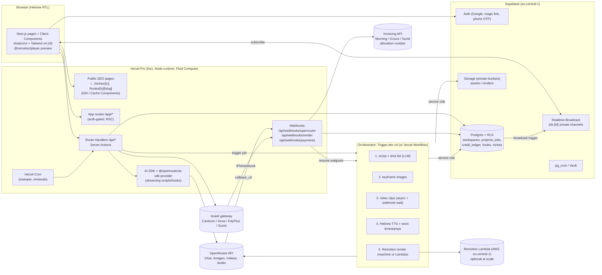

# 05: Stack and reference architecture for a Hebrew-first AI video SaaS
## React/Next.js + Node.js on Vercel, with Supabase and OpenRouter (as of 2026-10-13)

---

## 0. Read this first: how reliable this report is

- **No web search ran in this run.** The first batch of searches was refused because the session's shared web-search budget (200 calls per turn, shared by all agents) was already used up. The harness forbids workarounds such as curl, readers or proxies, so I used none.
- **Where the content comes from.** The report combines three sources:
  1. My model knowledge, with a cutoff around mid-2026.
  2. Facts that the sibling report `04-openrouter.md` (same folder) sourced live. Those keep their original URLs and are tagged **[sourced-04]**.
  3. Architecture reasoning, tagged **[design]**.
- **Every vendor fact is unverified.** Each one carries one of these tags:
  - **[KB-high]**: unverified in this run, from model knowledge, high confidence (stable and widely documented).
  - **[KB-med]**: unverified, medium confidence. The number or name may have changed.
  - **[KB-low]**: unverified, low confidence. Treat it as a lead to check, not a fact.
- **The URLs are where to verify, not proof.** Each link is the canonical page where the fact should be checked. I did **not** open these pages in this run.
- **Most likely to have changed since mid-2026:** prices; beta or GA status (Vercel Queues, Workflow, Sandbox, shadcn RTL); Remotion license prices; the Israeli allocation-number thresholds.
- **What to do next.** Section 12 lists the 15 facts to verify before you finalize the build prompt. A follow-up run with a fresh search budget could check them.
- **Update 2026-10-13 (verification pass).** A follow-up run with 40 web searches (no page fetches) checked the highest-impact claims. Tags were changed in place to **[verified: url]** or **[corrected: url]**. "(secondary)" means the confirmation came from a third-party page, not the vendor's own docs. The **Verification addendum** at the end summarizes the results. Any claim still tagged KB-high/KB-med/KB-low remains unverified.

---

## 1. TL;DR recommendation

| Layer | Recommendation | Why (short) |
|---|---|---|
| Web app + API | **Next.js 16 App Router (React 19) on Vercel Pro**, Node.js runtime with Fluid Compute, region `fra1` | SEO for the public **Hooks library** (`/hooks/[niche]`) needs server rendering or ISR. One codebase covers marketing site, app and API routes. It satisfies "React + Node.js". [design] |
| DB, Auth, Storage, Realtime | **Supabase Pro**, region **eu-central-1 (Frankfurt)**, co-located with Vercel `fra1` | Postgres + RLS for multi-tenant workspaces, Auth with Google, magic link and phone OTP, Storage for media, Realtime for job progress. [design] |
| AI calls | **OpenRouter**: `@openrouter/ai-sdk-provider` with the Vercel AI SDK for text (scripts, hooks, storyboards). Raw REST for `POST /api/v1/videos` (async, with `callback_url`), `/api/v1/images` and `/api/v1/audio/*` | One key covers text, image, video, TTS and STT [sourced-04]. The AI SDK gives streaming UI and structured output (Zod). |
| Long-running pipeline | **Trigger.dev v4** (managed) is the primary choice. **Vercel Workflows** (formerly Workflow DevKit) is the all-Vercel alternative; it has been **GA since 2026-04-16** [corrected: https://vercel.com/blog/a-new-programming-model-for-durable-execution]. | A video job runs for 2–15 minutes with external waits (video webhooks) and a CPU-heavy render. Trigger.dev's `maxDuration` is configurable and can be switched off per task or run with `timeout.None` [verified: https://trigger.dev/docs/runs/max-duration]. Machines go up to 8 vCPU/16 GB (`large-2x`) [verified: https://trigger.dev/docs/machines]. It has an ffmpeg build extension [verified: https://trigger.dev/docs/config/extensions/ffmpeg] and React realtime hooks [KB-med]. |
| Final video assembly | **Remotion** (React compositions, Hebrew RTL via Chromium). MVP renders on a Trigger.dev `large-1x` machine. At scale, use **Remotion Lambda** in eu-central-1. | Deterministic Hebrew typography, captions, logo and brand kit. The same React components drive the in-browser `@remotion/player` preview. [design] |
| Media storage/CDN | **Supabase Storage** (private buckets, signed URLs) for the MVP. Move finished MP4s to **Cloudflare R2** or Bunny when egress grows. | Video egress is the hidden cost line. [design] |
| Progress to UI | **Supabase Realtime Broadcast** on a private channel per job, with a 5-second polling fallback | `postgres_changes` scales poorly. [KB-med] |
| Payments | **Israeli gateway with tokenization** (Cardcom / Grow / PayPlus / Sumit), plus an invoicing provider that issues **חשבונית מס/קבלה** with **מספר הקצאה** (Morning / iCount / Sumit) | Stripe is not available to Israel-registered entities; Israel was absent from Stripe's country list when checked in July 2026 [verified (secondary): https://adircpa.com/en/guides/stripe-israel-tax]. SMBs expect ₪ prices plus a tax invoice. VAT is **18%** in 2026 [verified (secondary): https://trykintsugi.com/sales-tax-guides/middle-east/israel]. |
| RTL UI | Tailwind v4 logical utilities (`ms-/me-/ps-/pe-/start-/end-`), shadcn/ui with its RTL mode (`rtl: true`, shipped Jan 2026) [verified: https://ui.shadcn.com/docs/rtl] inside a Radix `DirectionProvider dir="rtl"`, `next/font` with Heebo or Assistant (`subsets:['hebrew','latin']`), `<html lang="he" dir="rtl">` | [KB-high] |

---

## 2. Reference architecture

### 2.1 Mermaid



### 2.2 ASCII (the same idea)

```
 Browser (he, rtl) --HTTPS--> Vercel fra1: Next.js 16 (RSC, Route Handlers, Server Actions)
   |   ^                         |  AI SDK -> OpenRouter (text/stream)      |
   |   | Realtime Broadcast      |  tasks.trigger("render-video", {jobId})  |
   |   |                         v                                          |
   |  Supabase eu-central-1 <-- Trigger.dev v4 task (no timeout, 2-8 vCPU)  |
   |  - Postgres+RLS             1 LLM script  -> OpenRouter /chat          |
   |  - Storage (signed URLs)    2 images      -> OpenRouter /images        |
   |  - Auth                     3 clips       -> OpenRouter /videos (async) 
   |  - pg_cron/Vault               wait.forToken() <- /api/webhooks/openrouter (callback_url)
   |                             4 TTS + STT   -> OpenRouter /audio/*       |
   +-- signed URL download <---- 5 Remotion render (local Chromium | Lambda)|
                                 6 upload MP4 -> Storage, jobs.status=done  |
 Payments: hosted page (Cardcom/Grow/PayPlus) -> webhook -> credit_ledger -> invoice API (allocation no.)
```

### 2.3 Video job lifecycle [design]

1. **Create.** The user submits the wizard: niche, business details, brand kit, format 9:16/1:1/16:9, length, and hook choice.
2. **Insert and reserve.** `POST /api/projects/:id/render` calls the Postgres RPC `reserve_credits_and_create_job()` (SECURITY DEFINER, one transaction):
   - checks the balance,
   - inserts a `credit_ledger` row (`kind='reserve'`),
   - inserts a `jobs` row (`status='queued'`, `idempotency_key`).
3. **Enqueue.** `tasks.trigger('render-video', { jobId }, { idempotencyKey, concurrencyKey: workspaceId, queue: planQueue })`. Store the run ID on the job.
4. **Pipeline steps.** Each step updates `jobs.stage` and `jobs.progress`. A DB trigger broadcasts each change to `job:{id}`. Generated media is uploaded to `assets/{workspace}/{project}/...`.
5. **Async video clips.**
   - Submit to `/api/v1/videos` with `callback_url = https://app.example.co.il/api/webhooks/openrouter?job=..&token=..` [sourced-04].
   - Wait on a waitpoint token (Trigger.dev `wait.forToken`) or a WDK `createWebhook()`.
   - The webhook handler verifies the signature and completes the token.
   - Fallback: poll every 30 s [sourced-04].
   - Download the clip **with the Authorization header** and re-host it in Storage [sourced-04].
6. **Render.** The Remotion composition is fed with JSON props: clip URLs (signed), VO audio, word timestamps, brand colors, logo, Hebrew font, captions style and hook text. The output goes to `renders/...mp4`.
7. **Finish.**
   - `jobs.status='succeeded'` and `output_path` is set.
   - The ledger records `kind='capture'`.
   - The user gets an email (Resend) and an in-app notification.
8. **Failure.** On error, `jobs.status='failed'` and the ledger records `kind='refund'`, so credits are refunded automatically. Cadabra advertises the same auto-refund (see `01-cadabra.md`).
9. **Sweeper.** A Vercel Cron job (or pg_cron) runs every 5 minutes. It marks jobs with `updated_at < now()-30min` as stalled, then retries or refunds them.

---

## 3. Vercel (facts to build on)

### 3.1 Framework choice: Next.js 16 App Router vs Vite SPA + Express

| Option | Pros | Cons | Verdict |
|---|---|---|---|
| **Next.js 16 App Router** | SSR, ISR and Cache Components for SEO of the hooks library and niche landing pages; Route Handlers and Server Actions; `next/font`; `next/image`; first-class on Vercel; `after()` for post-response work | Learning curve (RSC, caching); vendor gravity | **Recommended** [design] |
| Vite SPA + Express (`/api`) | Simple mental model; Express runs zero-config on Vercel (Vercel added framework-less backends such as Express, Hono and Fastify in 2025) [KB-med] ([verify](https://vercel.com/docs/frameworks/backend/express)) | Client-rendered pages hurt SEO of the public hooks library; you would need a separate prerender step; two build targets | Only if the team refuses Next.js |
| React Router v7 (framework mode) | SSR, Vite-based | Smaller Vercel/Supabase example ecosystem | Viable alternative |

**Next.js 16 facts** (released 2025-10-21 at Next.js Conf) [verified (secondary; search results incl. https://dev.to/ahmed_mahmoud360/upgrading-to-nextjs-16-field-notes-from-two-production-apps-mj7, https://pagepro.co/blog/react-tldr/next-js-16-cache-components-stable-turbopack-and-ai-devtools/)] ([official post](https://nextjs.org/blog/next-16)):

- Turbopack is the default bundler for both `next dev` and `next build`; webpack is still available with `--webpack` [verified (secondary), same results].
- "Cache Components" add the `"use cache"` directive and opt-in caching [verified (secondary), same results].
- `middleware.ts` is renamed **`proxy.ts`** (the exported function becomes `proxy`), and it runs on the **Node.js runtime by default**. `middleware.ts` still works in v16 but is **deprecated**. Codemod: `npx @next/codemod@canary middleware-to-proxy .` [verified (secondary; search results incl. https://auth0.com/blog/whats-new-nextjs-16/, https://johnkavanagh.co.uk/articles/next-js-proxy-replaces-middleware/)].
- It ships with React 19.2 features [verified (secondary), same results]. The Node 20.9+ minimum was not found in this pass [KB-med].
- The `next lint` command was removed, and so were the synchronous request APIs [verified (secondary): https://dev.to/ahmed_mahmoud360/upgrading-to-nextjs-16-field-notes-from-two-production-apps-mj7].
- 16.1 has shipped; it fully removed `next/legacy/image` [verified (secondary): https://www.wisp.blog/blog/nextjs-16-1-upgrade-guide]. A 16.2 release was not found in this pass [KB-low].
- `after()` (stable since 15.1) runs work after the response is sent [KB-med].

### 3.2 Function limits (Node runtime)

| Limit | Hobby | Pro | Enterprise | Tag / verify |
|---|---|---|---|---|
| Max duration, **Fluid Compute on** (the default for new projects since 2025) | default 300 s, **max 300 s** | default 300 s, **max 800 s** (GA); **extended max 1,800 s (30 min), beta** | default 300 s, **max 800 s**; **extended 1,800 s (beta)** | [verified: https://vercel.com/docs/functions/limitations]. The 1,800 s tier was missing [corrected: https://vercel.com/changelog/vercel-functions-can-now-run-up-to-30-minutes]: it is beta above 800 s, requires Fluid Compute, started on Node.js/Python (Bun added later), and you opt in with `maxDuration` |
| Max duration, Fluid off (legacy) | 10 s default / 60 s max | 15 s / 300 s | 15 s / 900 s | [KB-med] same link |
| Memory / CPU | 2 GB / 1 vCPU | 2 GB / 1 vCPU (Standard) or **4 GB / 2 vCPU** (Performance) | same as Pro | [KB-med] [verify](https://vercel.com/docs/functions/configuring-functions/memory) |
| Request **and** response body | **4.5 MB** | 4.5 MB | 4.5 MB | [verified: https://vercel.com/docs/functions/limitations]. It is a hard limit on every plan and returns 413 `FUNCTION_PAYLOAD_TOO_LARGE`. Streamed responses are not subject to it [verified: https://vercel.com/kb/guide/how-to-bypass-vercel-body-size-limit-serverless-functions] |
| Bundle size (unzipped) | 250 MB | 250 MB | 250 MB | [KB-high] same link |
| `/tmp` writable | ~500 MB | ~500 MB | ~500 MB | [KB-med] same link |
| Commercial use | **Not allowed on Hobby** (personal, non-commercial only). Commercial includes taking payments, advertising a product or service, or being paid to build or host the site | allowed | allowed | [verified: https://vercel.com/docs/limits/fair-use-guidelines] |

**Consequences for this product** [design]:

- **Never upload video through a function.** The 4.5 MB body limit rules it out. Use signed direct-to-Storage uploads: Supabase `createSignedUploadUrl` or TUS resumable uploads, or Vercel Blob client uploads.
- **Never render a 30–60 s 1080p video inside a Vercel function.** Even with 800 s (or the 1,800 s beta) and 2 vCPU, Chromium plus x264 is fragile, and the 250 MB bundle limit fights with Chromium + ffmpeg binaries. Offload the render.
- **Fluid Compute pricing.** Billing is by **Active CPU** (around $0.128 per CPU-hour in iad1), plus **provisioned memory** (around $0.0106 per GB-hour) and **invocations** (around $0.60 per million) [KB-med] ([verify](https://vercel.com/docs/functions/usage-and-pricing)). Waiting on I/O (LLM streaming) is cheap under Active CPU billing. That suits AI SDK streaming routes.

### 3.3 Other Vercel products

| Product | Status / key facts | Use here? |
|---|---|---|
| **Vercel Cron** | Up to 100 cron jobs per project on all plans. **Hobby: once per day, imprecise timing.** Pro: minute granularity. Calls your route with `Authorization: Bearer $CRON_SECRET`. [KB-med] ([verify](https://vercel.com/docs/cron-jobs/usage-and-pricing)) | Yes: stale-job sweeper, subscription renewals via gateway tokens, daily hook-of-the-day ISR revalidation |
| **Vercel Queues** | **Public beta** [verified: https://vercel.com/changelog/vercel-queues-now-in-public-beta]. One secondary source dates the public beta to 2026-02-27, on all plans, so the earlier "public beta in late 2025" timeline is doubtful [corrected (secondary date)]. **No GA announcement found as of Oct 2026.** Package `@vercel/queue` (needs Node.js 22+). Limits: message TTL 60 s–7 days (default 24 h); delay up to 7 days; visibility timeout up to 60 min; 1–10 messages per receive. Billed per API operation from **$0.60 per 1M operations**, metered in 4 KiB chunks, with 1M operations included on Hobby [verified: https://vercel.com/docs/queues/pricing, https://vercel.com/changelog/queues-now-supports-7-day-ttl]. Vercel Workflows run on top of Queues. Topics, consumer groups and at-least-once delivery were not re-checked [KB-low] | Optional; Trigger.dev covers it |
| **Vercel Workflows / Workflow DevKit (WDK; also called Workflow SDK)** | Open source. **Public beta Oct 2025** [verified: https://vercel.com/changelog/open-source-workflow-dev-kit-is-now-in-public-beta]. **GA on 2026-04-16**, after 100M+ runs in beta [corrected: https://vercel.com/blog/a-new-programming-model-for-durable-execution]. Directives `"use workflow"` and `"use step"`, with automatic step retries [verified: same changelog]. **Pricing:** Workflow Events $0.02 per 1K ($20 per 1M), with 50K events/month included on Hobby. Data Written costs $0.50/GB (1 GB included on Hobby). Data Retained costs $0.50/GB-month (not available on Hobby) [verified: https://vercel.com/docs/workflows/pricing]. **Step duration:** since Jul 2026, steps on Pro/Enterprise can run up to 30 min (opt-in via an environment variable; not on Hobby) [verified: https://vercel.com/changelog/workflow-steps-now-support-extended-function-durations]. Built on Vercel Queues. Durable `sleep()`, **`createWebhook()`** (suspends until an HTTP callback arrives, which suits OpenRouter `callback_url`) and "Worlds" (Vercel, Postgres, local) were not re-checked [KB-med] ([verify](https://useworkflow.dev), [docs](https://vercel.com/docs/workflows)) | **Strong alternative** to Trigger.dev for orchestration, and now GA. **Not** for the CPU-heavy render itself, because each step is still a Vercel function bounded by maxDuration (30 min at most) and memory. [design] |
| **Vercel Blob** | Object storage with client uploads (bypasses the 4.5 MB limit; multipart for large files). Billed by storage, operations and data transfer. [KB-med] ([verify](https://vercel.com/docs/vercel-blob)) | Not needed; Supabase Storage plus optional R2 instead |
| **Vercel Sandbox** | Firecracker microVMs (Amazon Linux, Node 22 / Python 3.13) [KB-low]. **1 vCPU or an even number from 2 to 32, depending on plan** (default 2), with **2 GB RAM per vCPU**. The "up to 8 vCPU" figure came from the old beta docs [corrected: https://vercel.com/docs/vercel-sandbox/pricing]. Max runtime is **45 min on Hobby / 5 h on Pro & Enterprise** (default 5 min, extendable) [verified: same page]. Active CPU costs $0.128 per vCPU-hour. Concurrency is 10 sandboxes on Hobby and 2,000 on Pro/Ent [verified: same page]. GA was reported for 2026-01-30 [verified (secondary): https://rywalker.com/research/vercel-sandbox]. An older docs page said iad1 only; the current region list is unverified. | **Viable Vercel-native render host for Remotion.** Remotion documents it: the `@remotion/vercel` package, a template from `npx create-video@latest --vercel`, and output to Vercel Blob. Each render runs on one machine, so it is slower than Lambda. Snapshots and outputs persist until you delete them [verified: https://www.remotion.dev/docs/vercel-sandbox, https://vercel.com/templates/next.js/remotion-on-vercel]. |
| **AI SDK (`ai` package)** | v5 (Jul 2025): UIMessage, typed tool parts, SSE streaming [KB-med]. v6 went GA on 2025-12-22: `Agent`/`ToolLoopAgent`, tool approval [verified (secondary): https://www.issoh.co.jp/tech/details/10402/]. **The current major is v7, released 2026-06-25.** It adds `WorkflowAgent` for durable execution, overhauled telemetry, typed tool context, top-level reasoning, granular timeouts, and stable speech and transcription APIs. Migrate with `npx @ai-sdk/codemod v7`. The original report stopped at v6 [corrected: https://vercel.com/changelog/ai-sdk-7]. The 7.x line reached `ai@7.0.88` by 2026-09-01 [verified (secondary): https://releasebot.io/updates/vercel]. v7 reportedly renames some APIs (e.g. `stepCountIs` → `isStepCount`, `onFinish` → `onEnd`) [secondary, unverified]. `generateText`, `streamText`, structured output and `useChat` remain the core APIs ([docs](https://ai-sdk.dev/docs)) | Yes, for all text and structured LLM output. Move to `ai@7` only once the OpenRouter provider confirms v7 support (next row). |
| **`@openrouter/ai-sdk-provider`** | OpenRouter's provider: `import { createOpenRouter } from '@openrouter/ai-sdk-provider'`, `const openrouter = createOpenRouter({ apiKey: process.env.OPENROUTER_API_KEY })`, `streamText({ model: openrouter('anthropic/claude-sonnet-4.5'), ... })`. Major versions track AI SDK majors, so pin a version compatible with your `ai` major. `1.x` targets `ai@^5` [KB-med, consistent with a lockfile seen in search]. **`2.0.0` is the version for AI SDK v6** [verified (secondary): https://cdn.jsdelivr.net/npm/@convex-dev/agent@0.6.1/MIGRATION.md]. `3.0.0` reportedly tracks AI SDK v7, but only an aggregator says so [unverified: https://openapps.pro/packages/ai-sdk-provider]. Run `npm view @openrouter/ai-sdk-provider peerDependencies` before choosing ([verify](https://github.com/OpenRouterTeam/ai-sdk-provider), [verify](https://ai-sdk.dev/providers/community-providers/openrouter)) | Yes, for text. Use **raw fetch** (or `@openrouter/sdk` [sourced-04]) for `/api/v1/videos`, `/images` and `/audio`, which are OpenRouter-specific async/multimodal endpoints. |
| **Vercel AI Gateway** | Vercel's own multi-provider gateway (GA around Aug 2025) [KB-med] | Fallback if OpenRouter has an outage. Not primary, because the user chose OpenRouter. |
| **Edge vs Node runtime** | Vercel now recommends the **Node.js runtime** for functions (Fluid Compute gives fast cold starts and in-function concurrency). Edge has small code-size limits (around 1–4 MB) and no Node APIs. [KB-med] ([verify](https://vercel.com/docs/functions/runtimes)) | Use **Node everywhere**, including `proxy.ts` |
| **Image Optimization** (`next/image`) | Priced since 2025 by transformations, cache reads and cache writes. Hobby has a small included quota (around 5,000 transformations per month). [KB-low] ([verify](https://vercel.com/docs/image-optimization/limits-and-pricing)) | Use it for marketing images. For user-generated thumbnails use Supabase image transforms or pre-generated WebP to avoid a per-image bill. Add `remotePatterns` for `*.supabase.co`. |
| **Web Analytics / Speed Insights** | Per-event pricing; small included quota on Hobby [KB-low] | Optional. PostHog (EU cloud) gives product analytics and funnels. |
| **Pro pricing** | **$20/month per paid (deploying) seat, including $20 of monthly usage credit per seat**; viewer seats are free. The included 1 TB Fast Data Transfer and 10M Edge Requests don't draw down the credit [verified (secondary, 2026; search results incl. https://makerkit.dev/blog/saas/vercel-cost, https://schematichq.com/blog/vercel-pricing)] ([official](https://vercel.com/pricing)) | Budget about $20–$150/month at an early stage |
| **Regions** | No Israel compute region. **`fra1` (Frankfurt)** is the usual choice for IL users and co-locates with Supabase eu-central-1. [KB-med] Set `"regions": ["fra1"]` in `vercel.json` or `preferredRegion`. | Yes |

---

## 4. Long-running jobs: patterns and options

### 4.1 Canonical pattern [design]

```
POST /api/render  ->  INSERT jobs(status='queued')  ->  enqueue(jobId)  ->  202 {jobId}
worker(jobId): for each stage { do work; UPDATE jobs SET stage, progress }   (idempotent per stage)
UI: subscribe Realtime 'job:{jobId}'  +  fallback poll GET /api/jobs/:id every 5 s
External async APIs (OpenRouter /videos) -> callback_url -> resume worker (waitpoint/webhook)
Sweeper cron: stalled jobs -> retry or refund
```

**Rules for this pattern:**

- Every stage stores its output path in `job_steps`. A retry then skips completed stages and never pays OpenRouter twice.
- Use **idempotency keys** at three points: job creation, gateway webhooks, and OpenRouter callbacks (dedupe by OpenRouter video ID).

### 4.2 Options compared

| Option | Long tasks? | ffmpeg / Chromium | Waiting for webhooks | Realtime progress | Pricing (unverified) | Notes |
|---|---|---|---|---|---|---|
| **Trigger.dev v4** (managed or self-host) | No hard platform timeout. A default `maxDuration` is set in `trigger.config.ts` (minimum 5 s) and can be turned off per task or per run with `timeout.None` [verified: https://trigger.dev/docs/runs/max-duration]. Machines, each with 10 GB disk: `micro` 0.25 vCPU/0.25 GB, `small-1x` 0.5/0.5 (default), `small-2x` 1/1, `medium-1x` 1/2, `medium-2x` 2/4, `large-1x` 4/8, `large-2x` 8 vCPU/16 GB [verified: https://trigger.dev/docs/machines] | `ffmpeg()` installs Debian's apt ffmpeg by default, or a static FFmpeg 7.x with `ffmpeg({ version: "7" })`. It sets `FFMPEG_PATH`/`FFPROBE_PATH`. Add `fluent-ffmpeg` to `external` [verified: https://trigger.dev/docs/config/extensions/ffmpeg]. Extensions apply to deployed builds only, so install ffmpeg locally for dev [secondary]. Others: `aptGet()`, `puppeteer()`, `additionalFiles()`, `syncVercelEnvVars()` [KB-med] ([verify](https://trigger.dev/docs/config/extensions/overview)) | **Waitpoint tokens**: `wait.createToken()` / `wait.forToken()`; v4 tokens expose a callback URL [KB-low] | `@trigger.dev/react-hooks` `useRealtimeRun` with run `metadata` progress [KB-med] ([verify](https://trigger.dev/docs/realtime)) | Free $0; **Hobby $10/mo; Pro $50/mo**, each fee counting as included usage credit. Compute is billed per second, from $0.0000169/s (`micro`) to $0.00068/s (`large-2x`); `small-1x` is $0.0000338/s. Each run start costs about $0.000025 [verified (secondary): https://www.zenml.io/blog/trigger-dev-pricing] ([official](https://trigger.dev/pricing)). Free-plan credit and concurrency limits are unverified, because sources conflict. | **v4 is GA** (Launch Week 2) [verified: https://trigger.dev/changelog/trigger-v4-ga]; GA date around Aug 2025 [KB-med]. Apache-2.0, so self-hostable. Concurrency keys per workspace. **Best fit for the MVP.** |
| **Vercel Workflows (WDK)** | Durable across steps. Each step is bounded by function maxDuration: 800 s on Pro, or up to 30 min opt-in on Pro/Ent since Jul 2026 [verified: https://vercel.com/changelog/workflow-steps-now-support-extended-function-durations] | Only what fits in a Vercel function, so offload the render to Lambda or Sandbox | `createWebhook()` [KB-med] | Write progress to Supabase yourself | Workflow Events $0.02/1K plus data written/retained at $0.50/GB, on top of function compute [verified: https://vercel.com/docs/workflows/pricing] | All-Vercel DX; **GA since 2026-04-16** [corrected: https://vercel.com/blog/a-new-programming-model-for-durable-execution] |
| **Inngest** | Step functions; each step within the host function's timeout; "Connect" workers on your own containers for long work [KB-low] | Only via your own worker | `step.waitForEvent()` | `@inngest/realtime` [KB-low] | Free hobby tier (around 50k executions per month), Pro from about $75/mo [KB-low] ([verify](https://www.inngest.com/pricing)) | Mature, Vercel Marketplace integration |
| **Upstash QStash / Workflow** | Each step is an HTTP call to your Vercel route. `context.call()` offloads long HTTP waits. | No | `context.waitForEvent()` [KB-low] | DIY | QStash about $1 per 100k messages; free daily quota [KB-low] ([verify](https://upstash.com/pricing/qstash)) | Cheapest; serverless-native |
| **Supabase Queues (pgmq) + Edge Functions** | Edge Functions: **wall clock 150 s (Free) / 400 s (paid)**, **2 s CPU time** per request (async I/O excluded), 256 MB memory, plus a 150 s request idle timeout (504) [verified: https://supabase.com/docs/guides/functions/limits] | **No** (Deno, no ffmpeg binary, 2 s CPU) | DIY via webhook route | Realtime | Included in Supabase plan | Fine for light glue (send email, enqueue). **Wrong for rendering.** Queues launched Dec 2024 [verified: https://supabase.com/blog/supabase-queues]. **No GA announcement found:** the features page still labels it "Public Alpha", though that page may be stale [verified: https://supabase.com/features/queues]. pgmq needs Postgres 15.6.1.143 or later ([docs](https://supabase.com/docs/guides/queues)). |
| **DIY: jobs table + Vercel Cron + Fluid** | Each tick ≤ 800 s | No | Webhook route updates row | Realtime | Cheapest | OK for the pre-render AI stages only. Brittle. |
| **Render worker on Fly.io / Railway / Cloud Run** | Unlimited | Full control (Docker with Chromium + ffmpeg + Hebrew fonts) | DIY | DIY | Pay for VM | Choose this if you outgrow Trigger.dev pricing |

**Recommendation** [design]:

- **Trigger.dev v4** orchestrates the whole pipeline. The render runs in-task on `large-1x` (4 vCPU / 8 GB) with Remotion's bundled Chrome Headless Shell plus ffmpeg.
- Switch the render step to **Remotion Lambda** when you need parallelism (many users rendering at once) or faster wall-clock times.
- Vercel Workflows has been GA since 2026-04-16 [corrected: https://vercel.com/blog/a-new-programming-model-for-durable-execution]. If you prefer one vendor, use it for orchestration, with Remotion Lambda (or Vercel Sandbox) for the render.

---

## 5. Video assembly and rendering

### 5.1 Remotion (recommended render engine)

- **What it is.** You write videos as React components, rendered frame by frame in headless Chromium and encoded with ffmpeg.
- **Hebrew rendering.** Hebrew shaping and bidi are handled by the browser engine, the same as on the website. That is the main reason to choose it for Hebrew. [KB-high]
- **Licensing** [verified: https://www.remotion.pro/license, https://www.remotion.dev/docs/license/pricing]:
  - Free for individuals, **for-profit organisations with up to 3 employees** (commercial use included; revenue and render volume don't matter), non-profits and evaluation [verified: https://www.remotion.dev/docs/pricing, https://github.com/remotion-dev/remotion/blob/main/LICENSE.md].
  - Companies of **4 or more people** need a **Company License**.
  - 2026 prices [verified: https://www.remotion.pro/license]:
    - **Remotion for Creators: $25 per seat per month**, for people who write Remotion code.
    - **Remotion for Automators: $0.01 per render with a $100/month minimum**, for automated pipelines, video editors and embedded Player use.
    - If both apply, there is one combined $100/month minimum, and seats count toward it.
    - **Enterprise starts at $500/month**.
  - One successful video, audio, GIF, PDF or still counts as one render. Studio and Player previews don't count [verified (secondary): https://genmotion.dev/answers/remotion-do-i-need-a-company-license].
  - The license file says the terms will change slightly in **Remotion 5.0**. v5.0 terms are already published, but it is unclear whether they apply yet [verified: https://www.remotion.dev/docs/terms].
  - **A SaaS that renders for customers is exactly the "Automators" use case.** Budget at least $100/month once the team reaches 4 people.
- **Rendering options:**

| Option | Facts | Fit |
|---|---|---|
| `@remotion/renderer` on your own machine or container (Trigger.dev task, Fly, Cloud Run) | `renderMedia()`, `selectComposition()`; downloads Chrome Headless Shell via `ensureBrowser()`; needs Linux libs (nss, fonts) [KB-med] | MVP: simplest |
| **Remotion Lambda** | Renders in parallel chunks across AWS Lambda functions (up to 10 GB RAM, 15 min each, ephemeral disk up to 10 GB). `renderMediaOnLambda()`, `getRenderProgress()`, **webhooks with signature**, output to S3. Costs typically fractions of a cent to a few cents for short videos (AWS bill, separate from the Remotion license). [KB-med] ([verify](https://www.remotion.dev/docs/lambda), [limits](https://www.remotion.dev/docs/lambda/limits)) | **Scale**. Gotchas: new AWS accounts often get a **low Lambda concurrency quota** (request an increase). Region support list: use **eu-central-1**, which is supported. **`il-central-1` (Tel Aviv) is not in Remotion's published region lists** [verified: https://www.remotion.dev/docs/lambda/region-selection]. The default region is us-east-1. Pass the region explicitly to the Node APIs, and confirm for your installed version with `npx remotion lambda regions` [verified: https://www.remotion.dev/docs/lambda/cli/regions]. |
| Remotion Cloud Run (GCP) | Alpha / not actively developed [KB-med] ([verify](https://www.remotion.dev/docs/cloudrun)) | Avoid |
| Remotion on **Vercel Sandbox** | **Officially documented and templated.** `@remotion/vercel` provides `renderMediaOnVercel()` with `onProgress`. The Next.js template comes from `npx create-video@latest --vercel` and needs a Vercel Blob store. Each render gets one ephemeral VM with Chrome and FFmpeg; startup takes a few seconds, and it is slower than Lambda [verified: https://www.remotion.dev/docs/vercel-sandbox, https://vercel.com/templates/next.js/remotion-on-vercel] | Viable all-Vercel render host for the MVP. Add your own rate limiting and cleanup, because snapshots and videos persist. |
| In-browser preview `@remotion/player` | Plays the same composition live in the editor UI with no render cost [KB-high] ([verify](https://www.remotion.dev/docs/player)) | **Yes.** It is the instant "live preview" that makes the editor feel premium. |
| Client-side rendering (`@remotion/web-renderer`, WebCodecs) | Experimental in 2025–2026 [KB-low] | Later, for cheap low-res drafts |

- **Captions with word-level highlight:**
  - Use `@remotion/captions`. Its `Caption` type is `{ text, startMs, endMs, timestampMs, confidence }`, and `createTikTokStyleCaptions({ captions, combineTokensWithinMilliseconds })` builds pages of words for TikTok-style captions where the active word is highlighted. [KB-med] ([verify](https://www.remotion.dev/docs/captions))
  - Word timestamps can come from ElevenLabs **Scribe v2 via OpenRouter** (about $0.0019/min) or Whisper `verbose_json` with word granularity [sourced-04] ([OpenRouter](https://openrouter.ai/elevenlabs/scribe-v2), [tutorial](https://openrouter.ai/blog/tutorials/transcription-on-openrouter/)).
  - Map the result to `Caption[]`. `@remotion/openai-whisper` has a converter for the OpenAI Whisper format [KB-med].
- **Hebrew fonts in Remotion:** `import { loadFont } from '@remotion/google-fonts/Heebo'; const { fontFamily } = loadFont('normal', { weights: ['400','700','900'], subsets: ['hebrew','latin'] });` [KB-med] ([verify](https://www.remotion.dev/docs/google-fonts)). Remotion waits for the font through `delayRender` internally. For custom or paid fonts, use `@remotion/fonts` `loadFont({ family, url })` with files in `public/` [KB-med].
- **Hebrew RTL gotchas in Remotion** [KB-high, browser behavior]:
  - Put `direction: 'rtl'` on caption and title containers.
  - Mixed Hebrew with numbers, English, "%" or "₪" can reorder punctuation at line ends. Use `unicode-bidi: plaintext` or wrap Latin runs in `<bdi>`.
  - Don't split words into per-letter spans: that breaks Hebrew final letters (ך ם ן ף ץ) and ligatures. Animate per **word**.
  - Avoid `letter-spacing` on Hebrew.
  - Nikud needs fonts that support it (Noto Sans Hebrew, Frank Ruhl Libre, David Libre).

### 5.2 FFmpeg in serverless (if you avoid Remotion)

- **`ffmpeg-static` in a Vercel function.** The Linux x64 binary is roughly 70–80 MB, so it fits under the 250 MB bundle. It is CPU-bound on 1–2 vCPU with no GPU, and long encodes risk the 800 s cap. [KB-med]
- **Hebrew in ffmpeg:**
  - The `drawtext` filter needs an ffmpeg build with **libfreetype + libfribidi + libharfbuzz**, and the `text_shaping=1` option. Otherwise Hebrew renders as reversed, unshaped glyphs. [KB-med] ([verify](https://ffmpeg.org/ffmpeg-filters.html#drawtext-1))
  - **Prefer ASS subtitles via libass** (`-vf "subtitles=caps.ass:fontsdir=./fonts"`): libass does bidi (fribidi) and shaping (HarfBuzz) and supports styling. [KB-med] ([verify](https://github.com/libass/libass))
  - **Word highlight** in ASS: write one Dialogue event per word-window with inline color overrides (`{\c&H00FFFF&}word{\c&HFFFFFF&}`). Karaoke `\k` tags are unreliable with RTL text [KB-low]. Always ship the `.ttf` (Heebo/Assistant) with the job and set `fontsdir`.
- **Verdict.** Use ffmpeg for mechanical steps: concatenating clips, mixing VO and music with ducking (`sidechaincompress`), loudness normalization (`loudnorm`), creating proxies and thumbnails. Use Remotion for typography and motion design. [design]

### 5.3 Cloud render APIs (buy instead of build)

All pricing below is **[KB-low]** and must be verified on each vendor's pricing page. These APIs mainly avoid DevOps. The costs: lower margin per video, and less control over Hebrew typography. Test Hebrew RTL support explicitly with each vendor; it is unverified for all of them.

| Vendor | Model | Hebrew/RTL | Price lead (verify) | Verify |
|---|---|---|---|---|
| **Shotstack** | JSON timeline Edit API, templates, webhooks | HTML/text assets; RTL not confirmed | Credit-based; roughly $0.20–$0.40 per rendered minute depending on plan | https://shotstack.io/pricing/ |
| **Creatomate** | Template editor + REST API, JSON source, webhooks | Claims multi-language text; RTL unconfirmed | Plans around $41 / $99 / $249 per month (credit-based) | https://creatomate.com/pricing |
| **JSON2Video** | JSON movie spec; free tier with watermark | Unconfirmed | Paid plans from around $50/mo | https://json2video.com/pricing/ |
| **Plainly** | After Effects templates rendered via API | AE handles RTL with the Middle East text engine | From around $69/mo | https://www.plainlyvideos.com/pricing |

**Recommendation.** Build on Remotion. Keep Creatomate or Shotstack as a contingency only if the team cannot run render infrastructure. [design]

---

## 6. Supabase

### 6.1 Auth

- **Methods:**
  - Email magic link / OTP.
  - **Google OAuth**, the most-used method by Israeli SMB owners [design].
  - **Phone OTP** through the built-in providers (Twilio, Twilio Verify, MessageBird, Vonage, Textlocal), or the **Send SMS Hook** to call any Israeli SMS gateway (e.g. 019 SMS / InforU / ActiveTrail) [KB-med] ([verify](https://supabase.com/docs/guides/auth/phone-login), [hook](https://supabase.com/docs/guides/auth/auth-hooks/send-sms-hook)).
  - WhatsApp OTP via Twilio is also possible [KB-med].
- **SSR with Next.js.** Use `@supabase/ssr` (`createServerClient` / `createBrowserClient`, cookie-based sessions) and refresh the session in `proxy.ts` (formerly `middleware.ts`) [KB-high] ([verify](https://supabase.com/docs/guides/auth/server-side/nextjs)).
- **Configure custom SMTP (Resend / Postmark) before launch.** The built-in email sender is rate-limited to a few emails per hour and is meant for testing [KB-high] ([verify](https://supabase.com/docs/guides/auth/auth-smtp)). Hebrew RTL email templates: set `dir="rtl"` on the `<html>`/`<body>` of each template.
- **2025 changes**:
  - New API keys: `sb_publishable_…` replaces `anon` and `sb_secret_…` replaces `service_role`. **Supabase is deprecating the legacy `anon`/`service_role` keys by the end of 2026**, so a project started in Oct 2026 must use the new keys [verified: https://supabase.com/docs/guides/getting-started/api-keys, https://supabase.com/docs/guides/getting-started/migrating-to-new-api-keys].
  - Gotchas: send the new keys in the `apikey` header, not as `Authorization: Bearer`, because they are not JWTs. Secret keys are rejected (401) when used from a browser [secondary; search results incl. https://www.guardlayer.io/blog/supabase-publishable-secret-api-keys, https://safeforprod.com/guides/supabase-anon-key-vs-service-role-key].
  - **Asymmetric JWT signing keys**, verified locally with JWKS [KB-med].
  - Use the new keys in new projects.
- **Custom Access Token Hook.** It injects claims (e.g. `active_workspace_id`, `plan`) into the JWT so RLS needs no per-query joins [KB-med].

### 6.2 RLS for multi-tenant workspaces [design + KB-high patterns]

```sql
create table workspaces (id uuid primary key default gen_random_uuid(), name text not null, plan text not null default 'free', created_at timestamptz default now());
create table workspace_members (workspace_id uuid references workspaces on delete cascade, user_id uuid references auth.users on delete cascade, role text check (role in ('owner','admin','editor','viewer')) not null, primary key (workspace_id, user_id));

-- helper: SECURITY DEFINER avoids recursive RLS on workspace_members; STABLE + (select ...) lets Postgres cache it per statement
create or replace function public.is_member(ws uuid) returns boolean
language sql stable security definer set search_path = '' as $$
  select exists (select 1 from public.workspace_members m where m.workspace_id = ws and m.user_id = (select auth.uid()));
$$;

alter table projects enable row level security;
create policy "members read projects" on projects for select to authenticated using ( (select public.is_member(workspace_id)) );
create policy "editors write projects" on projects for insert to authenticated with check ( (select public.is_member(workspace_id)) );
-- jobs / credit_ledger: SELECT for members only; INSERT/UPDATE only via SECURITY DEFINER RPCs or the service role (worker)
```

**Performance rules** [KB-high] ([verify](https://supabase.com/docs/guides/database/postgres/row-level-security)):

- Wrap `auth.uid()` in `(select auth.uid())`.
- Index every column that policies filter on (`workspace_id`, `user_id`).
- Always add `to authenticated`.
- Never expose the service/secret key to the browser.

**Credits:**

- Credits live in an **append-only `credit_ledger`**. The balance is the sum of the ledger, optionally cached in a `workspace_balances` row updated by a trigger.
- Reserve, capture and refund all happen inside SECURITY DEFINER functions with `for update` row locks, to prevent double-spend. [design]

### 6.3 Storage

- **Buckets.** Use `brand-assets` (logos, photos), `generated` (images, clips, VO) and `renders` (final MP4). All are **private**, with a path convention of `{workspace_id}/{project_id}/...`. Storage RLS policies on `storage.objects` use `(storage.foldername(name))[1]::uuid` to match the workspace [KB-high].
- **Upload size limits** [verified: https://supabase.com/docs/guides/storage/uploads/file-limits]:
  - Free: **50 MB** per file.
  - Pro and Team: a configurable global limit of up to **500 GB** per file, raised from 50 GB [verified: https://supabase.com/blog/storage-500gb-uploads-cheaper-egress-pricing]. A per-bucket limit can't exceed the global one. Enterprise is custom.
  - Use **TUS resumable uploads** or S3 multipart for files over 6 MB.
- **Signed URLs** [KB-high]:
  - Use `createSignedUrl(path, seconds)` for viewing or downloading, and `createSignedUploadUrl(path)` so the browser uploads directly.
  - Remotion and Lambda need signed URLs with a TTL **longer than the render**, e.g. 2–6 hours.
- **Image transformations** [KB-med] ([verify](https://supabase.com/docs/guides/storage/serving/image-transformations)):
  - Pro plan and above, via `getPublicUrl/createSignedUrl(..., { transform: { width, height, resize, quality } })`.
  - Billed per origin image, with around 100 included and then about $5 per 1,000.
- **S3-compatible endpoint.** Supabase Storage has one [KB-med], so ffmpeg and AWS SDK tools can read and write.

### 6.4 Realtime (job progress)

- **`postgres_changes`.** It is the simplest option, but it checks RLS for every subscriber on every change and runs on a single thread, so Supabase recommends **Broadcast** for scale [KB-med] ([verify](https://supabase.com/docs/guides/realtime/postgres-changes)).
- **Recommended setup: "Broadcast from Database"** [verified: https://supabase.com/docs/guides/realtime/subscribing-to-database-changes, https://supabase.com/blog/realtime-broadcast-from-database] ([auth](https://supabase.com/docs/guides/realtime/authorization)):
  - A trigger on `jobs` calls `realtime.broadcast_changes('job:' || new.id, ...)` [verified: same pages], or `realtime.send(...)` [KB-med].
  - The client subscribes to a **private** channel `job:{id}` and calls `supabase.realtime.setAuth()` before subscribing [verified: same pages].
  - Authorization comes from RLS policies on `realtime.messages`: SELECT for receiving and INSERT for sending, `to authenticated` [verified: https://supabase.com/docs/guides/realtime/getting_started].
  - Under the hood, Realtime reads WAL inserts on `realtime.messages` through a replication slot. You choose which action types and columns go into the payload [verified: https://supabase.com/blog/realtime-broadcast-from-database].
- **Quotas** [KB-low] ([verify](https://supabase.com/pricing)): Pro includes about 500 concurrent connections and about 5M messages per month.
- **Fallback.** Always poll `GET /api/jobs/:id` (SWR / TanStack Query, every 5 s) when the socket disconnects (mobile Safari backgrounding). [design]

### 6.5 Other Supabase pieces

- **pg_cron (Supabase Cron)** with **pg_net**. It schedules SQL or HTTP calls, e.g. the stale-job sweeper or daily hook rotation [KB-med] ([verify](https://supabase.com/docs/guides/cron)).
- **Database Webhooks.** They POST to a URL on insert, update or delete, via pg_net, asynchronously [KB-high] ([verify](https://supabase.com/docs/guides/database/webhooks)).
- **Edge Functions (Deno)** ([limits](https://supabase.com/docs/guides/functions/limits)):
  - 150 s (Free) / 400 s (paid) wall clock, 2 s CPU (async I/O excluded), 256 MB memory [verified: https://supabase.com/docs/guides/functions/limits]. The wall-clock cap can't be raised on hosted Supabase, only by self-hosting [verified: https://supabase.com/docs/guides/troubleshooting/edge-function-wall-clock-time-limit-reached-Nk38bW]. 20 MB bundle [KB-med].
  - `EdgeRuntime.waitUntil()` for background work.
  - Good for auth hooks and the Send SMS hook. Not for rendering.
- **Vault.** Encrypted secrets readable from SQL (`vault.create_secret`, `vault.decrypted_secrets`) [KB-med] ([verify](https://supabase.com/docs/guides/database/vault)). Use it when pg_cron or pg_net must call your API with a secret.
- **supabase-js v2.** Typed clients come from `supabase gen types typescript`. [KB-high]
- **Pricing**: the Pro row is [verified (secondary, 2026; search results incl. https://makerkit.dev/blog/saas/supabase-pricing, https://focusreactive.com/blog/supabase-price/)]; the other rows remain [KB-med] ([official](https://supabase.com/pricing)):

| Plan | Monthly fee | Included | Overage / limits |
|---|---|---|---|
| **Pro** | **$25/month per org** | $10 compute credit (covers one Micro instance: 2-core ARM, 1 GB RAM), 8 GB DB disk, 100 GB file storage, 250 GB egress, 100k MAU, 2M Edge Function invocations | DB disk about $0.125/GB-month; storage about $0.021/GB-month and egress about $0.09/GB [unverified]. **Spend cap is on by default.** |
| Free | $0 | 2 projects, 500 MB DB, 1 GB storage | Projects **pause after about 1 week of inactivity**. **Never use it for production.** |
| Team | $599/month | | |

- **Region.** Supabase has no Israel region to my knowledge [KB-low]. Pick **eu-central-1 (Frankfurt)** and put Vercel functions in `fra1`.

---

## 7. Payments for an Israeli SaaS in ILS

### 7.1 Tax basics

- **VAT (מע"מ) is 18% from 2025-01-01** (raised from 17%), and it is still 18% in 2026. A proposed rise to 19% for Jan 2026 was dropped in Dec 2025 [verified (secondary): https://trykintsugi.com/sales-tax-guides/middle-east/israel, https://www.vatcalc.com/vat/israel-vat-rise-to-19-jan-2026-proposal/]. Watch item: in July 2026 the Finance Ministry warned VAT could rise to 22.5% to fund defence, but no legislation was found [verified (secondary): https://www.vatupdate.com/2026/07/08/israels-ministry-of-finance-warns-of-4-5-vat-hike-to-22-5-to-fund-defence/]. Keep the VAT rate configurable, not hard-coded. Show prices **including VAT** for consumers. B2B prices can be shown "+ מע"מ".
- **Israel Invoices (חשבוניות ישראל) / allocation number (מספר הקצאה)** ([Israel Tax Authority](https://www.gov.il/he/departments/israel_tax_authority)):
  - It is required on a tax invoice to an **עוסק** who wants to deduct input VAT when the pre-VAT amount exceeds a threshold.
  - The threshold steps down: ₪25,000 (2024) → ₪20,000 (2025) [KB-med, not re-checked] → **₪10,000 (from 2026-01-01) → ₪5,000 before VAT (from 2026-06-01; current)** [verified (secondary; invoicing vendors and accountants, not the Tax Authority itself): https://www.greeninvoice.co.il/magazine/israel-invoice/, https://www.icount.co.il/blog/invoice-israel/, https://bakertilly.co.il/blog-invoices-2026.html].
  - Without the number, the buyer cannot deduct the input VAT. One secondary source says a number can be requested retroactively up to one year after issue [unverified].
  - Monthly SaaS plans (₪99–₪399) are below the threshold. **Annual or agency plans over ₪5,000 + VAT need an allocation number.**
  - Use an invoicing API that requests it automatically from SHAAM (Morning, iCount, Sumit, and gateways with built-in documents).
- **Document types.** An **עוסק מורשה** issues **חשבונית מס/קבלה**. An **עוסק פטור** (exempt dealer) issues only **קבלה**. The exempt-dealer ceiling is around ₪120k per year from 2025 [KB-low]. Consult an accountant (רו"ח).

### 7.2 Stripe and merchant-of-record options

| Option | Status for an Israeli company | ILS? | Invoices | Verdict |
|---|---|---|---|---|
| **Stripe (direct)** | **Not available to Israel-registered businesses.** Israel was absent from Stripe's supported-country list when checked in July 2026 [verified (secondary): https://adircpa.com/en/guides/stripe-israel-tax]. Stripe's earlier attempt at an Israeli clearing license stalled [https://en.globes.co.il/en/article-stripe-struggling-to-receive-israeli-clearing-license-1001381078] ([official list](https://stripe.com/global)) | n/a | n/a | Only via a foreign entity (e.g. Stripe Atlas, Delaware), which brings tax and accounting complexity |
| **Paddle** (MoR) | Pays out to sellers in most countries including Israel [KB-low]. Paddle is the seller of record and handles global sales tax. | Supports ~30 currencies; ILS **likely** supported [KB-low] ([verify](https://developer.paddle.com/concepts/sell/supported-currencies)) | Paddle's invoice, **not** your Israeli חשבונית מס | Good for selling **abroad**, poor for Israeli B2B customers who need a local tax invoice. About 5% + $0.50 per transaction [KB-med] ([verify](https://www.paddle.com/pricing)). |
| **Lemon Squeezy** (MoR) | Owned by Stripe since 2024; moving toward "Stripe Managed Payments" in 2025 [KB-med] | Mostly USD | MoR receipt | Not recommended for an IL-first product |
| **Polar.sh** (MoR) | Developer-focused MoR [KB-low] | USD-centric | MoR | Not recommended |

### 7.3 Israeli gateways (סליקה) with recurring billing and APIs

The capability columns are **[KB-med]/[KB-low]**. Confirm hosted page, tokenization, recurring billing, webhook (IPN) and document generation with each vendor's sales or dev docs. All support Visa, Mastercard and Isracard. Most add **Bit**, **Apple Pay** and **Google Pay**.

| Provider | Hosted payment page | Tokenization | Recurring (הוראת קבע) | Built-in tax documents | API notes | Verify |
|---|---|---|---|---|---|---|
| **Cardcom** | Yes ("LowProfile") | Yes | Yes (recurring module) | **Yes**: חשבונית מס/קבלה, with allocation-number support | REST JSON API v11 [KB-low]. Only a third-party summary (Aug 2026) was found; official v11 docs did not surface in search [still unverified: https://skillselion.com/skills/skills-il/tax-and-finance/cardcom-payment-gateway] | https://www.cardcom.co.il |
| **Grow** (formerly משולם / Meshulam) | Yes (payment pages / SDK, Bit) [KB-med] | Yes: token-based billing, where you store the payment method and trigger later charges [verified: https://developers.grow.business/reference] | Yes: Grow-managed recurring payments, with webhooks per payment outcome [verified: https://developers.grow.business/reference, https://grow-il.readme.io/reference/billing] | Yes (automatic receipts and invoices) [KB-med] | Official developer hub with an API reference [verified: https://developers.grow.business/]. The "Light server" name is [KB-low] | https://grow.business; developer docs at https://developers.grow.business [verified] |
| **PayPlus** | Yes (Payment Pages API, generate link) [verified: https://docs.payplus.co.il] | Yes: a token service for charges you trigger yourself [verified: https://www.payplus.co.il/faq/%D7%A1%D7%9C%D7%99%D7%A7%D7%94-%D7%90%D7%99%D7%A0%D7%98%D7%A8%D7%A0%D7%98%D7%99%D7%AA/%D7%97%D7%99%D7%91%D7%95%D7%A8-%D7%95%D7%94%D7%A8%D7%A9%D7%90%D7%95%D7%AA-API/How-to-Make-a-Request-to-a-Payment-Page-Using-an-API] | Yes, but automatic recurring charges use a separate **Recurring Payments interface that you arrange with PayPlus**; it is not fully public [corrected: same FAQ] | Yes (PayPlus invoices) [KB-med] | REST API reference v1.0 at docs.payplus.co.il; PayPlus asks integrators to email them before starting [verified: https://docs.payplus.co.il]. Webhooks (IPN) [KB-med] | https://www.payplus.co.il |
| **Tranzila** | Yes (iframe / hosted fields) [KB-low]. An integrator documents an iframe plus token-billing flow [secondary: https://docs.bill.run/en/payment-gateway/tranzila] | Yes (TranzilaTK) [KB-low] | Yes (standing orders) [KB-low] | Add-on invoicing [KB-low] | Older-style API. A third-party summary describes a REST base `api.tranzila.com/v1` and API V2 auth with four HMAC-SHA256 headers [unverified, secondary: https://skillselion.com/skills/skills-il/tax-and-finance/tranzila-payment-gateway] | https://www.tranzila.com |
| **Sumit** (formerly OfficeGuy) | Yes. Card fields are handled by SUMIT's `payments.js`, so card data never reaches your server [secondary: Digitizers `sumit-react` README] | Yes: a browser-side `APIPublicKey` produces a single-use token [secondary: https://raw.githubusercontent.com/Digitizers/sumit-api/HEAD/docs/API_REFERENCE.md] | Yes: `POST /billing/recurring/charge/` (one-off charges: `/billing/payments/charge/`) [secondary: same reference] | **Yes**: full accounting system [KB-med] | REST API at **api.sumit.co.il** (moved from myofficeguy.com) [verified: https://oci.wordpress.org/plugins/woo-payment-gateway-officeguy/]. No official typed SDK. Clearing runs through partner processors such as Upay [secondary: same reference] | https://www.sumit.co.il |
| **iCount** | Yes (through partner clearing) | Yes | Yes (standing orders) | **Yes**: accounting system | API-token integration exists; iCount's WordPress plugin asks for an iCount API token [verified: https://eu.wordpress.org/plugins/icount/]. The "v3" version is unverified [KB-low] | https://www.icount.co.il |
| **Morning** (formerly Green Invoice / חשבונית ירוקה) | Payment forms via partner clearing [KB-low] | via partner | via partner [KB-low] | **Yes**: invoicing leader; allocation numbers automated | REST API with JWT bearer auth. Production base `https://api.greeninvoice.co.il/api/v1`, plus a sandbox [secondary: https://skills.sh/skills-il/accounting/green-invoice; community client https://pypi.org/project/green-invoice/]. Morning's app says allocation numbers are requested automatically above the threshold from Jan 2026 [secondary]. Webhooks [KB-med] | https://www.morning.co / https://www.greeninvoice.co.il |
| Hyp (formerly YaadPay) / Pelecard | Yes | Yes | Yes | Varies | [KB-low] | vendor sites |

**Recommended billing design** [design]:

1. **Checkout.** Open the gateway's hosted page in an iframe or redirect, so no card data touches your servers (PCI SAQ-A). Save the **token** and the last 4 digits.
2. **Subscriptions** (two options):
   - **Your own billing engine** (recommended, for flexibility with credits, upgrades and proration): a `subscriptions` table plus a Vercel Cron job that charges tokens on the renewal date. Retry 3 times over 7 days, then downgrade.
   - The gateway's recurring module, with its webhooks syncing status into your DB.
3. **Webhook.** It must be **idempotent**: dedupe by transaction ID, verify the signature or re-query the gateway API, then write `payments` and `credit_ledger` rows.
4. **Invoice.** Issue it through the gateway's document module or the Morning/iCount/Sumit API immediately after capture, and email the PDF (Hebrew). Store `document_number`, `allocation_number` and `pdf_url`.
5. **Pricing display.** Use `Intl.NumberFormat('he-IL', { style: 'currency', currency: 'ILS' })` and show "כולל מע"מ".
6. **Simplest path.** **Sumit** (one vendor for clearing, recurring billing and accounting) or **Cardcom** (clearing plus built-in documents). Second best: **PayPlus/Grow + Morning**. [design]

---

## 8. Hebrew RTL frontend

- **Root.** Use `<html lang="he" dir="rtl">` in `app/layout.tsx`. Mark per-element exceptions:
  - `dir="ltr"` on email, URL, phone, code and coupon inputs.
  - `dir="auto"` on user-generated text such as business names and prompts. [KB-high]
- **Tailwind CSS v4** (released Jan 2025; v4.1 Apr 2025) [KB-high] ([verify](https://tailwindcss.com/blog/tailwindcss-v4), [rtl variants](https://tailwindcss.com/docs/hover-focus-and-other-states#rtl-support)):
  - **Logical utilities:** `ms-*` / `me-*` (margin-inline), `ps-*` / `pe-*` (padding-inline), `start-*` / `end-*` (inset), `text-start` / `text-end`, `border-s` / `border-e`, `rounded-s-*` / `rounded-e-*`, `scroll-ms-*`.
  - **Variants:** `rtl:` and `ltr:` for exceptions.
  - **Lint rule.** Ban `ml-`/`mr-`/`pl-`/`pr-`/`left-`/`right-`/`text-left`/`text-right` in code review, except for intentional physical cases such as video timelines.
  - **Layout.** Prefer `gap-*` over `space-x-*`.
  - **Icons.** Flip directional icons (arrows, chevrons, "next") with `rtl:-scale-x-100`. Never flip logos, play buttons or checkmarks.
  - **Config.** Tailwind v4 is CSS-first: `@import "tailwindcss";` plus `@theme { --font-sans: var(--font-heebo); ... }`.
- **shadcn/ui** [verified: https://ui.shadcn.com/docs/changelog/2026-01-rtl, https://ui.shadcn.com/docs/rtl]:
  - shadcn/ui shipped first-class RTL support in **January 2026**. Set `rtl: true` in `components.json`, or pass `--rtl` to `init`/`create`.
  - The CLI rewrites physical classes to logical ones at install time: `left-*` → `start-*`, `ml-*` → `ms-*`, `pr-*` → `pe-*`, `slide-in-from-left` → `slide-in-from-start`. Existing projects use the `migrate rtl` command.
  - Directional icons get `rtl:rotate-180`. The `rtl:-scale-x-100` advice above also works.
  - Limits: automatic transformation only works for projects created with `shadcn create` using the new styles (`base-nova`, `radix-nova`, ...). Other styles need the manual migration guide, and some components must be migrated by hand.
  - Either way, wrap the app in Radix's **`<DirectionProvider dir="rtl">`** (`@radix-ui/react-direction`) so DropdownMenu, ContextMenu, Slider, Tabs, ScrollArea, NavigationMenu and Toast honor RTL keyboard navigation and placement [KB-high] ([verify](https://www.radix-ui.com/primitives/docs/utilities/direction-provider)).
  - **Sheet:** use `side="right"` as the "start" side in RTL.
  - **Sonner:** set `dir="rtl"`.
  - **Embla carousel:** set `direction: 'rtl'`.
  - **Charts (Recharts):** no native RTL. Mirror the axes manually or keep charts LTR, since numbers are LTR anyway.
- **i18n.**
  - For a **Hebrew-only launch**, skip locale routing but keep all strings in `messages/he.json`.
  - **next-intl v4** (2025) gives an easy path to English or Arabic later [KB-med] ([verify](https://next-intl.dev)). Keep `dir` derived from the locale (`he`/`ar` → rtl).
- **Dates and numbers** [KB-high]:

| Need | Code |
|---|---|
| Dates | `new Intl.DateTimeFormat('he-IL', { dateStyle: 'long', timeZone: 'Asia/Jerusalem' })` |
| Relative time ("לפני 5 דקות") | `Intl.RelativeTimeFormat('he', { numeric: 'auto' })` |
| Currency | `Intl.NumberFormat('he-IL', { style: 'currency', currency: 'ILS' })` |
| Hebrew calendar (optional) | `he-IL-u-ca-hebrew` |
| Library locales | `date-fns/locale/he`, `dayjs/locale/he` |

  The week starts on **Sunday**, and the weekend is Fri–Sat, which matters for scheduling features.
- **Fonts via `next/font/google`** [KB-med] ([verify](https://nextjs.org/docs/app/api-reference/components/font), [catalog](https://fonts.google.com/?subset=hebrew)):

  ```ts
  import { Heebo, Assistant, Rubik } from 'next/font/google';
  export const heebo = Heebo({ subsets: ['hebrew', 'latin'], variable: '--font-heebo', display: 'swap' });
  ```

  - **UI:** Heebo (variable 100–900), Assistant (200–800) or Rubik (300–900).
  - **Display/headlines:** Secular One, Suez One, Karantina, Bellefair, Frank Ruhl Libre (serif, with nikud), Varela Round, Amatic SC (Hebrew).
  - **Body with nikud:** Noto Sans Hebrew, IBM Plex Sans Hebrew.
  - **Commercial Israeli foundries** (e.g. Fontimonim, FbFonts, AlefAlefAlef) need a **web plus video-embedding license** if you also burn them into rendered videos. [KB-low]
- **Accessibility** (Israeli law, IS 5568 / WCAG 2.0 AA) [KB-med]:
  - Commercial websites in Israel must meet accessibility regulations (תקנות שוויון זכויות לאנשים עם מוגבלות).
  - Provide an accessibility statement page (הצהרת נגישות), keyboard navigation and contrast.
  - Avoid "accessibility overlay" widgets as the only measure.

---

## 9. Decision table (alternatives and trade-offs)

| Decision | Recommended | Alternatives | Trade-offs |
|---|---|---|---|
| Framework | Next.js 16 App Router | Vite SPA + Express on Vercel; React Router v7 | SEO and one deployable vs simpler SPA mental model |
| API runtime | Vercel Node (Fluid), `fra1` | Edge runtime | Edge: small bundles, no Node APIs; Node is now recommended |
| AI text | AI SDK + `@openrouter/ai-sdk-provider` | `@openrouter/sdk`; OpenAI SDK with `baseURL` | AI SDK gives streaming UI hooks and Zod structured output |
| AI media | Raw REST to OpenRouter `/videos`, `/images`, `/audio` [sourced-04] | fal.ai for missing models | Async video needs webhook plus polling |
| Orchestration | **Trigger.dev v4** | Vercel Workflow (WDK); Inngest; Upstash Workflow; DIY cron | Trigger.dev: long tasks plus ffmpeg, but a third vendor. WDK: all-Vercel, beta risk, no heavy CPU. Inngest: mature, step timeouts. Upstash: cheapest, DIY. |
| Render engine | **Remotion** | FFmpeg + ASS; Shotstack / Creatomate | Remotion: best Hebrew typography and a React preview, but needs a license past 3 employees. FFmpeg: free and fast, but painful for RTL design. APIs: no infra, but lower margin and unknown RTL. |
| Render host | Trigger.dev machine (MVP) → **Remotion Lambda** (scale) | Vercel Sandbox; Fly/Cloud Run worker | Lambda: parallel and fast, but needs an AWS account and quota requests |
| DB / Auth | Supabase Pro | Neon + Clerk / Better Auth | Supabase bundles Realtime, Storage and RLS |
| File storage | Supabase Storage | Cloudflare R2 (zero egress), Vercel Blob, Bunny Stream | Egress cost vs integration simplicity |
| Progress | Realtime Broadcast + polling | postgres_changes; Trigger.dev realtime hooks | Broadcast scales; postgres_changes is simpler |
| Payments | Israeli gateway + invoicing (Sumit or Cardcom; PayPlus/Grow + Morning) | Paddle (MoR) for overseas customers | Local: ₪, Bit, חשבונית מס. MoR: global tax handled, no Israeli invoice. |
| Email | Resend + React Email (RTL) | Postmark, SendGrid | — |
| Analytics / errors | PostHog (EU) + Sentry | Vercel Analytics | — |
| Rate limit / abuse | Postgres-based quotas + Upstash Ratelimit | Vercel WAF / Firewall rules | Protects the OpenRouter spend |

---

## 10. Key limits cheat-sheet (tags updated in the 2026-10-13 verification pass)

| Item | Value | Tag | Source / verify |
|---|---|---|---|
| Vercel function max duration (Fluid) | Hobby 300 s; Pro / Ent **800 s** (GA), **1,800 s** (beta, opt-in) | verified + corrected | https://vercel.com/docs/functions/limitations, https://vercel.com/changelog/vercel-functions-can-now-run-up-to-30-minutes |
| Vercel request/response body | **4.5 MB**, hard limit on all plans (streamed responses exempt) | verified | https://vercel.com/docs/functions/limitations |
| Vercel bundle | 250 MB unzipped | KB-high | same |
| Vercel memory | 2 GB (1 vCPU) / 4 GB (2 vCPU) Pro | KB-med | https://vercel.com/docs/functions/configuring-functions/memory |
| Vercel Hobby | non-commercial only | verified | https://vercel.com/docs/limits/fair-use-guidelines |
| Vercel Cron on Hobby | daily only | KB-med | https://vercel.com/docs/cron-jobs/usage-and-pricing |
| Vercel Pro | $20/seat/mo with $20 usage credit per seat | verified (secondary) | https://makerkit.dev/blog/saas/vercel-cost |
| Vercel Workflows | **GA 2026-04-16**; $0.02 per 1K events; steps up to 30 min on Pro/Ent (opt-in) | corrected + verified | https://vercel.com/blog/a-new-programming-model-for-durable-execution, https://vercel.com/docs/workflows/pricing |
| Vercel Queues | **public beta** (not GA); TTL ≤ 7 days; $0.60 per 1M operations | verified | https://vercel.com/docs/queues/pricing |
| Vercel Sandbox | 45 min Hobby / 5 h Pro; up to **32 vCPU**, 2 GB/vCPU | verified + corrected | https://vercel.com/docs/vercel-sandbox/pricing |
| Supabase Edge Function | 150 s (Free) / 400 s (paid) wall; 2 s CPU; 256 MB | verified | https://supabase.com/docs/guides/functions/limits |
| Supabase Storage max file | 50 MB Free; up to 500 GB Pro/Team (configurable) | verified | https://supabase.com/docs/guides/storage/uploads/file-limits |
| Supabase Pro | $25/mo; 8 GB DB; 100 GB storage; 250 GB egress; 100k MAU; $10 compute credit | verified (secondary) | https://makerkit.dev/blog/saas/supabase-pricing |
| Supabase legacy keys | `anon`/`service_role` deprecated by end of 2026 | verified | https://supabase.com/docs/guides/getting-started/api-keys |
| Supabase Free | pauses after about 7 days idle | KB-high | https://supabase.com/pricing |
| Remotion free license | ≤ 3 employees | verified | https://www.remotion.pro/license |
| Remotion Company License | Creators $25/seat/mo; Automators $0.01/render, $100/mo minimum; Enterprise from $500/mo | verified | https://www.remotion.pro/license |
| Remotion Lambda per function | ≤ 15 min, ≤ 10 GB RAM | KB-med | https://www.remotion.dev/docs/lambda/limits |
| Remotion Lambda region | eu-central-1 yes; il-central-1 not listed | verified | https://www.remotion.dev/docs/lambda/region-selection |
| Trigger.dev | configurable `maxDuration` (`timeout.None` disables); up to 8 vCPU / 16 GB | verified | https://trigger.dev/docs/runs/max-duration, https://trigger.dev/docs/machines |
| AI SDK | current major **v7** (2026-06-25) | corrected | https://vercel.com/changelog/ai-sdk-7 |
| OpenRouter video | async; poll about 30 s; `callback_url`; download needs auth header | sourced-04 | https://openrouter.ai/docs/guides/overview/multimodal/video-generation |
| Israeli VAT | 18% (since 2025-01-01; unchanged in 2026) | verified (secondary) | https://trykintsugi.com/sales-tax-guides/middle-east/israel |
| Allocation-number threshold | ₪10k (Jan 2026) → **₪5k (from Jun 2026)**, pre-VAT, B2B | verified (secondary) | https://www.greeninvoice.co.il/magazine/israel-invoice/ |
| Stripe for Israeli entities | not available (Jul 2026) | verified (secondary) | https://adircpa.com/en/guides/stripe-israel-tax |

---

## 11. Gotchas (things that will bite)

1. **Vercel Hobby is non-commercial.** Launch on Pro. [KB-high]
2. **4.5 MB body limit.** Upload images, video and audio directly to Storage with signed upload URLs. Return large AI results as Storage paths, not base64. OpenRouter image responses can be base64 data URLs [sourced-04]: decode them server-side and store them immediately.
3. **OpenRouter video download needs the Authorization header** [sourced-04]. You cannot hand that URL to the browser or to Remotion. Re-host the file first.
4. **The webhook signature scheme for OpenRouter video is only third-party-reported** [sourced-04]. Verify the header name, and also include an unguessable per-job token in `callback_url`.
5. **Don't render inside Vercel functions.** Chromium plus ffmpeg plus Hebrew fonts plus 60 s at 1080p hits CPU, bundle size and duration limits. Use a worker.
6. **Signed-URL expiry during renders.** Lambda chunks may fetch assets minutes after the render starts. Use TTLs of hours, or copy assets to the render's own S3 bucket.
7. **Hebrew text inside AI-generated images or video is unreliable** [sourced-04, design]. Generate visuals **without text**, then overlay all Hebrew with Remotion.
8. **Bidi edge cases.** "50%", "₪199", "WhatsApp", phone numbers and English brand names inside Hebrew lines. Test a fixture set of mixed strings in both UI and video. Use `unicode-bidi: plaintext` / `<bdi>`.
9. **Per-letter animation breaks Hebrew.** Final letters, nikud and shaping all suffer. Animate per word.
10. **Font licensing.** Google Fonts (OFL) are safe to embed in videos. Commercial Hebrew fonts often need a separate "video/broadcast" or "app embedding" license. [KB-med]
11. **`postgres_changes` doesn't scale.** It also leaks nothing only if RLS is right. Use private Broadcast channels with `realtime.messages` policies.
12. **Supabase default SMTP is rate-limited.** Magic-link login breaks on day one without custom SMTP. [KB-high]
13. **Phone OTP costs and sender IDs.** Israeli SMS via Twilio is expensive. Consider a local SMS gateway through the Send SMS Hook. Check sender-ID rules in Israel. [KB-low]
14. **Double charging.** Gateway webhooks and OpenRouter callbacks are delivered at least once. Make every handler idempotent (unique constraint on the external ID).
15. **Credit reservation race.** Use a single SQL function with row locks. Never "read balance in JS, then write".
16. **Cost blow-ups.** One premium video model can cost $0.20–$0.60 per second of output [sourced-04]. Enforce per-plan model whitelists, maximum durations and daily spend caps per workspace. Show credit cost **before** generating.
17. **Remotion license.** Free for 3 or fewer employees only. A SaaS that renders for customers needs the paid "Remotion for Automators" license after that: $0.01 per render with a $100/month minimum. [verified: https://www.remotion.pro/license]
18. **Lambda quotas.** New AWS accounts have low concurrent-execution limits. Request an increase before launch, and pick a Remotion-supported region (eu-central-1). [KB-med]
19. **Video egress.** A 30 s 1080p H.264 file is roughly 10–25 MB [design estimate]. Viral sharing of direct Storage links can eat the 250 GB Supabase egress quota. Serve finished videos via R2/Bunny or with short-lived signed URLs, and generate a lightweight preview (720p) plus a poster image.
20. **Next.js 16 rename.** `middleware.ts` is now `proxy.ts`. Many 2024–2025 Supabase SSR tutorials still show `middleware.ts`, which v16 still accepts but has deprecated. [verified (secondary): https://auth0.com/blog/whats-new-nextjs-16/]
21. **Supabase new API keys.** Old tutorials use `anon`/`service_role`. New projects use publishable and secret keys. The legacy keys are deprecated by the end of 2026. [verified: https://supabase.com/docs/guides/getting-started/api-keys]
22. **Region latency.** Put Vercel functions in `fra1` next to Supabase eu-central-1. The default `iad1` (US East) adds about 100+ ms per DB round-trip. [KB-med]
23. **Israeli invoices.** Plans sold to businesses above ₪5,000 + VAT (annual or agency plans) need an allocation number from June 2026. Choose an invoicing API that automates it. [verified (secondary): https://www.greeninvoice.co.il/magazine/israel-invoice/]
24. **Stripe-centric boilerplates** (most SaaS starters) won't work for an Israeli entity without a foreign company. Budget time to adapt the billing module. [verified (secondary, Jul 2026): https://adircpa.com/en/guides/stripe-israel-tax]
25. **Accessibility compliance** is a legal requirement for Israeli commercial sites (IS 5568). [KB-med]
26. **Model IDs churn.** Sora 2 was shut down on 2026-09-24 [sourced-04]. Fetch model lists from OpenRouter at runtime and keep them in an admin-editable table.
27. **AI SDK 7 vs the OpenRouter provider.** `ai@7` shipped on 2026-06-25 [verified: https://vercel.com/changelog/ai-sdk-7]. Don't upgrade `ai` until `@openrouter/ai-sdk-provider`'s peerDependencies accept v7. The safe pin today is `ai@6` with provider `2.x`. [design]
28. **Vercel Queues is still beta.** Workflows is GA; Queues is not. Don't build directly on `@vercel/queue` for billing-critical paths. [verified: https://vercel.com/changelog/vercel-queues-now-in-public-beta]

---

## 12. Verify-first checklist (top 15)

1. Vercel Fluid max duration (300/800 s) and Pro pricing, at https://vercel.com/docs/functions/configuring-functions/duration and https://vercel.com/pricing **Status:** verified; the 1,800 s beta tier was added. Pro price confirmed by secondary sources.
2. Vercel Workflow (WDK) GA status and pricing; `createWebhook()` API, at https://useworkflow.dev **Status:** corrected. GA on 2026-04-16, and pricing verified. The `createWebhook()` API was not re-checked.
3. Vercel Queues GA status, at https://vercel.com/docs/queues **Status:** verified that it is **still public beta**. Limits and pricing verified.
4. Vercel Sandbox GA, limits, and whether Remotion documents rendering on it, at https://vercel.com/docs/vercel-sandbox and https://www.remotion.dev/docs/vercel **Status:** verified and corrected: 45 min / 5 h; up to 32 vCPU; Remotion documents `@remotion/vercel`. The GA date (2026-01-30) comes from a secondary source only.
5. `@openrouter/ai-sdk-provider` version compatible with the current `ai` major, at https://github.com/OpenRouterTeam/ai-sdk-provider **Status:** partly done. AI SDK 7 is current (verified). Provider 2.x matches v6 (secondary). Provider 3.x for v7 is unverified, so check npm.
6. Trigger.dev v4 pricing, machine sizes, ffmpeg extension, waitpoint-token callback URL, at https://trigger.dev/pricing and https://trigger.dev/docs **Status:** verified GA, machines, ffmpeg extension and maxDuration; pricing from secondary sources. The waitpoint-token callback URL is still unverified.
7. Remotion Company License current prices (seats and per-render), at https://www.remotion.pro **Status:** verified: Creators $25/seat; Automators $0.01/render with a $100/month minimum; Enterprise from $500/month.
8. Remotion Lambda supported regions (eu-central-1 vs il-central-1), at https://www.remotion.dev/docs/lambda/region-selection **Status:** verified: eu-central-1 is supported; il-central-1 is not listed.
9. Supabase Edge Function limits, Storage limits, Pro inclusions, at https://supabase.com/docs/guides/functions/limits and https://supabase.com/pricing **Status:** verified; Pro inclusions come from secondary sources.
10. Supabase Realtime Broadcast-from-Database API names, at https://supabase.com/docs/guides/realtime/broadcast **Status:** verified `realtime.broadcast_changes()`, private channels and `realtime.messages` RLS. `realtime.send()` was not re-checked.
11. Stripe availability in Israel (2026), at https://stripe.com/global **Status:** verified (secondary, Jul 2026): not available.
12. Israeli allocation-number thresholds for 2026, at the Israel Tax Authority ("חשבוניות ישראל") **Status:** verified (secondary): ₪10k from 2026-01-01, then ₪5k from 2026-06-01.
13. Cardcom / PayPlus / Grow / Sumit: recurring billing plus token API plus webhook plus built-in invoice with allocation number (dev docs or sales) **Status:** partly done. Grow and PayPlus official docs found. Sumit endpoints come from a community reference. Cardcom v11 and Tranzila are still unverified.
14. shadcn/ui RTL support status, at https://ui.shadcn.com **Status:** verified: shipped Jan 2026.
15. OpenRouter video webhook signature header, at https://openrouter.ai/docs/cookbook/video-generation/video-generation-webhooks [sourced-04 flags it as unverified] **Status:** not checked in this pass; out of this task's scope.

---

## 13. Suggested repo layout and env vars (for the build prompt) [design]

```
/app
  (marketing)/page.tsx, niches/[niche]/page.tsx, hooks/[niche]/[slug]/page.tsx, pricing/, accessibility/
  (auth)/login, callback
  (app)/app/dashboard, projects/[id]/(wizard|editor|render), brand-kit, billing, settings
  api/
    projects/[id]/render/route.ts      -> reserve credits + trigger task
    jobs/[id]/route.ts                 -> polling fallback
    ai/script/route.ts                 -> streamText via OpenRouter (AI SDK)
    webhooks/openrouter/route.ts       -> verify + complete waitpoint
    webhooks/payments/route.ts         -> idempotent payment + invoice
    cron/sweeper/route.ts, cron/renewals/route.ts
/remotion   (compositions: PromoVertical, PromoSquare, PromoWide, CaptionsTikTok, LowerThird, LogoOutro)
/trigger    (render-video.ts, generate-clips.ts, tts-and-captions.ts)
/supabase   (migrations/*.sql, seed niches + hooks, RLS, functions)
/lib        (openrouter.ts, supabase/{server,client,admin}.ts, credits.ts, rtl.ts, format.ts)
/messages/he.json
proxy.ts
```

Env vars:

- `OPENROUTER_API_KEY`
- `OPENROUTER_APP_URL` / `OPENROUTER_APP_TITLE` (attribution headers [sourced-04])
- `NEXT_PUBLIC_SUPABASE_URL`, `NEXT_PUBLIC_SUPABASE_PUBLISHABLE_KEY`, `SUPABASE_SECRET_KEY`
- `TRIGGER_SECRET_KEY`
- `REMOTION_AWS_ACCESS_KEY_ID` / `REMOTION_AWS_SECRET_ACCESS_KEY` (if Lambda)
- `CRON_SECRET`
- `PAYMENT_GATEWAY_*`
- `INVOICE_API_*`
- `RESEND_API_KEY`
- `SENTRY_DSN`
- `NEXT_PUBLIC_POSTHOG_KEY`

Core tables:

- `profiles`, `workspaces`, `workspace_members`
- `brand_kits` (logo_path, colors jsonb, font, voice_id)
- `niches` (slug, he_name, icon)
- `hooks` (niche_id, text_he, category [שאלה/סטטיסטיקה/כאב/סקרנות/הוכחה חברתית], platform, performance_score, is_public)
- `templates` (remotion composition id, aspect, duration, props schema)
- `projects`
- `jobs` (status enum, stage, progress, error, cost_usd, idempotency_key, run_id)
- `job_steps` (step, status, output_path, provider_id)
- `assets`
- `credit_ledger` (workspace_id, delta, kind [grant/purchase/reserve/capture/refund], ref)
- `plans`, `subscriptions` (gateway_token_ref, renews_at, status)
- `payments`, `invoices` (doc_number, allocation_number, pdf_path)
- `webhook_events` (provider, external_id unique)
- `model_catalog` (admin-editable, synced from OpenRouter `/models`, `/videos/models` [sourced-04])

---

### Sources

- **[sourced-04] facts**: see `04-openrouter.md` in the same folder, which carries live-sourced URLs (e.g. https://openrouter.ai/docs/guides/overview/multimodal/video-generation, https://openrouter.ai/elevenlabs/scribe-v2, https://openrouter.ai/blog/tutorials/transcription-on-openrouter/, https://openrouter.ai/docs/cookbook/video-generation/video-generation-webhooks).
- **Everything else** is model knowledge (cutoff around mid-2026), **not re-verified in this run** because the web-search budget was exhausted. The "verify" links are the official pages to confirm against.
- **Update 2026-10-13:** a later pass verified or corrected many of these claims inline. See the Verification addendum below.

---

## Verification addendum (2026-10-13)

**Method.** This pass ran 40 WebSearch queries; WebFetch and curl were blocked, so no pages were opened directly. GitHub release lookups were refused because those repos are outside this session.

- **verified** means a vendor's own docs, changelog or blog confirmed the claim in search results.
- **verified (secondary)** means only third-party pages (blogs, accountants, aggregators) confirmed it.
- **corrected** means the original claim was wrong or out of date. The text was fixed in place, and the earlier claim is named in the tag.

### Corrections (the original text was wrong or out of date)

| # | Original claim | Correct as of Oct 2026 | Source |
|---|---|---|---|
| 1 | Vercel Workflow (WDK) is beta; GA date and pricing unknown | **GA on 2026-04-16**. Pricing: $0.02 per 1K Workflow Events, $0.50/GB data written, $0.50/GB-month data retained (50K events/month included on Hobby) | https://vercel.com/blog/a-new-programming-model-for-durable-execution, https://vercel.com/docs/workflows/pricing |
| 2 | AI SDK: v6 is the latest | **AI SDK 7 shipped on 2026-06-25**: `WorkflowAgent`, new telemetry, codemod `npx @ai-sdk/codemod v7`. The 7.x line reached 7.0.88 by Sep 2026 (secondary) | https://vercel.com/changelog/ai-sdk-7 |
| 3 | Vercel Pro/Ent max duration is 800 s | 800 s is GA, and there is now a **1,800 s (30 min) beta tier** on Pro/Ent with Fluid. Workflow steps can also run up to 30 min (opt-in, Jul 2026) | https://vercel.com/changelog/vercel-functions-can-now-run-up-to-30-minutes, https://vercel.com/changelog/workflow-steps-now-support-extended-function-durations |
| 4 | Vercel Sandbox goes up to 8 vCPU | **1 vCPU or an even number from 2 to 32, depending on plan**, with 2 GB per vCPU. The 45 min / 5 h caps are confirmed | https://vercel.com/docs/vercel-sandbox/pricing |
| 5 | Vercel Queues went to public beta in late 2025 | Still **public beta, not GA**. One secondary source dates the public beta to 2026-02-27 | https://vercel.com/changelog/vercel-queues-now-in-public-beta, https://vercel.com/docs/queues/pricing |
| 6 | Supabase legacy keys are "supported for a transition period" | `anon`/`service_role` are **deprecated by the end of 2026**. Use `sb_publishable_`/`sb_secret_` | https://supabase.com/docs/guides/getting-started/api-keys |
| 7 | Remotion on Vercel Sandbox is "possibly documented" | **Officially documented**: the `@remotion/vercel` package and the `npx create-video@latest --vercel` template | https://www.remotion.dev/docs/vercel-sandbox |
| 8 | Remotion Lambda `il-central-1` support is unknown | `il-central-1` is **not** in Remotion's published region lists. Use eu-central-1 | https://www.remotion.dev/docs/lambda/region-selection |
| 9 | Trigger.dev has "no task timeout" | There is a configurable default `maxDuration` (min 5 s), which can be disabled per task or run with `timeout.None` | https://trigger.dev/docs/runs/max-duration |
| 10 | PayPlus has a "Recurring Payments API" | PayPlus documents a token service publicly. Automatic recurring charges need a separate Recurring Payments interface that you arrange with PayPlus | https://docs.payplus.co.il |

### Newly verified (the claim was right)

- **Vercel:**
  - Hobby is capped at 300 s; Pro defaults to 300 s with an 800 s maximum (https://vercel.com/docs/functions/limitations).
  - The 4.5 MB request/response body limit is a hard limit on every plan (https://vercel.com/kb/guide/how-to-bypass-vercel-body-size-limit-serverless-functions).
  - Hobby is non-commercial only (https://vercel.com/docs/limits/fair-use-guidelines).
  - Pro costs $20 per seat with $20 of usage credit (secondary: https://makerkit.dev/blog/saas/vercel-cost).
- **Trigger.dev:**
  - v4 is GA (https://trigger.dev/changelog/trigger-v4-ga).
  - Machines run from `micro` to `large-2x` at 8 vCPU/16 GB (https://trigger.dev/docs/machines).
  - The `ffmpeg()` extension takes `{ version: "7" }` (https://trigger.dev/docs/config/extensions/ffmpeg).
  - Hobby is $10/month and Pro $50/month, plus per-second compute (secondary: https://www.zenml.io/blog/trigger-dev-pricing).
- **Remotion:**
  - Free for organisations of up to 3 employees.
  - Creators cost $25 per seat per month. Automators cost $0.01 per render with a $100/month minimum. Enterprise starts at $500/month (https://www.remotion.pro/license).
- **Supabase:**
  - Edge Functions: 150 s / 400 s wall clock, 2 s CPU, 256 MB (https://supabase.com/docs/guides/functions/limits).
  - Storage: 50 MB per file on Free, 500 GB on Pro (https://supabase.com/docs/guides/storage/uploads/file-limits).
  - `realtime.broadcast_changes()` with private channels and `realtime.messages` RLS (https://supabase.com/docs/guides/realtime/subscribing-to-database-changes).
  - Pro is $25/month with the listed inclusions (secondary).
  - Queues launched Dec 2024 but is still labeled "Public Alpha" (https://supabase.com/features/queues).
- **Next.js 16:**
  - Released 2025-10-21, with `proxy.ts` replacing `middleware.ts`. `middleware.ts` still works but is deprecated, and Proxy runs on the Node runtime by default.
  - Turbopack is the default bundler, and `next lint` was removed.
  - 16.1 has shipped (secondary: https://auth0.com/blog/whats-new-nextjs-16/, https://www.wisp.blog/blog/nextjs-16-1-upgrade-guide).
- **shadcn/ui RTL** shipped in Jan 2026, via `rtl: true`, `--rtl` and `migrate rtl` (https://ui.shadcn.com/docs/changelog/2026-01-rtl).
- **Payments and tax:**
  - Stripe still does not support Israel-registered businesses as of Jul 2026 (secondary: https://adircpa.com/en/guides/stripe-israel-tax).
  - VAT is 18% in 2026. The 19% proposal was dropped, and the 22.5% warning has not been enacted (secondary: https://www.vatcalc.com/vat/israel-vat-rise-to-19-jan-2026-proposal/, https://www.vatupdate.com/2026/07/08/israels-ministry-of-finance-warns-of-4-5-vat-hike-to-22-5-to-fund-defence/).
  - The allocation-number threshold was ₪10,000 from 2026-01-01 and has been **₪5,000 before VAT from 2026-06-01** (secondary: https://www.greeninvoice.co.il/magazine/israel-invoice/, https://www.icount.co.il/blog/invoice-israel/).
- **Gateways:**
  - Grow has an official developer hub with both Grow-managed recurring billing and token billing (https://developers.grow.business/).
  - PayPlus publishes an API reference, v1.0 (https://docs.payplus.co.il).
  - SUMIT's API base is api.sumit.co.il (https://oci.wordpress.org/plugins/woo-payment-gateway-officeguy/).

### Still unverified (left tagged in the text)

- **Vercel:**
  - Legacy (non-Fluid) durations, memory/CPU sizes and `/tmp` size.
  - Cron frequency on Hobby, Image Optimization quotas, and the function Active-CPU and memory rates.
  - WDK `createWebhook()`, "Worlds" and durable `sleep()`.
  - Queues topic and consumer-group semantics.
  - The current Sandbox region list.
- **OpenRouter provider:** which version supports AI SDK 7. A 3.0.0 release is reported by an aggregator only. Until npm peerDependencies confirm it, pin `ai@6` with `@openrouter/ai-sdk-provider@2`.
- **Trigger.dev:** the waitpoint-token callback URL, the Free-plan credit, and concurrency limits (sources conflict).
- **Remotion:** Lambda limits (15 min, 10 GB), whether the 5.0 terms apply yet, and the status of client-side rendering. The Hebrew/RTL notes rest on browser behavior; no Remotion-specific source was searched.
- **Supabase:** `realtime.send()`, Realtime quotas, egress and storage overage rates, image-transformation pricing, and the Team plan price.
- **Front end:** the Next.js Node 20.9 minimum, a 16.2 release, the latest React 19.x minor, and the Tailwind v4 logical-class list. Tailwind and React were not searched, to save budget.
- **Payments:**
  - Cardcom API v11 details (third-party summary only).
  - The Tranzila REST/V2 API and iCount API "v3".
  - The Morning API base URL and auth (secondary only).
  - The 2024 and 2025 allocation thresholds, the עוסק פטור ceiling, and Paddle ILS support.
- **Out of scope:** Inngest, Upstash, Shotstack, Creatomate, JSON2Video and Plainly pricing.
